# Project explained — Comparison of CNN models in pneumonia image classification

*A complete walk-through of the project for the team members who defend it: data preparation, every piece of code
that influences training, every hyperparameter, the six models and the mathematics behind them, the results, the
history of decisions and a list of likely defence questions with answers.*

> **Language:** English · Українська версія: [PROJECT_EXPLAINED_UK.md](PROJECT_EXPLAINED_UK.md)
> **State of the project described here:** `main` after PR #19 (all 18 tasks done, 18 training runs).
> **One-page version:** [results/SUMMARY.md](../results/SUMMARY.md).

## Table of contents

1. [How to read this document and what to revise first](#1-how-to-read-this-document-and-what-to-revise-first)
2. [The task, the dataset and the fair-comparison rules](#2-the-task-the-dataset-and-the-fair-comparison-rules)
   1. [The task](#21-the-task) · 2. [The dataset](#22-the-dataset) · 3. [Fair-comparison rules](#23-fair-comparison-rules) · 4. [The whole pipeline in one picture](#24-the-whole-pipeline-in-one-picture)
3. [Data preparation](#3-data-preparation)
   1. [What the data looks like (EDA)](#31-what-the-data-looks-like-eda) · 2. [Patient-level split](#32-patient-level-split--pneumoniasplitspy) · 3. [Loading and resizing](#33-loading-and-resizing-an-image--load_image) · 4. [Image cache](#34-the-image-cache--chestxraydataset) · 5. [Augmentation and normalization](#35-augmentation-and-normalization--build_transforms) · 6. [Class balancing: weighted sampler](#36-class-balancing-the-weighted-sampler--make_weighted_sampler) · 7. [DataLoaders and debug mode](#37-dataloaders-and-debug-mode--build_dataloaders)
4. [Configuration, seeds and reproducibility](#4-configuration-seeds-and-reproducibility)
5. [All hyperparameters, one by one](#5-all-hyperparameters-one-by-one)
   1. [How the values were chosen (honestly)](#51-how-the-values-were-chosen-honestly) · 2. [Hyperparameter reference](#52-hyperparameter-reference)
6. [The models](#6-the-models)
   1. [Building blocks and their maths](#61-building-blocks-and-their-maths) · 2. [Transfer learning](#62-transfer-learning-and-what-we-change-in-every-pretrained-model) · 3. [Baseline CNN](#63-baseline-cnn) · 4. [VGG16](#64-vgg16) · 5. [ResNet50](#65-resnet50) · 6. [DenseNet121](#66-densenet121) · 7. [EfficientNet-B0](#67-efficientnet-b0) · 8. [MobileNetV3-Large](#68-mobilenetv3-large)
7. [Training](#7-training--pneumoniatrainpy)
8. [Evaluation](#8-evaluation--pneumoniaevaluatepy)
9. [Grad-CAM: where the models look](#9-grad-cam-where-the-models-look)
10. [Infrastructure: scripts, Kaggle, tests, git](#10-infrastructure-scripts-kaggle-tests-git)
11. [Results and how to interpret them](#11-results-and-how-to-interpret-them)
12. [History of the work: decisions, problems, fixes](#12-history-of-the-work-decisions-problems-fixes)
13. [Likely defence questions with answers](#13-likely-defence-questions-with-answers)
14. [Glossary](#14-glossary)

---

## 1. How to read this document and what to revise first

The document assumes you know the basics of the course: what a neural network, a layer, a loss function and gradient
descent are. Every other term is explained in plain words the first time it appears, and the maths is always followed
by a **worked example with our real numbers**.

Code references look like [`data.py` → `make_weighted_sampler`](../pneumonia/data.py#L75): click them on GitHub to
see the code. Line numbers refer to `main` after PR #19.

**If something is still unclear**, revise these topics first. Search terms are in *italics* — they give good videos
(e.g. 3Blue1Brown, StatQuest, Andrej Karpathy, CS231n lectures) and articles.

| # | Topic | Why you need it here | Search terms |
|---|---|---|---|
| 1 | Neural network, forward pass, loss, gradient descent | Everything | *neural network from scratch*, *gradient descent intuition* |
| 2 | Backpropagation and the chain rule | How weights are updated; Grad-CAM uses gradients | *backpropagation calculus 3Blue1Brown*, *chain rule neural network* |
| 3 | Convolution, kernel, stride, padding, feature map, channels | All 6 models are CNNs | *convolutional neural network explained*, *CS231n convolution* |
| 4 | Pooling, global average pooling | Shrinking feature maps; the classifier head | *max pooling vs average pooling*, *global average pooling* |
| 5 | Activation functions (ReLU, SiLU/swish, hard-swish) | Non-linearity inside every block | *ReLU vs sigmoid*, *swish activation* |
| 6 | Softmax and cross-entropy | Our loss and our probabilities | *softmax cross entropy explained* |
| 7 | Batch normalization | Present in 5 of 6 models | *batch normalization explained* |
| 8 | Overfitting, regularization, dropout, weight decay, data augmentation | Why the training settings look like they do | *overfitting regularization*, *dropout explained* |
| 9 | Optimizers: SGD, momentum, Adam, AdamW | Our optimizer | *Adam optimizer explained*, *AdamW decoupled weight decay* |
| 10 | Learning-rate schedules, warm-up, cosine annealing | Our schedule | *cosine annealing learning rate*, *learning rate warmup* |
| 11 | Train / validation / test split, data leakage | Our split by patient | *train validation test split*, *data leakage machine learning* |
| 12 | Class imbalance, oversampling | Our weighted sampler | *imbalanced dataset oversampling*, *WeightedRandomSampler* |
| 13 | Confusion matrix, precision, recall, specificity, F1 | Our metrics | *confusion matrix precision recall StatQuest* |
| 14 | ROC curve and AUC | Our primary metric | *ROC AUC StatQuest*, *AUC Mann-Whitney* |
| 15 | Transfer learning, fine-tuning, ImageNet | 5 of 6 models are pretrained | *transfer learning fine-tuning CNN* |
| 16 | The architectures: VGG, ResNet, DenseNet, EfficientNet, MobileNet | Chapter 6 | *VGG16 architecture*, *ResNet residual connection*, *DenseNet dense block*, *EfficientNet compound scaling*, *MobileNetV3 depthwise separable convolution* |
| 17 | Mixed precision (float16) training | Our training on GPU | *automatic mixed precision PyTorch*, *loss scaling* |
| 18 | Grad-CAM, explainability | Chapter 9 | *Grad-CAM explained*, *class activation map* |
| 19 | Random seeds, reproducibility | Why we run 3 seeds | *PyTorch reproducibility seed* |

Original papers worth knowing by name (you do not have to read them): VGG — Simonyan & Zisserman, 2014; ResNet — He et
al., 2015; DenseNet — Huang et al., 2016; EfficientNet — Tan & Le, 2019; MobileNetV3 — Howard et al., 2019; Batch
Normalization — Ioffe & Szegedy, 2015; Adam — Kingma & Ba, 2014; AdamW — Loshchilov & Hutter, 2017; Grad-CAM — Selvaraju
et al., 2016; the dataset — Kermany et al., *Cell*, 2018.

---

## 2. The task, the dataset and the fair-comparison rules

### 2.1 The task

**Binary image classification:** given a chest X-ray of a child, decide **NORMAL** (label 0) or **PNEUMONIA** (label 1).
We do not build "the best possible pneumonia detector"; we **compare six CNN architectures under identical conditions**
to see which one works best for this task and at what cost (size, speed).

### 2.2 The dataset

*Chest X-Ray Images (Pneumonia)*, Kaggle (paultimothymooney), from Kermany et al., 2018: 5,856 pediatric chest X-rays
(JPEG) from Guangzhou Women and Children's Medical Center. Pneumonia images are bacterial or viral; we treat both as one
class.

| Official folder | NORMAL | PNEUMONIA | Total | Pneumonia share |
|---|---|---|---|---|
| `train/` | 1,341 | 3,875 | 5,216 | 74.3 % |
| `val/` | 8 | 8 | 16 | 50 % |
| `test/` | 234 | 390 | 624 | 62.5 % |

Three problems with the data as published, and what we did about them (details in chapter 3):

1. **The official validation set has only 16 images** — useless for choosing the best epoch. → We pooled `train/` and
   `val/` and made our own 85 / 15 split.
2. **Many patients have several X-rays** (up to 30). If one patient is in both train and validation, the model can
   "recognise the person" and validation becomes too optimistic. → Split **by patient**.
3. **Class imbalance**: 3 pneumonia : 1 normal. → Weighted sampler during training; metrics beyond accuracy.

The official `test/` folder is used **only once per run, at the very end** — never for training, early stopping,
threshold choice or any other decision.

### 2.3 Fair-comparison rules

These rules come from [AGENTS.md](../AGENTS.md) and [Plan.md](Plan.md) and are the backbone of the whole project. Be
ready to explain how the code enforces each one.

| Rule | How it is enforced |
|---|---|
| Same data for every model | One set of split files in `data/splits/`, generated once with seed 42 and committed |
| Same pipeline | One data function (`build_dataloaders`), one training function (`fit`), one evaluation function (`evaluate_run`) for all models |
| Differences only in config | `configs/models/*.yaml` contain **only** `model.name`; a test (`test_every_model_has_a_config_that_only_sets_the_name`) fails if anyone adds a per-model setting |
| Fixed seeds | `set_seed()` seeds Python, NumPy and PyTorch; the seed is saved in every run's `config.yaml` |
| Same imbalance handling | The weighted sampler is used for every model |
| One evaluation function | `compute_metrics` + `evaluate_run` |
| No leakage | Patient-level split; test set untouched |
| Same hardware | Every run on one NVIDIA Tesla T4 (Kaggle), so training/inference times are comparable |

### 2.4 The whole pipeline in one picture

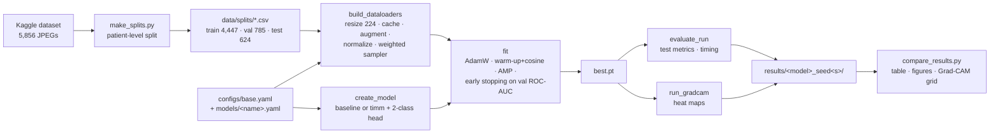

One training run = `python scripts/train.py --config configs/models/<model>.yaml --seed <s> --data-dir <path>`, which
calls `fit` → `evaluate_run` → `run_gradcam`. All 18 runs (6 models × seeds 42, 43, 44) were done on Kaggle with
[notebooks/02_kaggle_train.ipynb](../notebooks/02_kaggle_train.ipynb).

---

## 3. Data preparation

### 3.1 What the data looks like (EDA)

Notebook: [notebooks/01_eda.ipynb](../notebooks/01_eda.ipynb). EDA = *exploratory data analysis*, looking at the data
before modelling.

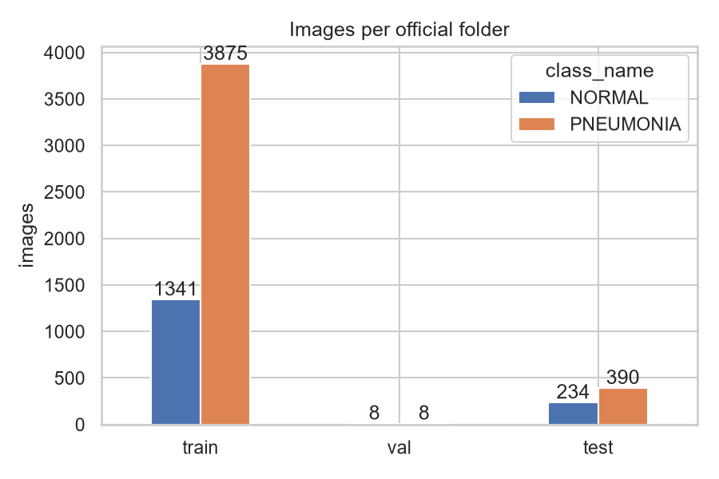

Findings that shaped later decisions:

| Finding | Number | Consequence |
|---|---|---|
| Official `val/` is tiny | 16 images | Re-split train + val |
| Images per patient | NORMAL mean 1.11 (max 4); PNEUMONIA mean 2.36 (max **30**) | Split by patient |
| Class imbalance | 74 % pneumonia in train | Weighted sampler; ROC-AUC, recall, specificity |
| Colour mode | 5,573 grayscale (`L`), 283 stored as RGB | Convert all to grayscale, then copy to 3 channels |
| **Image size differs by class** | median NORMAL 1654 × 1323 px, PNEUMONIA 1160 × 776 px | Everything is resized to 224 × 224; possible *shortcut* (see 9.4) |
| Patient numbers in train and test overlap | 170 PNEUMONIA `personN` IDs appear in both | Reported as a limitation; test set kept as published |

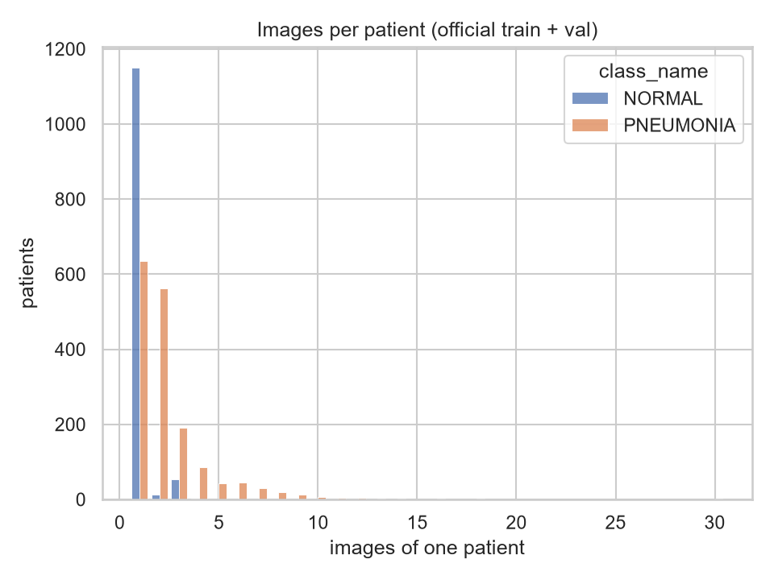

### 3.2 Patient-level split — `pneumonia/splits.py`

**Goal:** validation images must come from patients the model never saw in training, and both classes must keep their
proportion (≈ 15 % of each class in validation).

**Step 1 — patient ID from the file name** ([`patient_id_from_filename`](../pneumonia/splits.py#L25)). The dataset has
no patient table, but file names encode the patient:

| File name | Patient ID | Rule (regular expression) |
|---|---|---|
| `person1000_bacteria_2931.jpeg` | `person1000` | `^(person\d+)_` |
| `IM-0115-0001.jpeg` | `IM-0115` | `^((?:NORMAL2-)?IM-\d+)-\d+` |
| `NORMAL2-IM-0427-0001.jpeg` | `NORMAL2-IM-0427` | same; `NORMAL2-` kept as a separate group |

The class name is prefixed (`PNEUMONIA/person1000`) so IDs of the two classes can never collide. If no rule matches,
the file name itself becomes the ID (each such image is its own patient — the safe choice).

**Step 2 — list the images** ([`scan_folder`](../pneumonia/splits.py#L35)): one row per image with `path` (relative to
`chest_xray/`), `label` (0/1), `class_name`, `patient_id`, `source_split` (official folder). Hidden files like
`.DS_Store` are skipped.

**Step 3 — split by patient, per class** ([`split_by_patient`](../pneumonia/splits.py#L55)):

```python
rng = random.Random(seed)                       # one seeded generator → reproducible
for _, class_df in df.groupby("label", sort=True):          # NORMAL first, then PNEUMONIA
    counts = class_df.groupby("patient_id").size().sort_index()
    patients = list(counts.index)
    rng.shuffle(patients)                        # random patient order
    target = round(len(class_df) * val_fraction)             # 15 % of this class's images
    taken = 0
    for patient in patients:
        if taken >= target:
            break
        val_patients.add(patient)                # a patient goes to val with ALL their images
        taken += int(counts[patient])
```

It is a **greedy grouped stratified split**: per class, patients are taken in random order until the class has its 15 %
of images in validation. Because a patient is never divided, the result can overshoot the target by at most one
patient's images.

*Worked example (our data).* Pool = official train + val. NORMAL: 1,341 + 8 = 1,349 images → target
$\text{round}(1349 \cdot 0.15) = 202$ → validation got exactly 202. PNEUMONIA: 3,875 + 8 = 3,883 → target
$\text{round}(582.45) = 582$ → validation got 583 (the last patient added had 2 images). Result:

| Split | Images | Patients | NORMAL | PNEUMONIA | Pneumonia share |
|---|---|---|---|---|---|
| train | 4,447 | 2,441 | 1,147 | 3,300 | 74.2 % |
| val | 785 | 420 | 202 | 583 | 74.3 % |
| test (official, unchanged) | 624 | 427 | 234 | 390 | 62.5 % |

Train and validation share **0 patients**, and the class share is preserved (74.2 % vs 74.3 %).

**Step 4 — save** ([`save_splits`](../pneumonia/splits.py#L85)): rows sorted by path, written with LF line endings, so
re-running gives **byte-identical** files (checked by a test and by the final fresh-clone check). The CSVs are
committed: every teammate and every Kaggle run uses exactly the same images.

> **Why not `sklearn.model_selection.StratifiedGroupKFold`?** With `n_splits = 7` it gives ≈ 14.3 %, not 15 %, and it is
> harder to explain. The greedy rule is 15 lines, exact, and easy to test.

> **Limitation:** 170 PNEUMONIA patient numbers (`personN`) appear in both the official train folder and the official
> test folder. The dataset does not say whether the numbering is shared across folders, so we cannot know if these are
> the same children. We **report** it but do not change the test set, so our numbers remain comparable with other work.

### 3.3 Loading and resizing an image — `load_image`

[`load_image`](../pneumonia/data.py#L22):

```python
with Image.open(path) as img:
    return img.convert("L").resize((size, size), Image.Resampling.BILINEAR)
```

1. `convert("L")` — every image becomes 8-bit **grayscale** (one channel, values 0–255). The 283 images stored as RGB
   are grayscale in content anyway; converting removes the difference.
2. `resize((224, 224), BILINEAR)` — straight to a 224 × 224 square. The **aspect ratio is not kept** (a 1654 × 1323 image
   is squeezed horizontally by 1.25×). We chose this over crop-to-square because a crop could cut off parts of the lungs.
   Pillow's bilinear resize is **anti-aliased** when shrinking: each output pixel averages a neighbourhood of input
   pixels, so thin details are smoothed rather than aliased.

Why 224 × 224: it is the resolution all five pretrained models were trained at on ImageNet, and the same size for all
models is a fairness rule.

### 3.4 The image cache — `ChestXrayDataset`

[`ChestXrayDataset`](../pneumonia/data.py#L29) is a PyTorch `Dataset`: `__getitem__(i)` returns `(image_tensor, label)`.

**Problem found during development:** decoding the original JPEGs (up to 2,916 px) every epoch gave only
**~17 images/s** on a CPU — the GPU would wait for data most of the time.

**Solution:** with `cache_images: true` the dataset decodes and resizes every image **once**, in parallel threads, when
it is created, and keeps the 224 × 224 grayscale images in memory:

$$\text{memory} \approx 5{,}856 \text{ images} \times 224 \times 224 \text{ bytes} \approx 294 \text{ MB}$$

Afterwards loading runs at **~175 images/s per CPU process** (10× faster). The cache stores the result of
`load_image`, which is deterministic, so the images are **identical** with and without the cache (a test checks this).
Random augmentation is applied *after* the cache, so every epoch still sees different random versions.

### 3.5 Augmentation and normalization — `build_transforms`

[`build_transforms`](../pneumonia/data.py#L56) builds the chain applied to every image (training images get the random
steps, validation/test images only the deterministic ones):

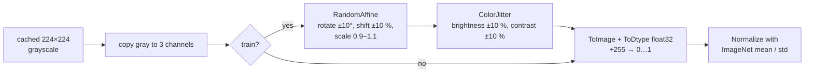

**Why copy the gray channel 3 times?** ImageNet models expect 3 input channels (RGB) — their first convolution has
weights for 3 channels. Repeating the gray value keeps those pretrained weights usable.

**Augmentation** (training only) = small random changes so the model sees a slightly different image every epoch and
learns patterns rather than memorising exact pixels.

- **`RandomAffine(degrees=10, translate=(0.1, 0.1), scale=(0.9, 1.1))`** — an *affine transformation* maps each pixel
  position $(x, y)$ to a new position by rotation, scaling and shift:
  $$\begin{pmatrix} x' \\ y' \end{pmatrix} = s \begin{pmatrix} \cos\theta & -\sin\theta \\ \sin\theta & \cos\theta \end{pmatrix} \begin{pmatrix} x - c_x \\ y - c_y \end{pmatrix} + \begin{pmatrix} c_x + t_x \\ c_y + t_y \end{pmatrix}$$
  with $\theta \sim U(-10°, 10°)$, $s \sim U(0.9, 1.1)$, $t_x, t_y \sim U(-0.1 \cdot 224, 0.1 \cdot 224) = U(-22.4, 22.4)$
  pixels, centre $c = (112, 112)$. Pixels that come from outside the image are filled with 0 (black). This simulates
  patients standing slightly tilted, off-centre or at a different distance.
- **`ColorJitter(brightness=0.1, contrast=0.1)`** — brightness: multiply every pixel by $b \sim U(0.9, 1.1)$; contrast:
  blend with the mean grey value, $x' = c \cdot x + (1 - c) \cdot \bar{x}$ with $c \sim U(0.9, 1.1)$. Simulates different
  X-ray machines and exposure.
- **No horizontal flip** (`horizontal_flip: false`): a flipped chest X-ray puts the heart on the right side — an
  anatomically impossible image. Many papers use flips anyway; we chose not to.

**Scaling and normalization** (all images): `ToDtype(float32, scale=True)` divides by 255, so pixels are in $[0, 1]$.
Then each channel $k$ is standardised with the **ImageNet** statistics the pretrained models were trained with:

$$x'_k = \frac{x_k - \mu_k}{\sigma_k}, \quad \mu = (0.485, 0.456, 0.406), \quad \sigma = (0.229, 0.224, 0.225)$$

*Worked example.* A pixel with gray value 128 → $128/255 = 0.502$ in all three channels →
R: $(0.502 - 0.485)/0.229 = 0.074$, G: $(0.502 - 0.456)/0.224 = 0.205$, B: $(0.502 - 0.406)/0.225 = 0.427$.
So the three channels are no longer identical after normalization — this is expected and matches what the pretrained
filters saw during ImageNet training. The baseline CNN (trained from scratch) uses the same normalization because the
pipeline must be identical for every model.

### 3.6 Class balancing: the weighted sampler — `make_weighted_sampler`

**Problem:** 74 % of training images are pneumonia. A model can reach 74 % accuracy by always answering "pneumonia",
and the loss is dominated by the majority class.

**Two standard fixes:** (a) a **class-weighted loss** (mistakes on the rare class cost more), or (b) **oversampling**
the rare class. The team chose (b), a **weighted random sampler** (decision recorded in [Plan.md](Plan.md) §4).

[`make_weighted_sampler`](../pneumonia/data.py#L75):

```python
class_counts = torch.bincount(labels)             # [1147, 3300]
weights = (1.0 / class_counts.double())[labels]   # every image gets 1 / (size of its class)
WeightedRandomSampler(weights, num_samples=len(labels), replacement=True, generator=seeded)
```

**Maths.** Each draw picks image $i$ with probability proportional to its weight $w_i = 1 / n_{c(i)}$:

$$P(\text{image } i) = \frac{w_i}{\sum_j w_j}, \qquad \sum_j w_j = n_0 \cdot \frac{1}{n_0} + n_1 \cdot \frac{1}{n_1} = 2$$

$$P(\text{class } c) = n_c \cdot \frac{1/n_c}{2} = \frac{1}{2}$$

*Worked example.* $n_0 = 1{,}147$ NORMAL, $n_1 = 3{,}300$ PNEUMONIA. $w_{\text{NORMAL}} = 1/1147 = 8.72 \cdot 10^{-4}$,
$w_{\text{PNEUMONIA}} = 1/3300 = 3.03 \cdot 10^{-4}$. Each draw is NORMAL with probability exactly 0.5. One epoch draws
$N = 4{,}447$ images **with replacement**, so ≈ 2,223.5 of each class:

- each NORMAL image is drawn on average $\lambda = 2223.5 / 1147 = 1.94$ times per epoch; the chance a given NORMAL image
  is not drawn at all in an epoch is $\approx e^{-1.94} = 14\%$;
- each PNEUMONIA image is drawn $\lambda = 2223.5 / 3300 = 0.67$ times; chance of not being drawn $\approx e^{-0.67} = 51\%$.

(Number of draws of one image ≈ Poisson($\lambda$), so $P(0) = e^{-\lambda}$.) So within one epoch about half of the
pneumonia images are skipped and normal images are repeated ~2×; over 25 epochs every image is seen many times.
We verified the balance on real data: the share of NORMAL in 20 training batches was 0.50.

**Consequence you must be able to explain:** the model is trained as if the classes were 50/50, but the test set is
62.5 % pneumonia and the validation set 74 %. The model's probabilities are therefore not calibrated to the real class
frequencies — one reason why the fixed 0.5 threshold gives unstable specificity (chapter 11). ROC-AUC is not affected by
this.

### 3.7 DataLoaders and debug mode — `build_dataloaders`

[`build_dataloaders`](../pneumonia/data.py#L99) returns three PyTorch `DataLoader`s:

| | train | val | test |
|---|---|---|---|
| Order | weighted sampler (random, balanced, with replacement) | fixed file order | fixed file order |
| Augmentation | yes | no | no |
| Batch size | 32 | 32 | 32 |

Other details: `num_workers = 2` background processes prepare batches while the GPU trains; `pin_memory` (on GPU)
speeds up the copy to the GPU; `worker_init_fn = seed_worker` and a seeded `torch.Generator` make the random order and
the augmentation reproducible.

**Debug mode** (`--debug`): [`debug_subset`](../pneumonia/data.py#L84) keeps 16 images per class in every split
(chosen with the seed), batch size 8, 1 epoch, `num_workers = 0`. It runs on a laptop CPU in about a minute and is used
to check that the code works, never for results (debug outputs go to `runs/debug/`, not `results/`).

---

## 4. Configuration, seeds and reproducibility

All settings live in [configs/base.yaml](../configs/base.yaml). A model config, e.g.
[configs/models/resnet50.yaml](../configs/models/resnet50.yaml), contains only:

```yaml
model:
  name: resnet50
```

**Merging** ([`load_config`](../pneumonia/utils.py#L59) + [`deep_merge`](../pneumonia/utils.py#L43)): `base.yaml` is
loaded first, then the model file is applied on top *recursively* (nested dictionaries are merged key by key, not
replaced). The final merged config — plus the seed, the debug flag and the environment (GPU name, Python, torch and timm
versions) — is saved to `results/<run>/config.yaml` for every run, so every result can be traced to its exact settings.

**Seeds** ([`set_seed`](../pneumonia/utils.py#L20)):

```python
random.seed(seed); np.random.seed(seed); torch.manual_seed(seed); torch.cuda.manual_seed_all(seed)
torch.backends.cudnn.deterministic = True
torch.backends.cudnn.benchmark = False
```

A seed fixes every "random" choice: the initial weights of the new classifier head (and of the whole baseline), the
order of the sampler, the augmentation parameters, dropout masks. `cudnn.deterministic = True` makes the GPU use
deterministic convolution algorithms (otherwise cuDNN may pick the fastest algorithm, which can differ slightly from run
to run). A test (`test_fit_is_reproducible`) checks that two identical CPU runs give identical training histories.

> **Why 3 seeds (42, 43, 44)?** One run is one sample from a random process: initial weights, sampled batches and
> augmentations change the result. With 3 runs we report **mean ± standard deviation** and can tell real differences
> between models from luck. This turned out to be essential (chapter 11). Standard deviation is the sample standard
> deviation, $s = \sqrt{\frac{1}{n-1}\sum (x_i - \bar{x})^2}$ with $n = 3$.

**Device** ([`get_device`](../pneumonia/utils.py#L38)): CUDA GPU if available, else CPU. The same code runs on a laptop
and on Kaggle without changes.

---

## 5. All hyperparameters, one by one

A **hyperparameter** is a setting chosen *before* training (learning rate, batch size, …), as opposed to the model's
**parameters** (weights), which training learns.

### 5.1 How the values were chosen (honestly)

**No hyperparameter search was run** — no grid search, random search or tuning on the validation set. This is a
deliberate decision, and you should be able to defend it:

1. **Fairness.** The goal is to compare architectures. If we tuned the learning rate etc. separately for each model, a
   difference in results could come from better tuning instead of a better architecture. So every model gets **exactly
   the same** settings (rule 2 of the fair-comparison rules; even the from-scratch baseline gets no special treatment —
   a team decision).
2. **Standard, well-known values.** The values are common defaults for fine-tuning ImageNet-pretrained CNNs on small
   medical datasets (small learning rate for AdamW, cosine schedule with warm-up, light augmentation, batch 32, 224 px).
   They were agreed by the team before any training (recorded in [Plan.md](Plan.md) §6) — so they could not be
   "tuned to the test set".
3. **Budget.** A search over, say, 3 learning rates × 2 batch sizes × 6 models × 3 seeds = 108 runs would need about
   15 GPU-hours, half of Kaggle's weekly quota — and its result would still be a different (per-model tuned) comparison.
4. **We checked the outcome:** training curves show all pretrained models converge within a few epochs and early
   stopping fires (except baseline and EfficientNet, which used most of the budget) — so the settings are reasonable.

**What a proper search would look like** (possible future work): for each model, try a small grid on the **validation
set only** (e.g. learning rate ∈ {3e-5, 1e-4, 3e-4}), with the **same budget for every model**, pick the best by
validation ROC-AUC, then evaluate once on test. The comparison would then answer "which architecture is best when
each is well tuned".

For every hyperparameter below, "if larger / smaller" is **what theory predicts**; we did **not** run those experiments.

### 5.2 Hyperparameter reference

#### `seed: 42` (+ 43, 44 via `--seed`)
- **What:** initial value of all random number generators (chapter 4).
- **Where:** `set_seed` in [utils.py](../pneumonia/utils.py#L20), called at the start of `fit`; also the sampler and the
  debug subset.
- **Why:** 42 is a conventional value; 43 and 44 are the next two, chosen before seeing any results.
- **Observed:** large effect on threshold-based metrics (ResNet50 specificity 0.61 / 0.88 / 0.82 for seeds 42 / 43 / 44),
  small effect on ROC-AUC (std ≤ 0.008).

#### `data.image_size: 224`
- **What:** every image is resized to 224 × 224 pixels.
- **Where:** `load_image` / `ChestXrayDataset` ([data.py](../pneumonia/data.py#L22)).
- **Why:** native ImageNet resolution of all pretrained models; same for every model (fairness).
- **If larger** (e.g. 384): finer lung texture visible, 3× more computation and memory, pretrained filters see objects at
  a different scale. **If smaller** (e.g. 128): faster but fine details of infiltrates are lost.
- **Observed:** the final feature maps are 7 × 7 for the pretrained models at 224 (see chapter 6).

#### `data.num_workers: 2`
- **What:** number of background processes that prepare batches. **Does not change results**, only speed.
- **Why:** Kaggle gives 4 CPU cores; with the cache, 2 workers keep the T4 busy.

#### `data.cache_images: true`
- **What:** decode + resize every image once and keep it in RAM (section 3.4). **Does not change results** (tested).
- **Observed:** 10× faster loading; ~1–2 minutes of each Kaggle run are spent filling the cache.

#### `augmentation.rotation_degrees: 10`, `translate: 0.1`, `scale: [0.9, 1.1]`
- **What:** random affine transform (section 3.5): rotation $\theta \sim U(-10°, 10°)$, shift up to 10 % (22 px), zoom
  0.9–1.1.
- **Where:** `build_transforms` ([data.py](../pneumonia/data.py#L56)), training images only.
- **Why "light":** chest X-rays are taken in a standardised position; real variation is small. Strong augmentation
  (e.g. ±30°) would create unrealistic images.
- **If larger:** more regularisation, slower convergence, risk of unrealistic images. **If smaller / none:** faster
  overfitting — the training loss of pretrained models already reaches ≈ 0.005 (VGG16), so less augmentation would make
  memorisation even easier.

#### `augmentation.brightness: 0.1`, `contrast: 0.1`
- **What:** multiply brightness by $U(0.9, 1.1)$; scale contrast by $U(0.9, 1.1)$ around the mean (section 3.5).
- **Why:** different X-ray machines and exposures; ±10 % keeps images realistic.

#### `augmentation.horizontal_flip: false`
- **What:** no mirror images.
- **Why:** a mirrored chest puts the heart on the wrong side; the team decided to keep only anatomically plausible
  images. (Many published works do flip; this is a defensible choice either way.)

#### `training.batch_size: 32`
- **What:** number of images per gradient step. One epoch = $\lceil 4447 / 32 \rceil = 139$ steps.
- **Where:** `build_dataloaders`.
- **Why:** standard value; fits VGG16 (the largest model) into the 15 GB of a T4 with mixed precision.
- **Maths:** the gradient is the average over the batch, $g = \frac{1}{B}\sum_{i=1}^{B} \nabla_\theta L_i$. Its noise
  (variance) shrinks like $1/B$. BatchNorm statistics are also computed per batch of 32.
- **If larger:** smoother gradients, fewer steps per epoch, usually needs a larger learning rate. **If smaller:** noisier
  steps (some regularisation), noisier BatchNorm statistics, slower per epoch.

#### `training.epochs: 25`
- **What:** maximum number of passes over the training set (early stopping usually stops earlier).
- **Why:** pretrained models converge in a few epochs; 25 leaves room for the from-scratch baseline. Total steps =
  139 × 25 = 3,475.
- **Observed:** best epochs (mean of 3 seeds) — baseline 19.7, VGG16 8.3, ResNet50 10.7, DenseNet121 11.0,
  EfficientNet-B0 18.3, MobileNetV3 12.3. The baseline and EfficientNet sometimes trained all 25 epochs, so for them a
  larger budget might have helped slightly.

#### `training.optimizer: adamw`, `training.lr: 1.0e-4`, `training.weight_decay: 1.0e-4`
- **What:** the AdamW optimizer (full maths in section 7.3) with peak learning rate $\eta = 10^{-4}$ and decoupled weight
  decay $\lambda = 10^{-4}$.
- **Where:** `build_optimizer` ([train.py](../pneumonia/train.py#L28)). Only `adamw` is accepted; anything else raises an
  error (so the config cannot silently differ).
- **Why $\eta = 10^{-4}$:** a standard learning rate for fine-tuning pretrained CNNs with Adam-type optimizers — small
  enough not to destroy the pretrained features in the first steps. The same value is used for the from-scratch
  baseline (fairness; a from-scratch model would usually get ~1e-3).
- **If larger** (1e-3): faster for the baseline, but pretrained weights could be damaged ("catastrophic forgetting"),
  unstable training. **If smaller** (1e-5): very slow; the baseline would underfit.
- **Weight decay — an honest observation:** with $\eta\lambda = 10^{-8}$ per step, the weights shrink by a factor
  $(1 - 10^{-8})^{3475} \approx 0.99997$ over a whole 25-epoch run — about **0.003 %**. So weight decay is practically
  inactive with these values; regularisation in our setup comes from augmentation, the sampler, early stopping and (in
  the baseline) dropout. PyTorch's default for AdamW is $\lambda = 0.01$. This is a good thing to mention if asked
  "what regularisation did you use".

#### `training.scheduler: cosine`, `training.warmup_epochs: 1`
- **What:** the learning rate rises linearly from almost 0 to $10^{-4}$ during the first epoch (139 steps), then falls
  along a half cosine to 0 at the end of epoch 25 (formula and worked example in section 7.4).
- **Where:** `build_scheduler` ([train.py](../pneumonia/train.py#L35)); updated after **every step**, not every epoch.
- **Why warm-up:** the new classifier head is random at the start; its large gradients in the first steps could push the
  pretrained layers far away. A gentle start avoids that. Adam's moment estimates are also unreliable in the first steps.
- **Why cosine:** smooth decay — large steps early (fast progress), tiny steps late (fine convergence); no extra
  hyperparameters like step-decay milestones.

#### `training.class_balancing: weighted_sampler`
- **What:** documents that the weighted sampler is used (section 3.6).
- **Honest note:** this key is **informational** — the code always uses the sampler and does not read this key. The same
  holds for `early_stopping_metric` below. Changing these two keys has no effect.

#### `training.amp: true`
- **What:** automatic mixed precision — most GPU operations in 16-bit floats (section 7.5). Only active on GPU.
- **Why:** ~2× faster training on the T4's tensor cores and half the memory for activations; same for all models.
- **If false:** slower, more memory, numerically slightly different results.

#### `training.early_stopping_metric: roc_auc`, `training.early_stopping_patience: 5`
- **What:** after every epoch the model is scored on the validation set. The epoch with the best validation ROC-AUC is
  kept (`best.pt`); ties are broken by lower validation loss. Training stops when 5 epochs in a row bring no improvement.
- **Where:** `is_improvement` and the loop in `fit` ([train.py](../pneumonia/train.py#L98)).
- **Why ROC-AUC:** it does not depend on the 0.5 threshold or on class balance (val is 74 % pneumonia while training is
  balanced by the sampler); validation loss jumped a lot between epochs (calibration effect, chapter 11).
- **Why patience 5:** enough to survive a single noisy epoch, small enough to save GPU time.
- **Observed problem:** for pretrained models validation ROC-AUC is **saturated** (0.998–0.9996), so "improvement" often
  means a change in the 4th–5th decimal — the choice of the best epoch is partly random. It still keeps a sensible epoch
  (training loss keeps falling, so later epochs would only overfit more).

#### `evaluation.threshold: 0.5`
- **What:** an image is predicted PNEUMONIA if $p(\text{pneumonia}) \ge 0.5$. Used for accuracy, precision, recall,
  specificity, F1 and the confusion matrix. ROC-AUC does not use it.
- **Where:** `compute_metrics` ([evaluate.py](../pneumonia/evaluate.py#L20)).
- **Why fixed:** choosing a threshold on the **test** set would be cheating; choosing it on validation is a sensible
  improvement that we left as future work (team decision, [Plan.md](Plan.md) §7).
- **Observed:** specificity 0.53–0.80 (mean per model) and very unstable between seeds; see chapter 11.

#### `evaluation.inference_warmup: 10`
- **What:** 10 untimed forward passes before measuring inference time (section 8.4). Does not change accuracy.
- **Why:** the first GPU calls include one-off costs (memory allocation, cuDNN algorithm selection).

#### `model.pretrained: true`
- **What:** load ImageNet weights for the five timm models. The baseline ignores it (always from scratch).

#### `debug.images_per_class: 16`, `debug.epochs: 1`, `debug.batch_size: 8`
- **What:** settings of `--debug` runs (section 3.7). Never used for results.

#### Fixed in code, not in the config (the same for every model)
| Setting | Value | Where |
|---|---|---|
| Loss | cross-entropy, no class weights | `train_one_epoch` |
| AdamW betas, epsilon | $\beta_1 = 0.9$, $\beta_2 = 0.999$, $\epsilon = 10^{-8}$ (PyTorch defaults) | `build_optimizer` |
| Baseline dropout | 0.3 | `BaselineCNN` |
| Fine-tuning | all layers trainable, same learning rate everywhere | `create_model` / `build_optimizer` |
| GradScaler | PyTorch defaults (initial scale $2^{16}$, ×2 every 2,000 good steps, ×0.5 on overflow) | `fit` |
| Validation split | 15 %, seed 42 | `make_splits.py` |

---

## 6. The models

All six models are created by one function, [`create_model(name)`](../pneumonia/models.py#L48), and all end with a
2-class output: two numbers (*logits*) $z_0, z_1$ for NORMAL and PNEUMONIA. Summary:

| Model | Parameters | Pretrained weights (timm tag) | Key idea | Grad-CAM layer (output size) |
|---|---|---|---|---|
| Baseline CNN | 0.39 M | none (from scratch) | 4 plain conv blocks | last BatchNorm, 256 × 28 × 28 |
| VGG16 | 134.3 M | `vgg16.tv_in1k` | very deep stack of 3×3 convs | last conv, 512 × 14 × 14 |
| ResNet50 | 23.5 M | `resnet50.a1_in1k` | residual (skip) connections | last bottleneck block, 2048 × 7 × 7 |
| DenseNet121 | 7.0 M | `densenet121.ra_in1k` | every layer gets all previous feature maps | final BN+ReLU, 1024 × 7 × 7 |
| EfficientNet-B0 | 4.0 M | `efficientnet_b0.ra_in1k` | MBConv + squeeze-and-excitation + compound scaling | BN+SiLU after conv_head, 1280 × 7 × 7 |
| MobileNetV3-Large | 4.2 M | `mobilenetv3_large_100.ra_in1k` | depthwise separable convs, h-swish, NAS-designed | last block, 960 × 7 × 7 |

### 6.1 Building blocks and their maths

These operations appear in all models; the teacher may ask about any of them.

**Convolution (2-D).** A layer with $C_{in}$ input channels, $C_{out}$ output channels and a $k \times k$ kernel computes
for every output channel $o$ and position $(i, j)$:

$$y_{o,i,j} = b_o + \sum_{c=1}^{C_{in}} \sum_{u=1}^{k} \sum_{v=1}^{k} W_{o,c,u,v} \cdot x_{c,\, i \cdot s + u - p,\, j \cdot s + v - p}$$

($s$ = stride, $p$ = padding). The same kernel slides over the whole image (*weight sharing*), so a convolution detects
the same pattern anywhere. **Parameters:** $C_{out} \cdot C_{in} \cdot k^2$ (+ $C_{out}$ biases). **Output size:**
$\lfloor (H + 2p - k)/s \rfloor + 1$. *Example:* the first baseline conv, $3 \to 32$ channels, $3 \times 3$, no bias:
$32 \cdot 3 \cdot 9 = 864$ parameters; with $p = 1$, $s = 1$ the 224 × 224 size is kept.

**Batch normalization (BN).** For each channel, over the batch and all positions:

$$\hat{x} = \frac{x - \mu_B}{\sqrt{\sigma_B^2 + \epsilon}}, \qquad y = \gamma \hat{x} + \beta$$

$\mu_B, \sigma_B^2$ = mean and variance of the current batch; $\gamma, \beta$ = 2 learned parameters per channel. It keeps
activations in a stable range, which allows larger learning rates and faster training. During training BN also keeps a
running average of $\mu$ and $\sigma^2$ (momentum 0.1); in evaluation mode (`model.eval()`) these running averages are
used instead of the batch statistics, so one image gives the same output regardless of its batch.

**Activations.** ReLU: $\max(0, x)$ (baseline, VGG, ResNet, DenseNet). SiLU / swish: $x \cdot \sigma(x)$ with
$\sigma(x) = 1/(1 + e^{-x})$ (EfficientNet) — smooth, lets small negative values through. Hard-swish:
$x \cdot \frac{\text{ReLU6}(x + 3)}{6}$ with $\text{ReLU6}(x) = \min(\max(0, x), 6)$ (MobileNetV3) — a cheap piecewise-linear
approximation of swish.

**Pooling.** Max pooling 2 × 2 with stride 2 keeps the largest value of each 2 × 2 window → halves height and width.
**Global average pooling (GAP)** averages each channel over all positions: a $C \times H \times W$ map becomes a vector of
$C$ numbers. It makes the classifier independent of image size and has no parameters.

**Linear (fully connected) layer:** $z = W h + b$. For our heads $W$ has shape $2 \times C$.

**Dropout** (baseline only, $p = 0.3$): during training each input value of the last layer is set to 0 with probability
0.3 and the rest are scaled by $1/(1 - 0.3)$; at evaluation nothing is dropped. It prevents the classifier from relying
on a few features.

**Softmax → probability.** From the two logits:

$$p_c = \frac{e^{z_c}}{e^{z_0} + e^{z_1}}, \qquad p_1 = p(\text{pneumonia}) = \frac{1}{1 + e^{-(z_1 - z_0)}} = \sigma(z_1 - z_0)$$

So with two classes softmax is just the sigmoid of the logit difference.

**Receptive field.** Each layer of 3 × 3 convolutions lets a neuron "see" a slightly larger region of the input;
pooling/striding doubles the growth. Deep networks end with neurons that see the whole image — that is why stacking many
small convolutions works.

### 6.2 Transfer learning and what we change in every pretrained model

**Transfer learning** = start from a network trained on ImageNet (1.28 million photos, 1,000 classes) and continue
training on our X-rays (*fine-tuning*). The early layers have learned general patterns (edges, textures, shapes) that
are useful for X-rays too; only the task-specific part must be learned anew. With only 4,447 training images, this is
the main reason the pretrained models beat the baseline (ROC-AUC ≈ 0.975 vs 0.935).

What [`create_model`](../pneumonia/models.py#L48) does for the five timm models:

```python
timm.create_model(TIMM_MODELS[name], pretrained=True, num_classes=2)
```

1. **Loads the exact pretrained weights** named by a pinned tag (e.g. `resnet50.a1_in1k`), so a future timm release
   cannot silently change them. `tv_in1k` = original torchvision weights; `a1_in1k` = ResNet trained with the
   "ResNet strikes back" A1 recipe; `ra_in1k` = timm's own training with RandAugment.
2. **Replaces the 1,000-class classifier** with a new randomly initialised linear layer with 2 outputs.
3. **Fine-tunes all layers** with the same learning rate (no frozen layers) — simple, identical for all models.

*timm* (PyTorch Image Models, by Ross Wightman) is a library that provides hundreds of architectures with pretrained
weights through one function — this is what makes "a new model = one registry line + one config file" possible.

### 6.3 Baseline CNN

**Purpose:** a small network trained **from scratch** — the reference point that shows how much pretraining and bigger
architectures help. Code: [`BaselineCNN`](../pneumonia/models.py#L21).

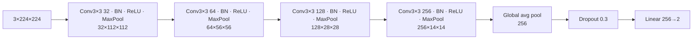

**Parameter count (worked example — every number can be checked):**

| Layer | Formula | Parameters |
|---|---|---|
| Conv 3→32 (no bias, BN follows) | $32 \cdot 3 \cdot 3^2$ | 864 |
| BN 32 | $2 \cdot 32$ | 64 |
| Conv 32→64 | $64 \cdot 32 \cdot 9$ | 18,432 |
| BN 64 | | 128 |
| Conv 64→128 | $128 \cdot 64 \cdot 9$ | 73,728 |
| BN 128 | | 256 |
| Conv 128→256 | $256 \cdot 128 \cdot 9$ | 294,912 |
| BN 256 | | 512 |
| Linear 256→2 | $256 \cdot 2 + 2$ | 514 |
| **Total** | | **389,410** |

Convolutions have `bias=False` because the following BatchNorm has its own shift $\beta$ — a bias would be redundant.

**Results (3 seeds):** ROC-AUC 0.935 ± 0.008; specificity 0.530 ± 0.364 (seed 44 called 208 of 234 healthy children
sick); fastest inference (1.0 ms/image). It used almost the whole epoch budget (best epoch 19.7 on average) and its
validation loss jumped strongly between epochs. Grad-CAM: diffuse maps, ~36 % of the heat on the image frame.

**Search terms:** *simple CNN from scratch PyTorch*, *batch normalization*, *global average pooling*.

### 6.4 VGG16

**Idea (Simonyan & Zisserman, 2014):** depth with the simplest possible building block — only 3 × 3 convolutions and
2 × 2 max pooling. Two stacked 3 × 3 convs see a 5 × 5 region with fewer parameters than one 5 × 5 conv
($2 \cdot 9C^2 = 18C^2$ vs $25C^2$) and with an extra non-linearity.

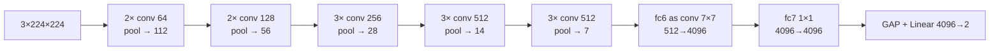

**Where the 134 M parameters are:** the 13 convolutions have only 14.7 M. The first fully connected layer (here
implemented as a 7 × 7 convolution, timm's `pre_logits`) alone has $512 \cdot 7 \cdot 7 \cdot 4096 = 102.8$ M weights, the
second $4096^2 = 16.8$ M. So 89 % of VGG16's parameters are in its classifier part — this is why VGG is huge but not
slow (convolutions, not parameters, dominate computation).

**Note:** VGG16 has no BatchNorm. Our Grad-CAM layer is the last convolution (14 × 14), before the final pooling.

**Results:** ROC-AUC 0.978 ± 0.008 (tied best); best accuracy (0.914) and specificity (0.803) at threshold 0.5;
slowest training (10.5 min, ~43 s/epoch); 9.7 ms/image. Training loss falls to ~0.001–0.005 — it memorises the training
set quickly; best epoch 8.3 on average. Grad-CAM: the most heat on the image frame (0.42) and empty maps for 6 of 24
images (explained in 9.3).

**Search terms:** *VGG16 architecture explained*, *why 3x3 convolutions*, *VGG parameters fully connected*.

### 6.5 ResNet50

**Problem it solves:** very deep plain networks train *worse* than shallower ones (the *degradation problem*); gradients
vanish on the way back through many layers.

**Idea (He et al., 2015): residual connection.** A block learns a correction $F(x)$ and adds the input back:

$$y = F(x) + x$$

If the best thing to do is nothing, the block only has to push $F$ to 0, which is easy. For backpropagation:

$$\frac{\partial L}{\partial x} = \frac{\partial L}{\partial y}\left(\frac{\partial F}{\partial x} + I\right)$$

— the identity term $I$ gives the gradient a direct path through every block, so it does not vanish even in 50+ layers.

**Bottleneck block** (used in ResNet50): $1 \times 1$ conv reduces channels by 4×, $3 \times 3$ conv works on the
small representation, $1 \times 1$ conv expands back; BN + ReLU after each conv; the addition happens before the last
ReLU. *Example (last stage):* $2048 \to 512 \to 512 \to 2048$:
$2048 \cdot 512 + 512 \cdot 512 \cdot 9 + 512 \cdot 2048 = 1{,}048{,}576 + 2{,}359{,}296 + 1{,}048{,}576 \approx 4.46$ M
parameters, versus $\approx 75.5$ M for two plain $3 \times 3$ convs at 2048 channels.

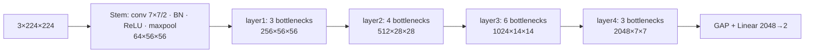

"50" = $1 + 3 \cdot (3 + 4 + 6 + 3) + 1 = 50$ weight layers. Our classifier head: $2048 \cdot 2 + 2 = 4{,}098$ parameters.

**Results:** ROC-AUC 0.978 ± 0.001 — tied best and **the most stable across seeds**; specificity very seed-dependent
(0.61 / 0.88 / 0.82); 5.3 min training; 8.4 ms/image. **Grad-CAM: the only model that clearly looks at the lungs**
(14 % of the heat on the frame vs 36 % for an evenly spread map). This is why it is our recommended model.

**Search terms:** *ResNet residual connection explained*, *vanishing gradient*, *bottleneck block*, *ResNet strikes back*.

### 6.6 DenseNet121

**Idea (Huang et al., 2016): dense connectivity.** Inside a *dense block*, layer $\ell$ receives the concatenated
feature maps of **all** previous layers:

$$x_\ell = H_\ell\big([x_0, x_1, \dots, x_{\ell-1}]\big)$$

($[\cdot]$ = concatenation along channels; $H_\ell$ = BN → ReLU → 1×1 conv ($4k$ channels) → BN → ReLU → 3×3 conv ($k$
channels)). Each layer adds only $k = 32$ new channels (*growth rate*), so layers are thin; features are reused instead
of re-learned, and gradients reach early layers directly. **Transition layers** between blocks (BN, 1×1 conv halving the
channels, 2×2 average pooling) shrink the maps.

*Worked example — channel count:* the stem outputs 64 channels. Block 1 (6 layers): $64 + 6 \cdot 32 = 256$ → transition
→ 128. Block 2 (12): $128 + 12 \cdot 32 = 512$ → 256. Block 3 (24): $256 + 24 \cdot 32 = 1024$ → 512. Block 4 (16):
$512 + 16 \cdot 32 = 1024$. So the final feature map is $1024 \times 7 \times 7$, and the head is $1024 \cdot 2 + 2 = 2{,}050$
parameters. "121" = $1 + 2 \cdot (6 + 12 + 24 + 16) + 3 + 1 = 121$ layers.

```mermaid
flowchart LR
    I[3×224×224] --> S[Stem conv 7×7 · pool<br/>64×56×56]
    S --> D1[Dense block 6 layers<br/>256] --> T1[Transition → 128, 28×28]
    T1 --> D2[Dense block 12<br/>512] --> T2[Transition → 256, 14×14]
    T2 --> D3[Dense block 24<br/>1024] --> T3[Transition → 512, 7×7]
    T3 --> D4[Dense block 16<br/>1024] --> N[BN + ReLU] --> H[GAP + Linear 1024→2]
```

DenseNet121 is the backbone of **CheXNet** (Rajpurkar et al., 2017), a well-known chest X-ray model — the reason it is
in our comparison.

**Results:** ROC-AUC 0.978 ± 0.002 (tied best); the most stable recall (0.991 ± 0.001); **slowest inference: 24.5 ms**
despite only 7 M parameters — its many thin layers and concatenations mean many small GPU operations and memory copies,
which is slow at batch size 1. Grad-CAM: 32 % of heat on the frame; for some confident mistakes it lights up the "R"
marker.

**Search terms:** *DenseNet dense block explained*, *growth rate DenseNet*, *CheXNet*.

### 6.7 EfficientNet-B0

**Ideas (Tan & Le, 2019):**

1. **MBConv block** (mobile inverted bottleneck, from MobileNetV2): $1 \times 1$ conv *expands* channels (×6), a
   **depthwise** $3 \times 3$ or $5 \times 5$ conv filters each channel separately, **squeeze-and-excitation** re-weights
   channels, $1 \times 1$ conv projects back down; a residual connection when shapes match.
2. **Depthwise separable convolution** — the source of efficiency. A standard conv mixes space and channels at once:
   $k^2 C_{in} C_{out}$ parameters. Separable = depthwise (one $k \times k$ filter per channel, $k^2 C$) + pointwise
   ($1 \times 1$, $C_{in} C_{out}$). *Example*, $3 \times 3$, 128 → 128: standard $9 \cdot 128 \cdot 128 = 147{,}456$;
   separable $9 \cdot 128 + 128 \cdot 128 = 17{,}536$ — **8.4× fewer** parameters and multiply-adds.
3. **Squeeze-and-excitation (SE):** learns how important each channel is for the current image:
   $$s = \sigma\big(W_2\, \delta(W_1\, \text{GAP}(x))\big), \qquad \tilde{x}_c = s_c \cdot x_c$$
   ($\delta$ = activation, $\sigma$ = sigmoid, $W_1$ reduces the channels, $W_2$ restores them).
4. **Compound scaling:** to make a network bigger, scale depth $d$, width $w$ and input resolution $r$ together:
   $$d = \alpha^\phi, \quad w = \beta^\phi, \quad r = \gamma^\phi, \qquad \alpha = 1.2,\ \beta = 1.1,\ \gamma = 1.15, \quad \alpha \beta^2 \gamma^2 \approx 2$$
   so each $+1$ in $\phi$ roughly doubles the computation (FLOPs grow like $d \cdot w^2 \cdot r^2$). **B0** is the base network
   ($\phi = 0$), found by neural architecture search; B1–B7 are scaled versions.

Activation: SiLU (swish). Final layers: last MBConv (320 channels) → $1 \times 1$ `conv_head` 320 → 1280 → BN + SiLU
(`bn2`, our Grad-CAM layer, $1280 \times 7 \times 7$) → GAP → Linear 1280 → 2.

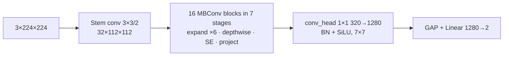

**Results:** ROC-AUC 0.971 ± 0.002 (lowest of the pretrained models); most consistent accuracy across seeds
(± 0.006); highest recall (0.994) but lowest pretrained specificity (0.701); very over-confident probabilities (median
healthy test image p = 0.003, yet 20 % of healthy images p > 0.9). First epoch ~40 s (cuDNN warm-up for depthwise
convs), then ~14 s. 13.1 ms/image.

**Search terms:** *EfficientNet compound scaling explained*, *MBConv inverted residual*, *squeeze and excitation*,
*depthwise separable convolution*.

### 6.8 MobileNetV3-Large

**Ideas (Howard et al., 2019):** a network for phones, designed by **neural architecture search (NAS)** plus manual
tweaks:

- **Inverted residual blocks** with depthwise convolutions (as in EfficientNet) and **SE** in some blocks (with a
  *hard-sigmoid* $\text{ReLU6}(x + 3)/6$ instead of the sigmoid — cheaper).
- **Hard-swish** activation $x \cdot \text{ReLU6}(x + 3)/6$ in the deeper layers.
- **Efficient last stage:** global average pooling is done **before** the last $1 \times 1$ conv (960 → 1280), so that
  conv works on a $1 \times 1$ map instead of $7 \times 7$ — 49× cheaper. This is why our Grad-CAM layer is the last block
  (`blocks[-1]`, $960 \times 7 \times 7$): after the pooling there is no spatial map left to explain.
- `_100` in the timm name = width multiplier 1.0.

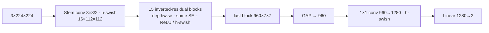

**Results:** ROC-AUC 0.975 ± 0.004; specificity 0.775; **shortest training of the pretrained models (3.3 min)**;
10.3 ms/image; 4.2 M parameters — the best quality-per-cost model. Grad-CAM: 39 % of the heat on the frame (corners,
"R" marker). The validation ROC-AUC was saturated from epoch 14 (changes in the 5th decimal), so its "best epoch" is
partly random.

**Search terms:** *MobileNetV3 explained*, *hard swish*, *neural architecture search*, *inverted residual block*.

---

## 7. Training — `pneumonia/train.py`

### 7.1 The training run — `fit`

[`fit`](../pneumonia/train.py#L118) runs one complete training:

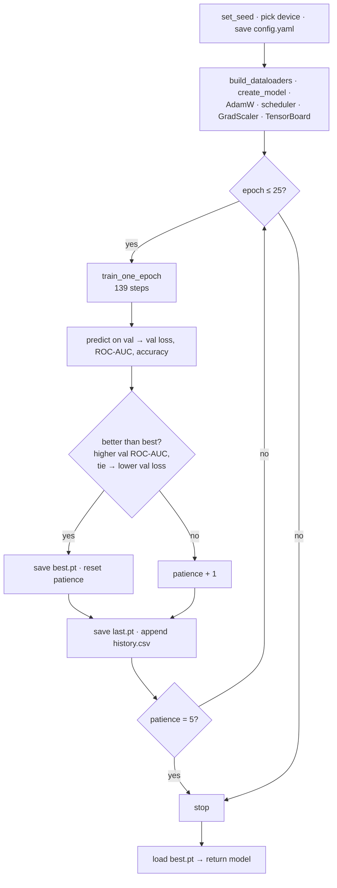

Outputs: `results/<run>/config.yaml`, `history.csv` (one row per epoch: learning rate, train loss, val loss, val ROC-AUC,
val accuracy, seconds, best-flag) and `runs/<run>/best.pt`, `last.pt`, TensorBoard logs. After `fit`, `scripts/train.py`
calls `evaluate_run` (chapter 8) and `run_gradcam` (chapter 9) with the **best** weights.

### 7.2 One epoch — `train_one_epoch` and the loss

[`train_one_epoch`](../pneumonia/train.py#L53):

```python
model.train()                                    # BN uses batch statistics, dropout active
for images, labels in loader:                    # 139 balanced batches of 32
    optimizer.zero_grad(set_to_none=True)
    with torch.autocast(device_type, enabled=use_amp):    # float16 where safe (GPU only)
        loss = criterion(model(images), labels)           # cross-entropy
    scaler.scale(loss).backward()                # backpropagation of the scaled loss
    scaler.step(optimizer)                       # un-scale, skip if inf/NaN, AdamW update
    scaler.update()                              # adapt the loss scale
    scheduler.step()                             # next learning rate (every step)
```

**Cross-entropy loss.** For one image with true class $y$ and predicted probabilities $p_0, p_1$:

$$L = -\log p_y = -\log \frac{e^{z_y}}{e^{z_0} + e^{z_1}}$$

The batch loss is the mean over the 32 images. *Worked example:* logits $z = (-1.2,\ 2.3)$ →
$p_1 = \sigma(2.3 - (-1.2)) = \sigma(3.5) = 0.971$. If the image is pneumonia: $L = -\log 0.971 = 0.030$ (good, small).
If it is actually normal: $L = -\log 0.029 = 3.53$ (confident and wrong → large loss).

**Gradient of the loss w.r.t. the logits** — the start of backpropagation, worth knowing by heart:

$$\frac{\partial L}{\partial z_c} = p_c - \mathbb{1}[c = y]$$

In the example with true class "normal": $\partial L/\partial z_0 = 0.029 - 1 = -0.971$, $\partial L/\partial z_1 = 0.971$
— the update pushes $z_0$ up and $z_1$ down. **Backpropagation** then applies the chain rule layer by layer:
$\frac{\partial L}{\partial W^{(\ell)}} = \frac{\partial L}{\partial a^{(\ell)}} \cdot \frac{\partial a^{(\ell)}}{\partial W^{(\ell)}}$,
passing $\frac{\partial L}{\partial a^{(\ell-1)}}$ back to the previous layer. PyTorch does this automatically
(`loss.backward()`).

No class weights in the loss: balance comes from the sampler (section 3.6).

### 7.3 The optimizer — AdamW

[`build_optimizer`](../pneumonia/train.py#L28): `torch.optim.AdamW(params, lr=1e-4, weight_decay=1e-4)`.

For every parameter $\theta$ with gradient $g_t$ at step $t$:

$$m_t = \beta_1 m_{t-1} + (1 - \beta_1) g_t \qquad \text{(moving average of gradients — momentum)}$$
$$v_t = \beta_2 v_{t-1} + (1 - \beta_2) g_t^2 \qquad \text{(moving average of squared gradients)}$$
$$\hat{m}_t = \frac{m_t}{1 - \beta_1^t}, \qquad \hat{v}_t = \frac{v_t}{1 - \beta_2^t} \qquad \text{(bias correction)}$$
$$\theta_t = \theta_{t-1} - \eta_t \left( \frac{\hat{m}_t}{\sqrt{\hat{v}_t} + \epsilon} + \lambda\, \theta_{t-1} \right)$$

with $\beta_1 = 0.9$, $\beta_2 = 0.999$, $\epsilon = 10^{-8}$, $\lambda = 10^{-4}$ and $\eta_t$ from the schedule.

- **Why Adam:** each parameter gets its own effective step size $\eta / \sqrt{\hat{v}}$ — parameters with large, noisy
  gradients take smaller steps. It works well without much tuning.
- **Worked example — the first step:** $m_1 = 0.1\,g_1$, $\hat{m}_1 = g_1$; $v_1 = 0.001\,g_1^2$, $\hat{v}_1 = g_1^2$ →
  the update is $\eta \cdot g_1 / |g_1| = \eta \cdot \text{sign}(g_1)$: every parameter moves by exactly $\eta$ (here
  $7.2 \cdot 10^{-7}$, the warm-up value) in the direction that lowers the loss. Bias correction prevents the tiny first
  steps that $m_1 = 0.1 g_1$ alone would give.
- **AdamW vs Adam:** in plain Adam, L2 regularisation is added to the gradient and then divided by $\sqrt{\hat{v}}$, so
  parameters with large gradients are barely regularised. AdamW applies weight decay **directly to the weights**
  (*decoupled*), the $\lambda \theta$ term above. As computed in 5.2, with our $\lambda = 10^{-4}$ its total effect is
  only ~0.003 %.

### 7.4 The learning-rate schedule — warm-up + cosine

[`build_scheduler`](../pneumonia/train.py#L35) defines a factor $f(t)$ multiplied with $\eta_{\max} = 10^{-4}$ at step $t$
($t = 0, 1, \dots$). With $S = 139$ steps per epoch, warm-up $W = 139$ steps, total $T = 139 \cdot 25 = 3{,}475$ steps:

$$f(t) = \begin{cases} \dfrac{t + 1}{W} & t < W \quad\text{(linear warm-up)} \\[2ex] \dfrac{1}{2}\left(1 + \cos\left(\pi \cdot \dfrac{t - W}{T - W}\right)\right) & t \ge W \quad\text{(cosine decay)} \end{cases}$$

*Worked example* (values recorded in `results/resnet50_seed42/history.csv` at the start of each epoch):

| Epoch | Step $t$ | Factor $f(t)$ | Learning rate |
|---|---|---|---|
| 1 | 0 | $1/139 = 0.0072$ | $7.19 \cdot 10^{-7}$ |
| 2 | 139 | $\frac{1}{2}(1 + \cos 0) = 1$ | $1.00 \cdot 10^{-4}$ |
| 5 | 556 | $\frac{1}{2}(1 + \cos(\pi \cdot 417/3336)) = 0.962$ | $9.62 \cdot 10^{-5}$ |
| 10 | 1251 | $\frac{1}{2}(1 + \cos(\pi/3)) = 0.75$ | $7.50 \cdot 10^{-5}$ |
| 13 | 1668 | $\frac{1}{2}(1 + \cos(\pi \cdot 0.458)) = 0.565$ | $5.65 \cdot 10^{-5}$ |
| 25 | 3336 | $\approx 0.0043$ | $4.3 \cdot 10^{-7}$ |

Because early stopping often ends training around epoch 10–15, many runs never reach the low-learning-rate end of the
cosine. Note: the schedule length is fixed at 25 epochs for everyone, so all models see the same learning rates at the
same epoch (fairness).

### 7.5 Mixed precision (AMP) and the GradScaler

On the GPU, `torch.autocast` runs most operations (convolutions, matrix multiplications) in **float16** and keeps
sensitive ones (softmax, loss, reductions) in float32. Float16 uses 2 bytes instead of 4, and the T4's tensor cores
compute it much faster.

**The problem:** float16 cannot represent numbers smaller than about $6 \cdot 10^{-8}$ (they become 0 — *underflow*), and
many gradients are that small. **Loss scaling** fixes this: multiply the loss by a large factor $S$ before
`backward()`; by the chain rule every gradient is multiplied by $S$ too and stays representable; before the optimizer
step, gradients are divided by $S$ again:

$$\nabla_\theta (S \cdot L) = S \cdot \nabla_\theta L \quad\Rightarrow\quad g = \frac{1}{S}\nabla_\theta(S \cdot L)$$

`GradScaler` adapts $S$: it starts at $2^{16} = 65{,}536$; if any gradient overflows to inf/NaN, that step is **skipped**
and $S$ is halved; after 2,000 steps without overflow, $S$ is doubled.

*This explains a warning seen in every GPU log:* "Detected call of `lr_scheduler.step()` before `optimizer.step()`". In the
very first step(s) the scale $2^{16}$ was too large, the GradScaler skipped the optimizer step, but our loop still
advanced the scheduler. Effect: the learning-rate schedule runs one step ahead — negligible, and identical for every
model.

### 7.6 Validation, early stopping and checkpoints

After each epoch, [`predict`](../pneumonia/train.py#L75) runs the model on the 785 validation images in evaluation mode
(`model.eval()`, `torch.no_grad()`), and [`validation_scores`](../pneumonia/train.py#L88) computes val loss, val ROC-AUC
and val accuracy (at 0.5). [`is_improvement`](../pneumonia/train.py#L98): higher val ROC-AUC wins; on an exact tie the
lower val loss wins. When improved → `best.pt` is saved and the patience counter resets; `last.pt` is saved every epoch.
After 5 epochs without improvement the loop stops, and the **best** weights are loaded for testing. The test set is never
looked at during training.

---

## 8. Evaluation — `pneumonia/evaluate.py`

### 8.1 From logits to predictions

[`evaluate_run`](../pneumonia/evaluate.py#L67) runs the best model on the 624 test images, converts logits to
$p = p(\text{pneumonia})$ with softmax, and predicts PNEUMONIA when $p \ge 0.5$. It writes `test_predictions.csv`
(probability and prediction per image — used later for ROC curves) and `metrics.json`.

### 8.2 Threshold metrics — `compute_metrics`

[`compute_metrics`](../pneumonia/evaluate.py#L20). PNEUMONIA is the **positive** class. Confusion matrix:

| | predicted NORMAL | predicted PNEUMONIA |
|---|---|---|
| **true NORMAL** | TN (true negative) | FP (false positive — false alarm) |
| **true PNEUMONIA** | FN (false negative — missed pneumonia) | TP (true positive) |

$$\text{Accuracy} = \frac{TP + TN}{TP + TN + FP + FN} \qquad \text{Precision} = \frac{TP}{TP + FP}$$
$$\text{Recall (sensitivity)} = \frac{TP}{TP + FN} \qquad \text{Specificity} = \frac{TN}{TN + FP} \qquad F_1 = \frac{2 \cdot P \cdot R}{P + R}$$

In plain words: **accuracy** — share of correct answers; **precision** — share of real pneumonia among all "pneumonia"
predictions; **recall (sensitivity)** — share of sick children found; **specificity** — share of healthy children
correctly called healthy; **F1** — harmonic mean of precision and recall.

*Worked example — baseline CNN, seed 42:* TN = 166, FP = 68, FN = 11, TP = 379.
Accuracy $= 545/624 = 0.873$; precision $= 379/447 = 0.848$; recall $= 379/390 = 0.972$; specificity $= 166/234 = 0.709$;
$F_1 = 2 \cdot 0.848 \cdot 0.972 / (0.848 + 0.972) = 0.906$.

**Why recall matters most clinically:** a false negative (missed pneumonia) is worse than a false alarm, which a doctor
can rule out. **Why accuracy alone misleads:** a model that always says "pneumonia" has recall 1.0 and accuracy
$390/624 = 0.625$ on our test set — or 0.74 on our validation set.

### 8.3 ROC curve and ROC-AUC — the primary metric

Moving the threshold from 1 down to 0 traces the **ROC curve**: true-positive rate (recall) against false-positive rate
($1 -$ specificity). **AUC** = area under it. Equivalent and easier to explain:

$$\text{AUC} = P\big(p(\text{random sick image}) > p(\text{random healthy image})\big) \quad (+\tfrac{1}{2} \text{ for ties})$$

— the share of (sick, healthy) pairs the model ranks correctly (the Mann–Whitney U statistic divided by
$n_{pos} \cdot n_{neg}$). 0.5 = random guessing, 1.0 = perfect ranking. **It does not depend on any threshold or on the
class proportions** — the reason it is our primary metric.

*Worked example* (this exact case is a unit test, `test_compute_metrics_hand_made_example`): sick images get
$p = 0.9, 0.8, 0.6, 0.4$; healthy images $p = 0.7, 0.55, 0.3, 0.1$. Count correctly ordered pairs: 0.9 beats all 4
healthy, 0.8 beats 4, 0.6 beats 3 (not 0.7), 0.4 beats 2 → $13$ of $4 \cdot 4 = 16$ pairs → $\text{AUC} = 13/16 = 0.8125$.
At threshold 0.5 the same model has recall 3/4 and specificity 2/4.

On our 624 test images there are $390 \cdot 234 = 91{,}260$ pairs; ROC-AUC 0.978 means ~89,250 of them are ordered
correctly.

### 8.4 Model size and speed

- **Parameters** = number of trainable weights ([`count_parameters`](../pneumonia/models.py#L61)).
- **Training time** = wall-clock seconds of the training loop (without data caching).
- **Inference time** ([`measure_inference_time`](../pneumonia/evaluate.py#L48)): each of the 624 test images is fed
  **alone** (batch size 1), after 10 untimed warm-up passes; `torch.cuda.synchronize()` before and after each call makes
  the timer wait for the GPU to finish; AMP as in training; we report the **median** (robust to occasional slow calls).
  Batch size 1 models a clinic scoring one X-ray at a time.

---

## 9. Grad-CAM: where the models look

### 9.1 The idea and the maths

**Grad-CAM** (gradient-weighted class activation mapping, Selvaraju et al., 2016) shows which regions of the image made
the model choose class $c$. Take a convolutional layer with $K$ feature maps $A^k$ (size $u \times v$) and the logit
$y^c$ of the predicted class:

1. **Importance of each feature map** = average gradient of the class score over the map:
   $$\alpha_k^c = \frac{1}{u \cdot v} \sum_{i}\sum_{j} \frac{\partial y^c}{\partial A^k_{ij}}$$
2. **Weighted sum and ReLU** (keep only regions that *increase* the score):
   $$L^c_{\text{Grad-CAM}} = \text{ReLU}\Big(\sum_k \alpha_k^c A^k\Big)$$
3. Upsample the $u \times v$ map to 224 × 224, normalise to $[0, 1]$ (divide by the maximum), overlay on the X-ray
   (red = strong influence).

*Size example:* for ResNet50 the layer has $K = 2048$ maps of $7 \times 7$, so the heat map has 49 cells, each covering a
$32 \times 32$-pixel area of the input — that is why Grad-CAM maps are blurry.

Library: `pytorch-grad-cam` ([`compute_cams`](../pneumonia/gradcam.py#L44)), with the target layer per model from
[`GRADCAM_TARGETS`](../pneumonia/models.py#L67) — always the **last convolutional feature map before global pooling**,
because deeper layers carry the most class-specific information while still having a spatial map.

### 9.2 What is produced — `run_gradcam`

[`run_gradcam`](../pneumonia/gradcam.py#L72), called on Kaggle right after training (checkpoints are not in git):

- **8 fixed test images** — 4 NORMAL + 4 PNEUMONIA chosen with a fixed seed (`GRADCAM_IMAGE_SEED = 0`, independent of the
  run seed), the **same for every model and seed**, so the maps can be compared side by side;
- **up to 4 of the model's most confident mistakes** (largest $|p - 0.5|$ among wrong predictions);
- output: `gradcam.jpg` (picture) and `gradcam_fixed.npz` (the 8 heat maps as numbers for the cross-model comparison).

### 9.3 Why some maps are empty

If $\sum_k \alpha_k^c A^k \le 0$ everywhere, the ReLU makes the whole map 0 — no region *increases* the class score
relative to the others in the way Grad-CAM measures. This happened for **VGG16 on 6 of its 24 fixed-image maps**, for very
confident predictions ($p \approx 1.00$). Those images cannot be explained with Grad-CAM; the "border share" for them is
undefined and excluded.

### 9.4 The shortcut check — border share

A **shortcut** = the model uses something correlated with the label that is not the disease — here e.g. image borders,
the "R" side marker, shoulders, or traces of the different original image sizes (section 3.1). Without lung masks we use
a simple proxy ([`border_share`](../pneumonia/compare.py#L272)): the share of the heat map's total "heat" lying in the
outer 10 % frame of the image:

$$\text{border share} = 1 - \frac{\sum_{(i,j) \in \text{inner } 80\% \times 80\%} L_{ij}}{\sum_{(i,j)} L_{ij}}$$

A map spread evenly over the image gives $1 - 0.8^2 = 0.36$ (the frame is 36 % of the area). Lower = more focus on the
centre (lungs). Per run: mean over the 8 fixed images; per model: mean ± std over the 3 seeds.

| Model | Border share | Reading |
|---|---|---|
| ResNet50 | **0.14 ± 0.03** | clearly focused inside the chest |
| EfficientNet-B0 | 0.29 ± 0.04 | in between |
| DenseNet121 | 0.32 ± 0.01 | in between |
| Baseline CNN | 0.36 ± 0.01 | like an evenly spread map |
| MobileNetV3-L | 0.39 ± 0.05 | above even — corners, "R" marker |
| VGG16 | 0.42 ± 0.11 | most heat on the frame (+ 6 empty maps) |

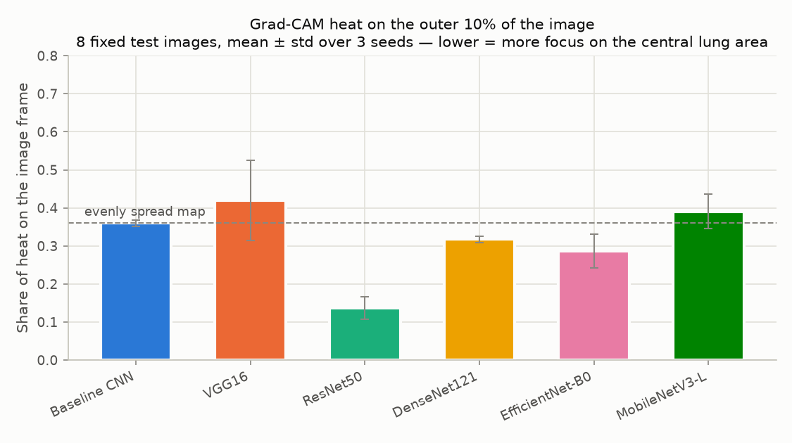

**Caveats (say them before you are asked):** only 8 images per run; Grad-CAM explains the *predicted* class; the frame is
a crude proxy for "not lungs" (the lungs do not fill the inner 80 % exactly); Grad-CAM itself is an approximation.

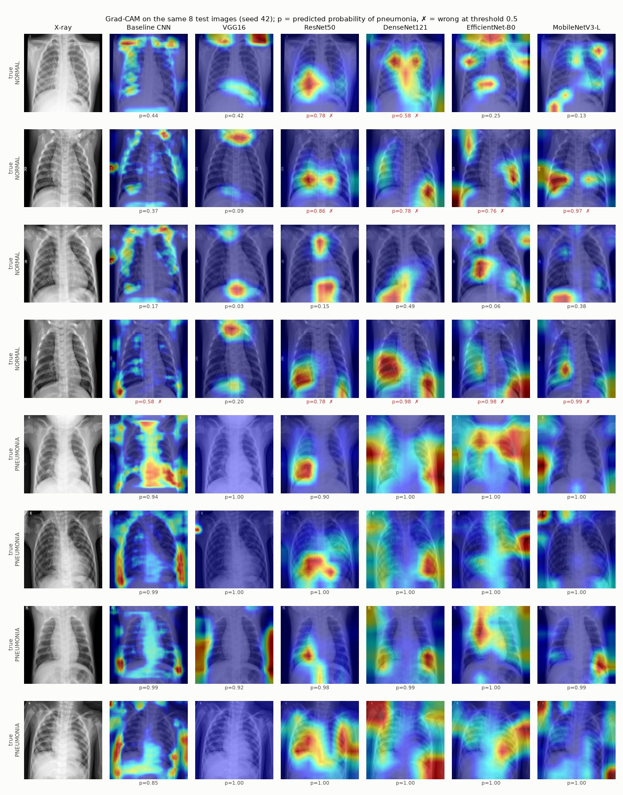

---

## 10. Infrastructure: scripts, Kaggle, tests, git

### 10.1 Repository layout and the three scripts

```
configs/      base.yaml + models/<model>.yaml        ← the ONLY place experiments differ
data/splits/  train.csv, val.csv, test.csv            ← committed, shared by everyone
pneumonia/    splits, data, models, train, evaluate, gradcam, compare, utils   ← all logic
scripts/      make_splits.py, train.py, compare_results.py                       ← thin command-line wrappers
notebooks/    01_eda, 02_kaggle_train, 03_results                               ← look & launch, no own logic
results/      <model>_seed<seed>/ … + comparison tables, figures, SUMMARY.md     ← committed
tests/        pytest, synthetic images, no dataset or GPU needed
```

| Script | What it does |
|---|---|
| `scripts/make_splits.py --data-dir …` | Builds `data/splits/*.csv` (run once) |
| `scripts/train.py --config … --seed … --data-dir … [--debug]` | `fit` → `evaluate_run` → `run_gradcam` |
| `scripts/compare_results.py [--data-dir …]` | Collects all `results/*/metrics.json` → `comparison.md/.csv`, figures, Grad-CAM grid and border share |

Design rule: **notebooks and scripts contain no training or metric logic** — they import it from `pneumonia/`, so a bug
fix applies to every model at once and nothing can silently differ between models.

### 10.2 Training on Kaggle

Kaggle Notebooks give a free NVIDIA **Tesla T4** GPU (16 GB, 30 hours/week) with the dataset already hosted. One GPU
epoch of ResNet50 takes ~20 s instead of minutes on a CPU.

[notebooks/02_kaggle_train.ipynb](../notebooks/02_kaggle_train.ipynb) (public: <https://www.kaggle.com/code/denngerz/02-kaggle-train>):
one settings cell (models, seeds, debug, branch) → `git clone` of the public repo → install only missing libraries
(`timm`, `grad-cam`; never reinstall torch) → find the attached dataset → run `scripts/train.py` for every
model × seed → zip `results/` for download. Run as *Save Version → Save & Run All* (background).
Step-by-step guide: [docs/KAGGLE_GUIDE.md](KAGGLE_GUIDE.md).

Kaggle environment used: Python 3.13, torch 2.11 (CUDA 12.8), timm 1.0.29 (locally: Python 3.11, torch 2.14, timm
1.0.30 — the code runs unchanged on both; each run records its versions in `config.yaml`). Total GPU time for all 18
runs: about 2.5 hours (1.7 hours of pure training).

### 10.3 Tests

51 `pytest` tests run in about a minute on a laptop, with tiny synthetic images (no dataset, no GPU). Overview in
[tests/README.md](../tests/README.md). The ones most relevant for the defence:

- no patient in both train and val; class ratios kept; split files reproducible byte-for-byte;
- the image cache does not change images; the sampler balances classes;
- every model outputs shape `(batch, 2)`; **model configs may only contain the model name** (fairness);
- the learning-rate schedule (warm-up then decreasing to ≈ 0); the early-stopping rule; **two identical runs give an
  identical history** (reproducibility);
- metrics on the hand-made example from 8.3; Grad-CAM works for all six models.

### 10.4 Git process

Every change went through a branch → commit (`Type: short description`) → Pull Request into `main` → review → merge; 18
PRs in total (list in chapter 12). Data, checkpoints and secrets are never committed (`.gitignore`). The final check
(ID-18) cloned the repository fresh, created a new environment, ran the tests, a debug training, the split script and
the comparison script — all reproduced the committed files.

---

## 11. Results and how to interpret them

### 11.1 The main table

Test set (624 images), mean ± standard deviation over seeds 42, 43, 44 (full table:
[results/comparison.md](../results/comparison.md)):

| Model | **ROC-AUC** | Accuracy | Recall | Specificity | Precision | F1 | Train (min) | ms/image | Params |
|---|---|---|---|---|---|---|---|---|---|
| Baseline CNN | 0.935 ± 0.008 | 0.810 ± 0.125 | 0.979 ± 0.019 | 0.530 ± 0.364 | 0.791 ± 0.121 | 0.871 ± 0.071 | 3.3 | 1.0 | 0.4 M |
| VGG16 | **0.978** ± 0.008 | **0.914** ± 0.017 | 0.980 ± 0.020 | **0.803** ± 0.060 | **0.893** ± 0.027 | **0.935** ± 0.012 | 10.5 | 9.7 | 134.3 M |
| ResNet50 | **0.978** ± 0.001 | 0.904 ± 0.048 | 0.985 ± 0.009 | 0.768 ± 0.142 | 0.880 ± 0.063 | 0.929 ± 0.032 | 5.3 | 8.4 | 23.5 M |
| DenseNet121 | **0.978** ± 0.002 | 0.900 ± 0.027 | 0.991 ± 0.001 | 0.746 ± 0.070 | 0.868 ± 0.031 | 0.925 ± 0.019 | 6.3 | 24.5 | 7.0 M |
| EfficientNet-B0 | 0.971 ± 0.002 | 0.884 ± 0.006 | **0.994** ± 0.006 | 0.701 ± 0.026 | 0.847 ± 0.011 | 0.915 ± 0.004 | 5.5 | 13.1 | 4.0 M |
| MobileNetV3-L | 0.975 ± 0.004 | 0.905 ± 0.009 | 0.983 ± 0.012 | 0.775 ± 0.039 | 0.880 ± 0.017 | 0.928 ± 0.006 | 3.3 | 10.3 | 4.2 M |

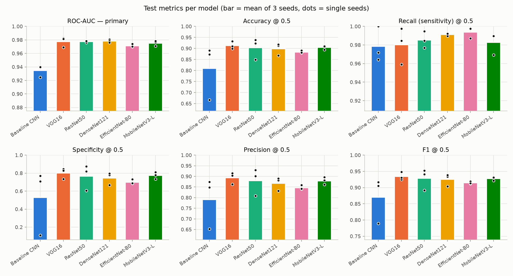

### 11.2 How to read it — the main conclusions

1. **Transfer learning is the biggest effect.** All five ImageNet-pretrained models reach ROC-AUC 0.971–0.978; the
   from-scratch baseline 0.935.
2. **No single winner on quality.** VGG16, ResNet50 and DenseNet121 have the same mean ROC-AUC (0.978); the differences
   between the pretrained models (≤ 0.007) are about as large as the seed-to-seed standard deviations (up to 0.008). With
   3 seeds we cannot claim one is better.
3. **Recommended model: ResNet50** — top ROC-AUC, the most stable (± 0.001), mid-size, fast, and the only model whose
   Grad-CAM attention stays on the lungs. **For weak hardware: MobileNetV3-Large** (0.975 with 4.2 M parameters and the
   fastest training among the pretrained models).
4. **Parameters ≠ speed.** DenseNet121 (7 M) is the slowest at inference (24.5 ms); VGG16 (134 M) takes 9.7 ms.

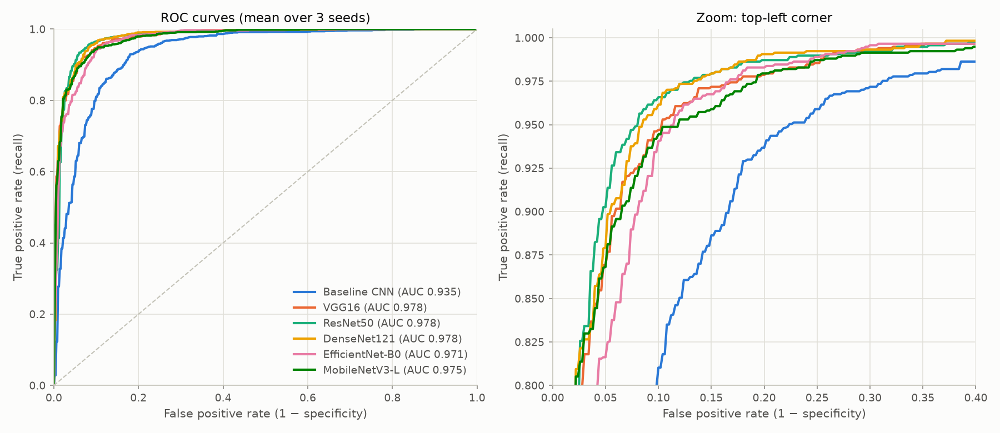

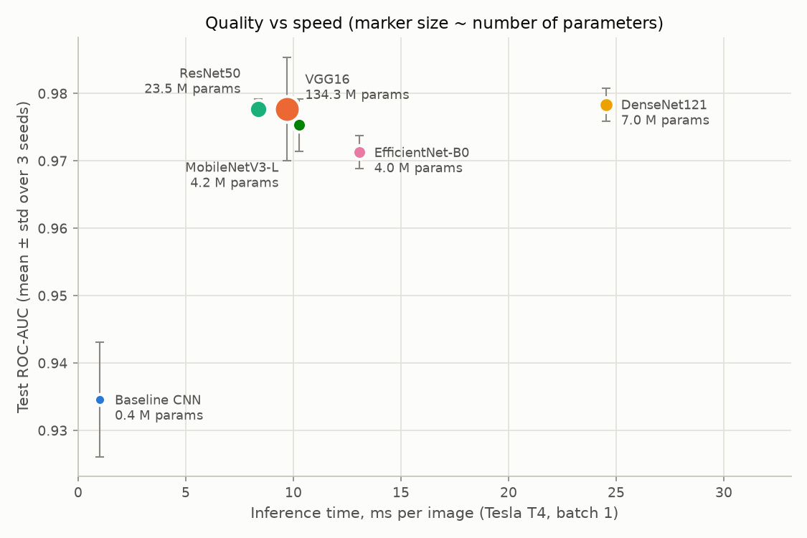

### 11.3 Why specificity is low and unstable

Recall is 0.98–0.99 for every model, but at threshold 0.5 between 46 (VGG16) and 110 (baseline) of the 234 healthy
children are called sick on average. Reasons:

- **Class balance shift:** the sampler trains the model on 50/50 batches, while val is 74 % and test 62.5 % pneumonia;
  together with the test set being "harder" (next point), the probabilities are not calibrated for the test data.
- **Over-confidence:** fine-tuned networks push probabilities to 0 or 1 (EfficientNet: median healthy $p = 0.003$, but
  20 % of healthy images get $p > 0.9$). A wrong prediction is then confidently wrong, and a small shift of the
  distribution moves many images across 0.5.
- **The ROC curves show the fix:** moving the threshold up would trade a little recall for much more specificity. We did
  not do it because choosing the threshold on the test set is not allowed, and choosing it on validation was left as
  future work (team decision).

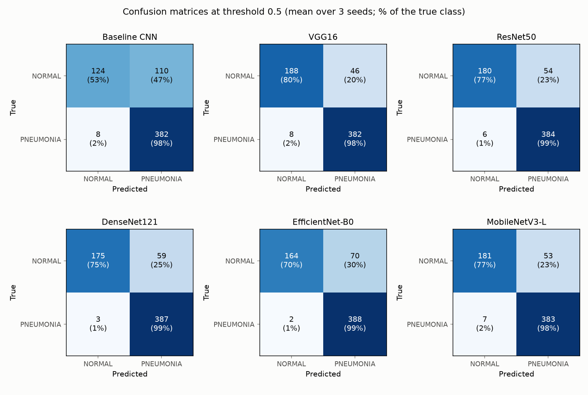

### 11.4 Why one run per model was not enough

ResNet50's specificity was 0.61 at seed 42 and 0.88 / 0.82 at seeds 43 / 44; the baseline's ranged from 0.11 to 0.77
(seed 44: 208 of 234 healthy children called sick, while its ROC-AUC was still 0.925 — it ranked images fine but almost
all its probabilities were above 0.5). Looking only at seed 42 we would have concluded "ResNet50 is worse than the
baseline at specificity" — wrong. **ROC-AUC varied by at most ±0.008** — which is why it is the primary metric, averaged
over 3 seeds (recorded in [Plan.md](Plan.md) §7).

### 11.5 Validation looks much easier than test

Validation ROC-AUC of the pretrained models is ~0.999, test ~0.975; validation accuracy ~0.98, test ~0.90. Reasons: the
validation images come from the same source folders (same period, same acquisition) as training, while the official
test set is known to be harder / differently distributed. Consequence: validation is **saturated**, so early stopping
chooses between epochs that differ in the 4th–5th decimal (e.g. MobileNetV3 seed 42: epochs 14–21 all had val ROC-AUC
0.9992–0.9993). The selection is therefore partly random — another reason for 3 seeds.

### 11.6 Training behaviour

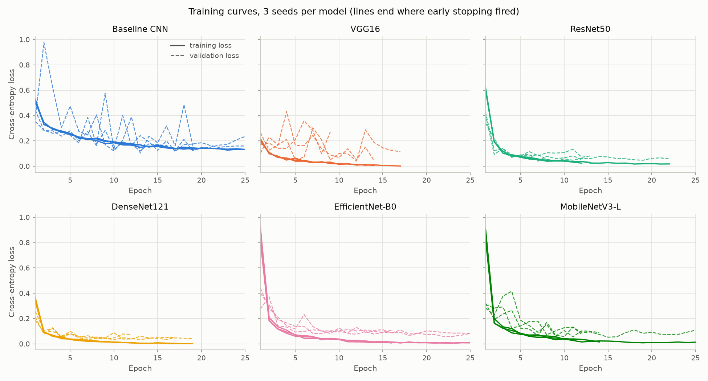

Pretrained models reach their best validation score within a few epochs and then overfit (training loss → ~0.001–0.01).
The validation loss of the baseline and of VGG16 jumps between epochs (e.g. baseline seed 42: 0.16 → 0.58 → 0.13 at
epochs 8–10) while validation ROC-AUC stays smooth: the **ranking** of images is stable, the **probability scale** is not.

### 11.7 Limitations (say them before you are asked)

- Threshold fixed at 0.5 (see 11.3).
- One dataset, one hospital; no external test set → we measure in-distribution performance, not real generalisation.
- 170 possibly shared patient numbers between official train and test (section 3.2).
- 3 seeds give a rough estimate of the spread; no formal significance test.
- No hyperparameter search (section 5.1); weight decay practically inactive.
- Grad-CAM on 8 fixed images, crude "frame" proxy, no lung masks.
- Images squeezed to a square (aspect ratio lost); NORMAL images are systematically larger in the original data — a
  possible shortcut that we could not fully rule out.

---

## 12. History of the work: decisions, problems, fixes

### 12.1 Key decisions (and why)

| Decision | Alternative considered | Why this one |
|---|---|---|
| PyTorch + timm | TensorFlow/Keras | One library gives all 5 pretrained models with pinned weights |
| Kaggle T4 for all runs | Colab, local GPU | Free, stable, dataset already hosted; one GPU type → comparable times |
| Shared `.py` code + small notebooks | One notebook per model | Copied code would drift between models and break fairness |
| Pool train+val, split by patient 85/15 | Use the official 16-image val | 16 images cannot select an epoch; patients must not leak |
| Weighted sampler | Class-weighted loss | Team choice; balanced batches, plain loss |
| `torchvision.transforms.v2` | albumentations | No extra dependency, no OpenCV version conflicts on Kaggle |
| No horizontal flip | Flip | Anatomically impossible images |
| Identical settings for all models, incl. baseline | Higher LR for baseline | Strict fairness (team decision) |
| Early stopping on val ROC-AUC | Val loss | Val loss jumps (calibration); AUC is threshold-free |
| 3 seeds | 1 seed | Results turned out very seed-dependent |
| ROC-AUC as primary metric | Threshold-0.5 metrics; tuning the threshold on val | Stable across seeds; tuning left as future work |
| Grad-CAM computed on Kaggle right after training | Commit checkpoints | Checkpoints are large (VGG16: 0.5 GB) and not allowed in git |

### 12.2 Problems found and how they were fixed

| Problem | Cause | Fix |
|---|---|---|
| Data loading 17 images/s | Decoding JPEGs up to 2,900 px every epoch | In-memory cache of resized images → 175 images/s (identical output, tested) |
| Saving `config.yaml` crashed | `torch.__version__` is a special string type that YAML cannot write | Convert versions to plain `str` |
| Grad-CAM pictures 1.2 MB each | Photo-like images saved as PNG | Save as JPEG (~5× smaller) |
| Warning "scheduler.step() before optimizer.step()" | GradScaler skips the first step(s) while calibrating the loss scale | Understood, harmless, identical for all models (7.5) |
| EfficientNet/MobileNet very slow in the debug run | cuDNN warm-up for depthwise convs in the first epoch | Confirmed in full runs: only epoch 1 slow (~40 s), then ~14 s |
| Baseline seed 44: specificity 0.11 | Probabilities almost all above 0.5 | Documented; motivated ROC-AUC as primary metric |
| Regenerated files showed as "modified" on Windows | Git line-ending conversion (CRLF vs LF) | `.gitattributes` forcing LF |
| Notebook editing on Kaggle by hand was error-prone | — | Import the notebook from the repository by URL; only the settings cell is edited |

### 12.3 Pull requests

| PR | Task | What it added |
|---|---|---|
| #2 | ID-1 | Agreed hyperparameters in Plan.md; albumentations removed |
| #3 | ID-2 | Patient-level split, split CSVs, EDA notebook |
| #4 | ID-3 | `base.yaml`, data pipeline, cache, sampler |
| #5 | ID-4 | Model registry, pinned weights, model configs |
| #6 | ID-5 | Training loop, `scripts/train.py`, debug mode |
| #7 | ID-6 | Metrics, `metrics.json`, inference timing, Grad-CAM module |
| #8 | ID-7 | Kaggle notebook and guide; first end-to-end GPU run |
| #9–#14 | ID-8…13 | Seed-42 results of the six models |
| #15, #16 | ID-14, 15 | Seeds 43 and 44 |
| #17 | ID-16 | Comparison table, figures, results notebook; ROC-AUC as primary metric |
| #18 | ID-17 | Cross-model Grad-CAM, border-share check |
| #19 | ID-18 | Fresh-clone check, SUMMARY.md, updated READMEs |

---

## 13. Likely defence questions with answers

Answers are short; the section in brackets has the details.

### Data

1. **Why didn't you use the official validation set?** It has 16 images — one wrong image changes accuracy by 6 %; useless
   for choosing the best epoch. We pooled train + val and split 85/15 by patient (3.2).
2. **What is data leakage and how did you prevent it?** Information from the evaluation data reaching training. Here: the
   same patient in train and val → the model recognises the person. We extract the patient ID from file names and keep
   all images of a patient in one split; the test set is used only once at the end (3.2, 2.3).
3. **How do you know the split is stratified?** Pneumonia share train 74.2 %, val 74.3 %; the algorithm takes 15 % of each
   class separately (3.2).
4. **Is there leakage between train and test?** Possibly: 170 PNEUMONIA patient numbers occur in both official folders;
   the dataset does not say if they are the same children. We did not change the official test set, so results stay
   comparable with the literature; reported as a limitation (3.2).
5. **Why normalise with ImageNet mean/std for X-rays?** The pretrained filters expect inputs with those statistics; using
   them keeps the first layers' activations in the range they were trained on. Worked example: gray 128 → (0.074, 0.205,
   0.427) (3.5).
6. **Why 3 channels if X-rays are grayscale?** Pretrained first convolutions have weights for 3 input channels; repeating
   the gray channel reuses them (3.5).
7. **Why no horizontal flip?** A flipped chest puts the heart on the right — anatomically impossible (5.2).
8. **What exactly does the augmentation do mathematically?** An affine map: rotation matrix × scale + shift, with
   $\theta \in [-10°, 10°]$, $s \in [0.9, 1.1]$, shift ≤ 22 px; brightness factor and contrast blend in $[0.9, 1.1]$ (3.5).

### Class imbalance

9. **How did you handle class imbalance?** Weighted random sampler: weight $1/n_c$ per image → each class drawn with
   probability $\frac{1}{2}$; with replacement, one epoch = 4,447 draws (3.6).
10. **Compute the sampler weights.** $1/1147 = 8.7 \cdot 10^{-4}$ and $1/3300 = 3.0 \cdot 10^{-4}$; sum of all weights = 2;
    $P(\text{NORMAL}) = 1147 \cdot 8.7 \cdot 10^{-4} / 2 = 0.5$ (3.6).
11. **Does the sampler see every image each epoch?** No — draws with replacement. A pneumonia image is drawn on average
    0.67 times per epoch, so $e^{-0.67} \approx 51\%$ of them are skipped in a given epoch; normal images ≈ 1.94 times
    (Poisson approximation) (3.6).
12. **Sampler vs class-weighted loss — difference?** Both make the classes count equally in expectation. The sampler
    changes *what* the model sees (balanced batches, repeated normal images); the weighted loss keeps the data and
    multiplies the loss of rare-class images. The sampler gives more stable BatchNorm statistics per batch; the weighted
    loss sees every image once per epoch (3.6).

### Models

13. **What is a convolution? Count the parameters of a layer.** Weighted sum over a $k \times k \times C_{in}$ window, same
    weights everywhere; parameters $C_{out} C_{in} k^2$. Baseline conv 128→256: $256 \cdot 128 \cdot 9 = 294{,}912$ (6.1, 6.3).
14. **Why does the baseline have 389,410 parameters?** Table in 6.3; 76 % are in the last conv layer.
15. **Why do convolutions before BatchNorm have no bias?** BN subtracts the mean and adds its own $\beta$, so a bias would
    be cancelled (6.3).
16. **What does BatchNorm do, and what changes at test time?** Normalises each channel with the batch mean/variance and
    applies learned $\gamma, \beta$; at test time uses running averages instead of batch statistics (6.1).
17. **Why does ResNet train deep networks well?** $y = F(x) + x$; the gradient $\partial L/\partial x$ contains the identity
    term, so it reaches early layers without vanishing; a block can learn "do nothing" by $F \to 0$ (6.5).
18. **What is a bottleneck block and why use it?** 1×1 reduce → 3×3 → 1×1 expand; ~4.5 M parameters instead of ~75 M for
    two 3×3 convs at 2048 channels (6.5).
19. **How is DenseNet different from ResNet?** ResNet *adds* the input; DenseNet *concatenates* all previous feature maps,
    so features are reused; thin layers (growth rate 32). Channel count 64 → 256 → … → 1024 (6.6).
20. **Why is DenseNet slow with only 7 M parameters?** 121 thin layers and many concatenations → many small GPU kernels
    and memory copies; at batch size 1 the GPU is under-used (6.6, 11.2).
21. **Why does VGG16 have 134 M parameters?** The two fully connected layers hold 89 % of them; the first alone has
    $512 \cdot 7 \cdot 7 \cdot 4096 = 102.8$ M (77 %). The 13 convolutions have only 14.7 M (6.4).
22. **What is a depthwise separable convolution? Show the saving.** Per-channel $k \times k$ filter + 1×1 mixing; for 3×3,
    128→128: 17,536 vs 147,456 parameters (8.4× fewer) (6.7).
23. **What is squeeze-and-excitation?** GAP → small two-layer network → sigmoid → one weight per channel that rescales the
    channel: $\tilde{x}_c = s_c x_c$ (6.7).
24. **What is compound scaling?** Scale depth, width and resolution together with $\alpha^\phi, \beta^\phi, \gamma^\phi$,
    $\alpha\beta^2\gamma^2 \approx 2$, so each step doubles FLOPs; B0 is the base (6.7).
25. **What is hard-swish and why?** $x \cdot \text{ReLU6}(x+3)/6$ — a cheap approximation of swish, no exponential (6.8).
26. **What is transfer learning and why does it help here?** Start from ImageNet weights; early layers already detect
    edges/textures; with only 4,447 images this beats training from scratch (0.975 vs 0.935 ROC-AUC) (6.2).
27. **Did you freeze layers?** No; all layers fine-tuned with the same learning rate — same for all models (6.2).

### Training

28. **Write the cross-entropy loss and its gradient.** $L = -\log p_y$, $\partial L/\partial z_c = p_c - \mathbb{1}[c=y]$;
    example $z = (-1.2, 2.3)$, true NORMAL → $L = 3.53$ (7.2).
29. **Explain Adam/AdamW step by step.** Moving averages $m$ (gradient) and $v$ (squared gradient), bias correction,
    step $\eta\, \hat{m}/(\sqrt{\hat{v}} + \epsilon)$, plus decoupled $\eta \lambda \theta$. First step moves each weight by
    exactly $\eta$ (7.3).
30. **What does weight decay do in your setup?** Almost nothing: $(1 - 10^{-8})^{3475} \approx 0.99997$. Regularisation
    came from augmentation, sampling, early stopping and dropout (5.2).
31. **Why warm-up and cosine? Compute the learning rate at epoch 13.** Warm-up protects pretrained weights from the random
    head's large early gradients; cosine decays smoothly. Epoch 13: $t = 1668$, $f = \frac{1}{2}(1 + \cos(\pi \cdot
    1529/3336)) = 0.565$ → $5.65 \cdot 10^{-5}$ (7.4).
32. **What is mixed precision and why loss scaling?** float16 compute is faster; small gradients underflow to 0 in
    float16; multiplying the loss by $S$ scales all gradients by $S$ (chain rule), they are divided by $S$ before the
    update (7.5).
33. **Why early stopping on ROC-AUC instead of loss? What are its problems?** Threshold- and balance-free; val loss
    jumped. Problem: val ROC-AUC saturated at ~0.999, so the best epoch is partly random (5.2, 11.5).
34. **How did you choose the hyperparameters?** Standard fine-tuning defaults agreed before training, identical for all
    models; no search, to keep the comparison fair and within budget. A fair search would tune every model on validation
    with the same budget (5.1).
35. **Are your results reproducible?** Seeds for Python/NumPy/PyTorch, deterministic cuDNN, fixed splits, configs and
    environment saved per run; a test confirms identical histories on CPU; the fresh-clone check reproduced splits and
    tables. Bit-exact GPU reproduction across library versions is not guaranteed (4, 10.3).

### Evaluation and results

36. **Define precision, recall, specificity, F1 and compute them.** Formulas in 8.2; baseline seed 42: 0.848 / 0.972 /
    0.709 / 0.906.
37. **What is ROC-AUC? Compute it on a small example.** Probability that a random sick image gets a higher score than a
    random healthy one; example 13/16 = 0.8125 (8.3).
38. **Why is ROC-AUC your primary metric?** Independent of the threshold and class balance; std ≤ 0.008 across seeds
    while specificity varied by up to 0.36 (11.4).
39. **Why is specificity so low?** Sampler trains on 50/50, val/test are 74 %/62.5 % pneumonia; over-confident
    probabilities; fixed 0.5 threshold. The ROC curve shows a better threshold exists (11.3).
40. **Why not choose a better threshold?** On test = cheating; on validation = valid future work; the team chose to keep
    0.5 and report ROC-AUC as primary (5.2).
41. **Why is test so much worse than validation?** Validation comes from the same folders as training; the official test
    set is harder / differently distributed; val is saturated (11.5).
42. **Which model is best?** On quality, VGG16, ResNet50 and DenseNet121 are tied (0.978). We recommend ResNet50: most
    stable, focused on the lungs, fast. MobileNetV3 for weak hardware (11.2).
43. **How did you measure inference time?** Batch 1, 10 warm-up passes, CUDA synchronise, median over 624 images on a
    T4 (8.4).

### Grad-CAM

44. **What is Grad-CAM? Write the formula.** $\alpha_k^c$ = mean gradient of the class logit over feature map $k$;
    map = ReLU($\sum_k \alpha_k^c A^k$), upsampled (9.1).
45. **Which layer and why?** The last convolutional feature map before global pooling — most class-specific, still spatial.
    For MobileNetV3 the last block, because pooling happens before its last conv (6.8, 9.1).
46. **Why are some Grad-CAM maps empty?** The weighted sum is ≤ 0 everywhere, the ReLU zeroes it — happened for VGG16 on
    very confident predictions (9.3).
47. **Do the models look at the lungs?** ResNet50 yes (14 % of heat on the frame); VGG16, MobileNetV3 and the baseline
    spread as much or more heat to the frame than a uniform map (36–42 %) — possible shortcuts (9.4).
48. **What is a shortcut and why does it matter?** A feature correlated with the label but not the disease (markers,
    borders, image size). The model may then fail on X-rays from another hospital (9.4, 11.7).

---

## 14. Glossary

| Term | Meaning |
|---|---|
| Activation function | Non-linear function after a layer (ReLU, SiLU, hard-swish) |
| AdamW | Adam optimizer with decoupled weight decay |
| AMP (mixed precision) | Training with float16 where safe, float32 elsewhere |
| Augmentation | Random, realistic changes to training images |
| AUC / ROC-AUC | Area under the ROC curve; probability of ranking a random positive above a random negative |
| Backpropagation | Computing gradients layer by layer with the chain rule |
| Batch / batch size | Group of images processed together / its size (32) |
| BatchNorm | Per-channel normalisation with learned scale and shift |
| Checkpoint | Saved model weights (`best.pt`, `last.pt`) |
| Confusion matrix | Table of TN, FP, FN, TP |
| cuDNN | NVIDIA's library of fast GPU deep-learning operations |
| Data leakage | Evaluation information reaching training |
| Depthwise separable conv | Per-channel spatial filter + 1×1 channel mixing |
| Early stopping | Stop training when validation stops improving |
| Epoch | One pass over the training set (139 steps here) |
| Feature map | Output of a conv layer for one channel |
| Fine-tuning | Continuing to train a pretrained model on new data |
| GAP | Global average pooling — average of each channel |
| Grad-CAM | Heat map of the regions that increased a class score |
| GradScaler | PyTorch tool that scales the loss for float16 training |
| Hyperparameter | Setting chosen before training |
| ImageNet | 1.28 M labelled photos, 1,000 classes; source of pretrained weights |
| Logit | Raw model output before softmax |
| Overfitting | Learning the training set too specifically, worse on new data |
| Patience | Epochs without improvement before early stopping (5) |
| Precision / Recall / Specificity | See 8.2 |
| Residual connection | $y = F(x) + x$ |
| Seed | Start value of random number generators |
| Shortcut learning | Using a non-causal feature correlated with the label |
| Softmax | Turns logits into probabilities |
| Squeeze-and-excitation | Learned per-channel re-weighting |
| Stratified split | Split that keeps the class proportions |
| timm | PyTorch Image Models library |
| Transfer learning | Re-using a model trained on another task |
| Weighted random sampler | Draws training images with probabilities that balance the classes |
| Weight decay | Shrinking weights towards 0 as regularisation |
