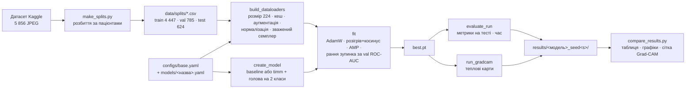
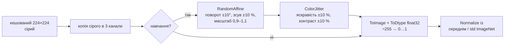
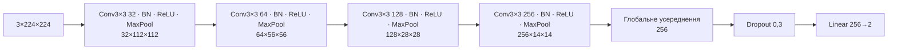
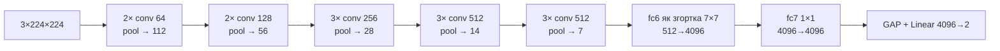
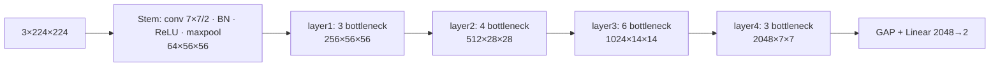
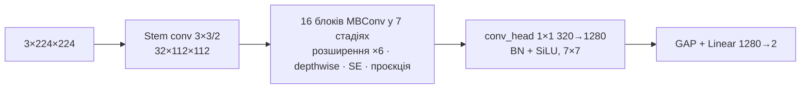
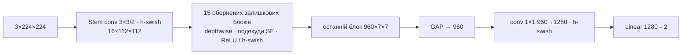
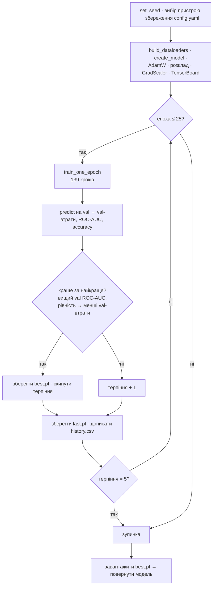

# Пояснення проєкту — Порівняння CNN-моделей для класифікації зображень пневмонії

*Повний розбір проєкту для членів команди, які його захищають: підготовка даних, увесь код, що впливає на навчання,
кожен гіперпараметр, шість моделей і математика, що за ними стоїть, результати, історія рішень і список імовірних
запитань на захисті з відповідями.*

> **Мова:** українська · English version: [PROJECT_EXPLAINED_EN.md](PROJECT_EXPLAINED_EN.md)
> **Описаний стан проєкту:** гілка `main` після PR #19 (усі 18 задач виконано, 18 запусків навчання).
> **Версія на одну сторінку:** [results/SUMMARY.md](../results/SUMMARY.md) (англійською).
>
> Терміни при першій появі подано з англійським оригіналом у дужках, щоб вони збігалися з кодом, графіками та
> статтями. Назви метрик (accuracy, recall, ROC-AUC тощо) залишено англійською, як у таблицях проєкту.

## Зміст

1. [Як читати документ і що повторити заздалегідь](#1-як-читати-документ-і-що-повторити-заздалегідь)
2. [Задача, датасет і правила чесного порівняння](#2-задача-датасет-і-правила-чесного-порівняння)
   1. [Задача](#21-задача) · 2. [Датасет](#22-датасет) · 3. [Правила чесного порівняння](#23-правила-чесного-порівняння) · 4. [Увесь конвеєр на одній схемі](#24-увесь-конвеєр-на-одній-схемі)
3. [Підготовка даних](#3-підготовка-даних)
   1. [Як виглядають дані](#31-як-виглядають-дані-eda) · 2. [Розбиття за пацієнтами](#32-розбиття-за-пацієнтами-splitspy) · 3. [Завантаження і зміна розміру](#33-завантаження-і-зміна-розміру-load_image) · 4. [Кеш зображень](#34-кеш-зображень-chestxraydataset) · 5. [Аугментація і нормалізація](#35-аугментація-і-нормалізація-build_transforms) · 6. [Балансування класів](#36-балансування-класів-зважений-семплер-make_weighted_sampler) · 7. [DataLoader і режим налагодження](#37-dataloader-і-режим-налагодження-build_dataloaders)
4. [Конфігурація, seed і відтворюваність](#4-конфігурація-seed-і-відтворюваність)
5. [Усі гіперпараметри по черзі](#5-усі-гіперпараметри-по-черзі)
   1. [Як обирали значення (чесно)](#51-як-обирали-значення-чесно) · 2. [Довідник гіперпараметрів](#52-довідник-гіперпараметрів)
6. [Моделі](#6-моделі)
   1. [Будівельні блоки та їхня математика](#61-будівельні-блоки-та-їхня-математика) · 2. [Перенесення навчання](#62-перенесення-навчання-і-що-ми-змінюємо-в-кожній-попередньо-навченій-моделі) · 3. [Baseline CNN](#63-baseline-cnn) · 4. [VGG16](#64-vgg16) · 5. [ResNet50](#65-resnet50) · 6. [DenseNet121](#66-densenet121) · 7. [EfficientNet-B0](#67-efficientnet-b0) · 8. [MobileNetV3-Large](#68-mobilenetv3-large)
7. [Навчання](#7-навчання-trainpy)
8. [Оцінювання](#8-оцінювання-evaluatepy)
9. [Grad-CAM: куди дивляться моделі](#9-grad-cam-куди-дивляться-моделі)
10. [Інфраструктура: скрипти, Kaggle, тести, git](#10-інфраструктура-скрипти-kaggle-тести-git)
11. [Результати та їх інтерпретація](#11-результати-та-їх-інтерпретація)
12. [Історія роботи: рішення, проблеми, виправлення](#12-історія-роботи-рішення-проблеми-виправлення)
13. [Імовірні запитання на захисті з відповідями](#13-імовірні-запитання-на-захисті-з-відповідями)
14. [Глосарій](#14-глосарій)

---

## 1. Як читати документ і що повторити заздалегідь

Документ розрахований на читача з базою курсу: ви знаєте, що таке нейронна мережа (neural network), шар (layer),
функція втрат (loss function) і градієнтний спуск (gradient descent). Кожен інший термін пояснено простими словами при
першій появі, а після математики завжди йде **розібраний приклад на наших реальних числах**.

Посилання на код мають вигляд [`data.py` → `make_weighted_sampler`](../pneumonia/data.py#L75): на GitHub вони відкривають
потрібне місце в коді. Номери рядків відповідають `main` після PR #19.

**Якщо щось усе одно незрозуміло**, спершу повторіть ці теми. Пошукові слова подано *курсивом* (англійською — за ними
знаходяться найкращі відео, наприклад 3Blue1Brown, StatQuest, Andrej Karpathy, лекції CS231n, і статті).

| # | Тема | Навіщо вона тут | Пошукові слова |
|---|---|---|---|
| 1 | Нейронна мережа, прямий прохід, втрати, градієнтний спуск | Усе | *neural network from scratch*, *gradient descent intuition* |
| 2 | Зворотне поширення помилки і ланцюгове правило | Як оновлюються ваги; Grad-CAM використовує градієнти | *backpropagation calculus 3Blue1Brown*, *chain rule neural network* |
| 3 | Згортка, ядро, крок, доповнення, карта ознак, канали | Усі 6 моделей — згорткові мережі | *convolutional neural network explained*, *CS231n convolution* |
| 4 | Пулінг, глобальне усереднення | Зменшення карт ознак; голова класифікатора | *max pooling vs average pooling*, *global average pooling* |
| 5 | Функції активації (ReLU, SiLU/swish, hard-swish) | Нелінійність у кожному блоці | *ReLU vs sigmoid*, *swish activation* |
| 6 | Softmax і перехресна ентропія | Наша функція втрат і ймовірності | *softmax cross entropy explained* |
| 7 | Нормалізація пакета (batch normalization) | Є в 5 із 6 моделей | *batch normalization explained* |
| 8 | Перенавчання, регуляризація, dropout, затухання ваг, аугментація | Чому налаштування навчання саме такі | *overfitting regularization*, *dropout explained* |
| 9 | Оптимізатори: SGD, імпульс, Adam, AdamW | Наш оптимізатор | *Adam optimizer explained*, *AdamW decoupled weight decay* |
| 10 | Розклад швидкості навчання, розігрів, косинусне згасання | Наш розклад | *cosine annealing learning rate*, *learning rate warmup* |
| 11 | Навчальна / валідаційна / тестова вибірки, витік даних | Наше розбиття за пацієнтами | *train validation test split*, *data leakage machine learning* |
| 12 | Незбалансовані класи, oversampling | Наш зважений семплер | *imbalanced dataset oversampling*, *WeightedRandomSampler* |
| 13 | Матриця помилок, precision, recall, specificity, F1 | Наші метрики | *confusion matrix precision recall StatQuest* |
| 14 | ROC-крива і AUC | Наша головна метрика | *ROC AUC StatQuest*, *AUC Mann-Whitney* |
| 15 | Перенесення навчання, донавчання, ImageNet | 5 із 6 моделей попередньо навчені | *transfer learning fine-tuning CNN* |
| 16 | Архітектури VGG, ResNet, DenseNet, EfficientNet, MobileNet | Розділ 6 | *VGG16 architecture*, *ResNet residual connection*, *DenseNet dense block*, *EfficientNet compound scaling*, *MobileNetV3 depthwise separable convolution* |
| 17 | Навчання зі змішаною точністю (float16) | Наше навчання на GPU | *automatic mixed precision PyTorch*, *loss scaling* |
| 18 | Grad-CAM, пояснюваність | Розділ 9 | *Grad-CAM explained*, *class activation map* |
| 19 | Seed, відтворюваність | Чому ми запускаємо 3 seed | *PyTorch reproducibility seed* |

Оригінальні статті, які варто знати хоча б на назву (читати не обов'язково): VGG — Simonyan & Zisserman, 2014; ResNet —
He et al., 2015; DenseNet — Huang et al., 2016; EfficientNet — Tan & Le, 2019; MobileNetV3 — Howard et al., 2019; Batch
Normalization — Ioffe & Szegedy, 2015; Adam — Kingma & Ba, 2014; AdamW — Loshchilov & Hutter, 2017; Grad-CAM — Selvaraju
et al., 2016; датасет — Kermany et al., *Cell*, 2018.

---

## 2. Задача, датасет і правила чесного порівняння

### 2.1 Задача

**Бінарна класифікація зображень (binary image classification):** за рентгенівським знімком грудної клітки дитини
визначити **NORMAL** (норма, мітка 0) або **PNEUMONIA** (пневмонія, мітка 1). Ми не будуємо «найкращий можливий детектор
пневмонії»; ми **порівнюємо шість архітектур CNN в однакових умовах**, щоб побачити, яка з них найкраще підходить для
цієї задачі і якою ціною (розмір, швидкість).

### 2.2 Датасет

*Chest X-Ray Images (Pneumonia)*, Kaggle (paultimothymooney), за роботою Kermany et al., 2018: 5 856 дитячих рентгенівських
знімків грудної клітки (JPEG) з Guangzhou Women and Children's Medical Center. Знімки з пневмонією бувають бактеріальні
або вірусні; ми об'єднуємо їх в один клас.

| Офіційна папка | NORMAL | PNEUMONIA | Разом | Частка пневмонії |
|---|---|---|---|---|
| `train/` | 1 341 | 3 875 | 5 216 | 74,3 % |
| `val/` | 8 | 8 | 16 | 50 % |
| `test/` | 234 | 390 | 624 | 62,5 % |

Три проблеми опублікованих даних і що ми з ними зробили (деталі в розділі 3):

1. **Офіційна валідаційна вибірка має лише 16 знімків** — непридатна для вибору найкращої епохи. → Ми об'єднали `train/`
   і `val/` і зробили власне розбиття 85 / 15.
2. **У багатьох пацієнтів кілька знімків** (до 30). Якщо один пацієнт є і в навчальній, і у валідаційній вибірці, модель
   може «впізнати людину», і валідація стає надто оптимістичною. → Розбиття **за пацієнтами**.
3. **Дисбаланс класів (class imbalance)**: 3 пневмонії на 1 норму. → Зважений семплер під час навчання; метрики, крім
   accuracy.

Офіційна папка `test/` використовується **лише один раз на запуск, у самому кінці** — ніколи для навчання, ранньої
зупинки, вибору порогу чи будь-якого іншого рішення.

### 2.3 Правила чесного порівняння

Ці правила взято з [AGENTS.md](../AGENTS.md) і [Plan.md](Plan.md); вони — основа всього проєкту. Будьте готові пояснити,
як код забезпечує кожне з них.

| Правило | Як воно забезпечується |
|---|---|
| Однакові дані для всіх моделей | Один набір файлів розбиття в `data/splits/`, створений один раз із seed 42 і закомічений |
| Однаковий конвеєр | Одна функція даних (`build_dataloaders`), одна функція навчання (`fit`), одна функція оцінювання (`evaluate_run`) для всіх моделей |
| Відмінності лише в конфігурації | `configs/models/*.yaml` містять **тільки** `model.name`; тест (`test_every_model_has_a_config_that_only_sets_the_name`) падає, якщо хтось додасть окреме налаштування для моделі |
| Фіксовані seed | `set_seed()` фіксує генератори Python, NumPy і PyTorch; seed зберігається в `config.yaml` кожного запуску |
| Однакова обробка дисбалансу | Зважений семплер для кожної моделі |
| Одна функція оцінювання | `compute_metrics` + `evaluate_run` |
| Без витоку даних | Розбиття за пацієнтами; тестова вибірка недоторкана |
| Однакове обладнання | Кожен запуск на одній NVIDIA Tesla T4 (Kaggle), тому час навчання й інференсу порівнянний |

### 2.4 Увесь конвеєр на одній схемі



Один запуск навчання = `python scripts/train.py --config configs/models/<модель>.yaml --seed <s> --data-dir <шлях>`, який
викликає `fit` → `evaluate_run` → `run_gradcam`. Усі 18 запусків (6 моделей × seed 42, 43, 44) зроблено на Kaggle за
допомогою [notebooks/02_kaggle_train.ipynb](../notebooks/02_kaggle_train.ipynb).

---

## 3. Підготовка даних

### 3.1 Як виглядають дані (EDA)

Ноутбук: [notebooks/01_eda.ipynb](../notebooks/01_eda.ipynb). EDA = *exploratory data analysis*, розвідувальний аналіз —
огляд даних перед моделюванням.


Висновки, що вплинули на подальші рішення:

| Висновок | Числа | Наслідок |
|---|---|---|
| Офіційна `val/` крихітна | 16 знімків | Нове розбиття train + val |
| Знімків на пацієнта | NORMAL у середньому 1,11 (макс. 4); PNEUMONIA 2,36 (макс. **30**) | Розбиття за пацієнтами |
| Дисбаланс класів | 74 % пневмонії в train | Зважений семплер; ROC-AUC, recall, specificity |
| Колірний режим | 5 573 у відтінках сірого (`L`), 283 збережено як RGB | Усі переводимо в сірий, потім копіюємо в 3 канали |
| **Розмір знімка залежить від класу** | медіана NORMAL 1654 × 1323 пкс, PNEUMONIA 1160 × 776 пкс | Усе зводимо до 224 × 224; можливий *shortcut* (див. 9.4) |
| Номери пацієнтів у train і test перетинаються | 170 ID `personN` класу PNEUMONIA є в обох | Указано як обмеження; тестову вибірку залишено як опубліковано |


### 3.2 Розбиття за пацієнтами (splits.py)

**Мета:** валідаційні знімки мають належати пацієнтам, яких модель ніколи не бачила під час навчання, і обидва класи
мають зберегти свою частку (≈ 15 % кожного класу у валідації).

**Крок 1 — ID пацієнта з назви файлу** ([`patient_id_from_filename`](../pneumonia/splits.py#L25)). У датасеті немає
таблиці пацієнтів, але назви файлів містять пацієнта:

| Назва файлу | ID пацієнта | Правило (регулярний вираз) |
|---|---|---|
| `person1000_bacteria_2931.jpeg` | `person1000` | `^(person\d+)_` |
| `IM-0115-0001.jpeg` | `IM-0115` | `^((?:NORMAL2-)?IM-\d+)-\d+` |
| `NORMAL2-IM-0427-0001.jpeg` | `NORMAL2-IM-0427` | те саме; `NORMAL2-` — окрема група |

До ID додається назва класу (`PNEUMONIA/person1000`), тож ID двох класів ніколи не збігаються. Якщо жодне правило не
спрацювало, ID стає сама назва файлу (кожен такий знімок — окремий пацієнт; це безпечний вибір).

**Крок 2 — перелік знімків** ([`scan_folder`](../pneumonia/splits.py#L35)): по рядку на знімок із полями `path` (відносно
`chest_xray/`), `label` (0/1), `class_name`, `patient_id`, `source_split` (офіційна папка). Приховані файли на кшталт
`.DS_Store` пропускаються.

**Крок 3 — розбиття за пацієнтами, окремо для кожного класу** ([`split_by_patient`](../pneumonia/splits.py#L55)):

```python
rng = random.Random(seed)                       # один генератор із seed → відтворюваність
for _, class_df in df.groupby("label", sort=True):          # спершу NORMAL, потім PNEUMONIA
    counts = class_df.groupby("patient_id").size().sort_index()
    patients = list(counts.index)
    rng.shuffle(patients)                        # випадковий порядок пацієнтів
    target = round(len(class_df) * val_fraction)             # 15 % знімків цього класу
    taken = 0
    for patient in patients:
        if taken >= target:
            break
        val_patients.add(patient)                # пацієнт іде у val з УСІМА своїми знімками
        taken += int(counts[patient])
```

Це **жадібне групове стратифіковане розбиття (greedy grouped stratified split)**: для кожного класу пацієнтів беруть у
випадковому порядку, доки клас не матиме 15 % знімків у валідації. Оскільки пацієнта ніколи не ділять, результат може
перевищити ціль щонайбільше на знімки одного пацієнта.

*Розібраний приклад (наші дані).* Пул = офіційні train + val. NORMAL: 1 341 + 8 = 1 349 знімків → ціль
$\text{round}(1349 \cdot 0.15) = 202$ → валідація отримала рівно 202. PNEUMONIA: 3 875 + 8 = 3 883 → ціль
$\text{round}(582.45) = 582$ → валідація отримала 583 (останній доданий пацієнт мав 2 знімки). Результат:

| Вибірка | Знімків | Пацієнтів | NORMAL | PNEUMONIA | Частка пневмонії |
|---|---|---|---|---|---|
| train | 4 447 | 2 441 | 1 147 | 3 300 | 74,2 % |
| val | 785 | 420 | 202 | 583 | 74,3 % |
| test (офіційна, без змін) | 624 | 427 | 234 | 390 | 62,5 % |

Train і val мають **0 спільних пацієнтів**, і частку класів збережено (74,2 % проти 74,3 %).

**Крок 4 — збереження** ([`save_splits`](../pneumonia/splits.py#L85)): рядки відсортовано за шляхом, записано з
закінченнями рядків LF, тому повторний запуск дає **побайтово однакові** файли (перевіряє тест і фінальна перевірка на
чистій копії). CSV-файли закомічено: кожен член команди і кожен запуск на Kaggle використовує рівно ті самі знімки.

> **Чому не `sklearn.model_selection.StratifiedGroupKFold`?** З `n_splits = 7` він дає ≈ 14,3 %, а не 15 %, і його важче
> пояснити. Жадібне правило — 15 рядків, точне і легко тестується.

> **Обмеження:** 170 номерів пацієнтів PNEUMONIA (`personN`) трапляються і в офіційній папці train, і в офіційній папці
> test. Датасет не уточнює, чи нумерація спільна для папок, тож ми не знаємо, чи це ті самі діти. Ми **повідомляємо** про
> це, але тестову вибірку не змінюємо, щоб наші числа залишалися порівнянними з іншими роботами.

### 3.3 Завантаження і зміна розміру (load_image)

[`load_image`](../pneumonia/data.py#L22):

```python
with Image.open(path) as img:
    return img.convert("L").resize((size, size), Image.Resampling.BILINEAR)
```

1. `convert("L")` — кожен знімок стає 8-бітним **сірим** (один канал, значення 0–255). 283 знімки, збережені як RGB, і
   так сірі за вмістом; перетворення прибирає відмінність.
2. `resize((224, 224), BILINEAR)` — одразу до квадрата 224 × 224. **Пропорції не зберігаються** (знімок 1654 × 1323
   стискається по горизонталі в 1,25 раза). Ми обрали це замість обрізання до квадрата, бо обрізання могло б відрізати
   частину легень. Білінійне зменшення в Pillow **згладжує (anti-aliasing)**: кожен вихідний піксель усереднює окіл
   вхідних пікселів, тож тонкі деталі розмиваються, а не спотворюються.

Чому 224 × 224: це роздільність, з якою всі п'ять попередньо навчених моделей навчалися на ImageNet, а однаковий розмір
для всіх моделей — правило чесності.

### 3.4 Кеш зображень (ChestXrayDataset)

[`ChestXrayDataset`](../pneumonia/data.py#L29) — це `Dataset` PyTorch: `__getitem__(i)` повертає `(тензор_знімка, мітка)`.

**Проблема, знайдена під час розробки:** декодування оригінальних JPEG (до 2 916 пкс) кожної епохи давало лише
**~17 знімків/с** на CPU — GPU більшість часу чекав би на дані.

**Рішення:** з `cache_images: true` датасет під час створення **один раз** декодує і зменшує кожен знімок (у паралельних
потоках) і тримає знімки 224 × 224 у пам'яті:

$$\text{пам'ять} \approx 5\,856 \text{ знімків} \times 224 \times 224 \text{ байт} \approx 294 \text{ МБ}$$

Після цього завантаження працює зі швидкістю **~175 знімків/с на процес CPU** (у 10 разів швидше). Кеш зберігає результат
`load_image`, який детермінований, тож знімки з кешем і без нього **однакові** (це перевіряє тест). Випадкова аугментація
застосовується *після* кешу, тому кожна епоха все одно бачить різні випадкові варіанти.

### 3.5 Аугментація і нормалізація (build_transforms)

[`build_transforms`](../pneumonia/data.py#L56) будує ланцюжок перетворень для кожного знімка (навчальні знімки отримують
випадкові кроки, валідаційні й тестові — лише детерміновані):



**Навіщо копіювати сірий канал 3 рази?** Моделі ImageNet очікують 3 вхідні канали (RGB) — їхня перша згортка має ваги
для 3 каналів. Повторення сірого значення дозволяє використати ці попередньо навчені ваги.

**Аугментація (augmentation)** (лише під час навчання) — невеликі випадкові зміни, щоб модель щоепохи бачила трохи інший
знімок і вчилася закономірностей, а не запам'ятовувала конкретні пікселі.

- **`RandomAffine(degrees=10, translate=(0.1, 0.1), scale=(0.9, 1.1))`** — *афінне перетворення* переводить кожну позицію
  пікселя $(x, y)$ у нову через поворот, масштабування і зсув:
  $$\begin{pmatrix} x' \\ y' \end{pmatrix} = s \begin{pmatrix} \cos\theta & -\sin\theta \\ \sin\theta & \cos\theta \end{pmatrix} \begin{pmatrix} x - c_x \\ y - c_y \end{pmatrix} + \begin{pmatrix} c_x + t_x \\ c_y + t_y \end{pmatrix}$$
  де $\theta \sim U(-10°, 10°)$, $s \sim U(0.9, 1.1)$, $t_x, t_y \sim U(-0.1 \cdot 224, 0.1 \cdot 224) = U(-22.4, 22.4)$
  пікселя, центр $c = (112, 112)$. Пікселі, що приходять з-поза меж знімка, заповнюються 0 (чорним). Так імітуються
  пацієнти, що стоять трохи нахилено, не по центру або на іншій відстані.
- **`ColorJitter(brightness=0.1, contrast=0.1)`** — яскравість: кожен піксель множиться на $b \sim U(0.9, 1.1)$; контраст:
  змішування із середнім сірим, $x' = c \cdot x + (1 - c) \cdot \bar{x}$, $c \sim U(0.9, 1.1)$. Імітує різні рентгенівські
  апарати й експозицію.
- **Без горизонтального віддзеркалення** (`horizontal_flip: false`): віддзеркалений знімок грудної клітки має серце
  праворуч — анатомічно неможливий знімок. Багато робіт усе ж віддзеркалюють; ми вирішили цього не робити.

**Масштабування і нормалізація** (усі знімки): `ToDtype(float32, scale=True)` ділить на 255, тож пікселі лежать у
$[0, 1]$. Потім кожен канал $k$ стандартизується статистиками **ImageNet**, з якими навчалися попередньо навчені моделі:

$$x'_k = \frac{x_k - \mu_k}{\sigma_k}, \quad \mu = (0.485, 0.456, 0.406), \quad \sigma = (0.229, 0.224, 0.225)$$

*Розібраний приклад.* Піксель із сірим значенням 128 → $128/255 = 0.502$ в усіх трьох каналах →
R: $(0.502 - 0.485)/0.229 = 0.074$, G: $(0.502 - 0.456)/0.224 = 0.205$, B: $(0.502 - 0.406)/0.225 = 0.427$.
Тобто після нормалізації три канали вже не однакові — це очікувано і відповідає тому, що попередньо навчені фільтри
бачили під час навчання на ImageNet. Baseline CNN (навчається з нуля) використовує ту саму нормалізацію, бо конвеєр
має бути однаковим для всіх моделей.

### 3.6 Балансування класів: зважений семплер (make_weighted_sampler)

**Проблема:** 74 % навчальних знімків — пневмонія. Модель може отримати 74 % accuracy, завжди відповідаючи «пневмонія»,
а втрати визначаються переважно більшим класом.

**Два стандартні рішення:** (а) **функція втрат із вагами класів (class-weighted loss)** — помилки на рідкісному класі
коштують дорожче, або (б) **oversampling** — частіший показ рідкісного класу. Команда обрала (б), **зважений випадковий
семплер (weighted random sampler)** (рішення записано в [Plan.md](Plan.md) §4).

[`make_weighted_sampler`](../pneumonia/data.py#L75):

```python
class_counts = torch.bincount(labels)             # [1147, 3300]
weights = (1.0 / class_counts.double())[labels]   # кожен знімок отримує 1 / (розмір свого класу)
WeightedRandomSampler(weights, num_samples=len(labels), replacement=True, generator=seeded)
```

**Математика.** Кожне витягування обирає знімок $i$ з імовірністю, пропорційною його вазі $w_i = 1 / n_{c(i)}$:

$$P(\text{знімок } i) = \frac{w_i}{\sum_j w_j}, \qquad \sum_j w_j = n_0 \cdot \frac{1}{n_0} + n_1 \cdot \frac{1}{n_1} = 2$$

$$P(\text{клас } c) = n_c \cdot \frac{1/n_c}{2} = \frac{1}{2}$$

*Розібраний приклад.* $n_0 = 1\,147$ NORMAL, $n_1 = 3\,300$ PNEUMONIA. $w_{\text{NORMAL}} = 1/1147 = 8.72 \cdot 10^{-4}$,
$w_{\text{PNEUMONIA}} = 1/3300 = 3.03 \cdot 10^{-4}$. Кожне витягування дає NORMAL з імовірністю рівно 0,5. Одна епоха
витягує $N = 4\,447$ знімків **з поверненням (with replacement)**, тобто ≈ 2 223,5 кожного класу:

- кожен знімок NORMAL витягується в середньому $\lambda = 2223.5 / 1147 = 1.94$ раза за епоху; імовірність, що конкретний
  знімок NORMAL взагалі не потрапить в епоху, $\approx e^{-1.94} = 0.14$ (14 %);
- кожен знімок PNEUMONIA — $\lambda = 2223.5 / 3300 = 0.67$ раза; імовірність не потрапити $\approx e^{-0.67} = 0.51$ (51 %).

(Кількість витягувань одного знімка ≈ Пуассон($\lambda$), тож $P(0) = e^{-\lambda}$.) Отже, за одну епоху приблизно
половина знімків пневмонії пропускається, а знімки норми повторюються ~2 рази; за 25 епох кожен знімок з'являється
багато разів. Баланс ми перевірили на реальних даних: частка NORMAL у 20 навчальних пакетах дорівнювала 0,50.

**Наслідок, який треба вміти пояснити:** модель навчається так, ніби класи 50/50, а тестова вибірка має 62,5 % пневмонії,
валідаційна — 74 %. Тому ймовірності моделі не відкалібровані під реальні частоти класів — одна з причин, чому
фіксований поріг 0,5 дає нестабільну specificity (розділ 11). На ROC-AUC це не впливає.

### 3.7 DataLoader і режим налагодження (build_dataloaders)

[`build_dataloaders`](../pneumonia/data.py#L99) повертає три `DataLoader` PyTorch:

| | train | val | test |
|---|---|---|---|
| Порядок | зважений семплер (випадковий, збалансований, з поверненням) | фіксований порядок файлів | фіксований порядок файлів |
| Аугментація | так | ні | ні |
| Розмір пакета | 32 | 32 | 32 |

Інші деталі: `num_workers = 2` фонові процеси готують пакети, поки GPU навчається; `pin_memory` (на GPU) пришвидшує
копіювання на GPU; `worker_init_fn = seed_worker` і `torch.Generator` із seed роблять випадковий порядок і аугментацію
відтворюваними.

**Режим налагодження (debug)** (`--debug`): [`debug_subset`](../pneumonia/data.py#L84) залишає 16 знімків кожного класу в
кожній вибірці (обраних із seed), розмір пакета 8, 1 епоха, `num_workers = 0`. Він працює на CPU ноутбука приблизно
хвилину і потрібен лише для перевірки, що код працює, а не для результатів (вихід налагодження йде в `runs/debug/`, не в
`results/`).

---

## 4. Конфігурація, seed і відтворюваність

Усі налаштування лежать у [configs/base.yaml](../configs/base.yaml). Конфіг моделі, наприклад
[configs/models/resnet50.yaml](../configs/models/resnet50.yaml), містить лише:

```yaml
model:
  name: resnet50
```

**Злиття** ([`load_config`](../pneumonia/utils.py#L59) + [`deep_merge`](../pneumonia/utils.py#L43)): спершу завантажується
`base.yaml`, потім поверх нього *рекурсивно* накладається файл моделі (вкладені словники зливаються ключ за ключем, а не
замінюються). Остаточний злитий конфіг — разом із seed, прапорцем налагодження і середовищем (назва GPU, версії Python,
torch і timm) — зберігається в `results/<запуск>/config.yaml` для кожного запуску, тож кожен результат можна простежити до
точних налаштувань.

**Seed** ([`set_seed`](../pneumonia/utils.py#L20)):

```python
random.seed(seed); np.random.seed(seed); torch.manual_seed(seed); torch.cuda.manual_seed_all(seed)
torch.backends.cudnn.deterministic = True
torch.backends.cudnn.benchmark = False
```

Seed фіксує кожен «випадковий» вибір: початкові ваги нової голови класифікатора (і всього baseline), порядок семплера,
параметри аугментації, маски dropout. `cudnn.deterministic = True` змушує GPU використовувати детерміновані алгоритми
згортки (інакше cuDNN може обрати найшвидший алгоритм, що трохи відрізняється від запуску до запуску). Тест
(`test_fit_is_reproducible`) перевіряє, що два однакові запуски на CPU дають однакову історію навчання.

> **Чому 3 seed (42, 43, 44)?** Один запуск — це одна вибірка з випадкового процесу: початкові ваги, витягнуті пакети й
> аугментації змінюють результат. З 3 запусками ми подаємо **середнє ± стандартне відхилення** і можемо відрізнити
> реальні відмінності моделей від везіння. Це виявилося вирішальним (розділ 11). Стандартне відхилення — вибіркове,
> $s = \sqrt{\frac{1}{n-1}\sum (x_i - \bar{x})^2}$ при $n = 3$.

**Пристрій** ([`get_device`](../pneumonia/utils.py#L38)): GPU з CUDA, якщо є, інакше CPU. Той самий код працює на ноутбуці
й на Kaggle без змін.

---

## 5. Усі гіперпараметри по черзі

**Гіперпараметр (hyperparameter)** — налаштування, яке обирають *до* навчання (швидкість навчання, розмір пакета, …), на
відміну від **параметрів** моделі (ваг), яких модель вчиться під час навчання.

### 5.1 Як обирали значення (чесно)

**Пошуку гіперпараметрів не проводили** — ні пошуку по сітці (grid search), ні випадкового пошуку (random search), ні
налаштування на валідаційній вибірці. Це свідоме рішення, і ви маєте вміти його захистити:

1. **Чесність.** Мета — порівняти архітектури. Якби ми налаштовували швидкість навчання тощо окремо для кожної моделі,
   різниця в результатах могла б походити від кращого налаштування, а не від кращої архітектури. Тому кожна модель
   отримує **рівно ті самі** налаштування (правило 2 чесного порівняння; навіть baseline, що навчається з нуля, не має
   особливих умов — рішення команди).
2. **Стандартні, відомі значення.** Значення — поширені типові вибори для донавчання (fine-tuning) попередньо навчених на
   ImageNet CNN на невеликих медичних датасетах (мала швидкість навчання для AdamW, косинусний розклад із розігрівом,
   легка аугментація, пакет 32, 224 пкс). Команда погодила їх до будь-якого навчання (записано в [Plan.md](Plan.md) §6),
   тож їх не могли «підігнати під тестову вибірку».
3. **Бюджет.** Пошук, скажімо, по 3 швидкостях навчання × 2 розмірах пакета × 6 моделей × 3 seed = 108 запусків потребував
   би близько 15 GPU-годин, половину тижневої квоти Kaggle, — і його результат усе одно був би іншим порівнянням (з
   налаштуванням під кожну модель).
4. **Ми перевірили результат:** криві навчання показують, що всі попередньо навчені моделі збігаються за кілька епох і
   рання зупинка спрацьовує (крім baseline та EfficientNet, які використали більшу частину бюджету), тобто налаштування
   розумні.

**Як виглядав би коректний пошук** (можлива подальша робота): для кожної моделі спробувати невелику сітку **лише на
валідаційній вибірці** (наприклад, швидкість навчання ∈ {3e-5, 1e-4, 3e-4}) з **однаковим бюджетом для кожної моделі**,
обрати найкраще значення за val ROC-AUC, а потім один раз оцінити на тесті. Тоді порівняння відповідало б на питання
«яка архітектура найкраща, коли кожну добре налаштовано».

Для кожного гіперпараметра нижче пункт «якщо більше / менше» — це **те, що передбачає теорія**; таких експериментів ми
**не проводили**.

### 5.2 Довідник гіперпараметрів

#### `seed: 42` (+ 43, 44 через `--seed`)
- **Що:** початкове значення всіх генераторів випадкових чисел (розділ 4).
- **Де:** `set_seed` у [utils.py](../pneumonia/utils.py#L20), викликається на початку `fit`; також семплер і підвибірка
  налагодження.
- **Чому:** 42 — умовне значення; 43 і 44 — два наступні, обрані до того, як побачили будь-які результати.
- **Що бачили:** сильний вплив на метрики з порогом (specificity ResNet50 0,61 / 0,88 / 0,82 для seed 42 / 43 / 44), слабкий
  вплив на ROC-AUC (std ≤ 0,008).

#### `data.image_size: 224`
- **Що:** кожен знімок зводиться до 224 × 224 пікселів.
- **Де:** `load_image` / `ChestXrayDataset` ([data.py](../pneumonia/data.py#L22)).
- **Чому:** рідна роздільність ImageNet для всіх попередньо навчених моделей; однакова для всіх моделей (чесність).
- **Якщо більше** (наприклад, 384): видно дрібнішу текстуру легень, у 3 рази більше обчислень і пам'яті, попередньо
  навчені фільтри бачать об'єкти в іншому масштабі. **Якщо менше** (наприклад, 128): швидше, але дрібні деталі
  інфільтратів втрачаються.
- **Що бачили:** фінальні карти ознак попередньо навчених моделей при 224 мають розмір 7 × 7 (розділ 6).

#### `data.num_workers: 2`
- **Що:** кількість фонових процесів, що готують пакети. **Не змінює результатів**, лише швидкість.
- **Чому:** Kaggle дає 4 ядра CPU; з кешем 2 процеси тримають T4 зайнятою.

#### `data.cache_images: true`
- **Що:** один раз декодувати і зменшити кожен знімок і тримати в оперативній пам'яті (розділ 3.4). **Не змінює
  результатів** (перевірено тестом).
- **Що бачили:** у 10 разів швидше завантаження; ~1–2 хвилини кожного запуску на Kaggle йдуть на заповнення кешу.

#### `augmentation.rotation_degrees: 10`, `translate: 0.1`, `scale: [0.9, 1.1]`
- **Що:** випадкове афінне перетворення (розділ 3.5): поворот $\theta \sim U(-10°, 10°)$, зсув до 10 % (22 пкс), масштаб
  0,9–1,1.
- **Де:** `build_transforms` ([data.py](../pneumonia/data.py#L56)), лише навчальні знімки.
- **Чому «легка»:** рентгенівські знімки грудної клітки робляться в стандартизованому положенні; реальна мінливість мала.
  Сильна аугментація (наприклад, ±30°) створювала б нереалістичні знімки.
- **Якщо більше:** більше регуляризації, повільніша збіжність, ризик нереалістичних знімків. **Якщо менше / без неї:**
  швидше перенавчання — втрати на навчанні в попередньо навчених моделей і так доходять до ≈ 0,005 (VGG16), тож без
  аугментації запам'ятовування було б ще легшим.

#### `augmentation.brightness: 0.1`, `contrast: 0.1`
- **Що:** яскравість множиться на $U(0.9, 1.1)$; контраст масштабується на $U(0.9, 1.1)$ відносно середнього (розділ 3.5).
- **Чому:** різні рентгенівські апарати й експозиції; ±10 % залишає знімки реалістичними.

#### `augmentation.horizontal_flip: false`
- **Що:** без дзеркальних знімків.
- **Чому:** у віддзеркаленій грудній клітці серце з іншого боку; команда вирішила залишити лише анатомічно правдоподібні
  знімки. (Багато опублікованих робіт віддзеркалюють; обидва вибори можна захистити.)

#### `training.batch_size: 32`
- **Що:** кількість знімків на один крок градієнта. Одна епоха = $\lceil 4447 / 32 \rceil = 139$ кроків.
- **Де:** `build_dataloaders`.
- **Чому:** стандартне значення; VGG16 (найбільша модель) поміщається в 15 ГБ T4 зі змішаною точністю.
- **Математика:** градієнт — середнє по пакету, $g = \frac{1}{B}\sum_{i=1}^{B} \nabla_\theta L_i$. Його шум (дисперсія)
  зменшується як $1/B$. Статистики BatchNorm також рахуються по пакету з 32.
- **Якщо більше:** плавніші градієнти, менше кроків на епоху, зазвичай потрібна більша швидкість навчання. **Якщо менше:**
  шумніші кроки (певна регуляризація), шумніші статистики BatchNorm, повільніше на епоху.

#### `training.epochs: 25`
- **Що:** максимальна кількість проходів по навчальній вибірці (рання зупинка зазвичай зупиняє раніше).
- **Чому:** попередньо навчені моделі збігаються за кілька епох; 25 залишає запас для baseline, що вчиться з нуля. Усього
  кроків = 139 × 25 = 3 475.
- **Що бачили:** найкращі епохи (середнє з 3 seed) — baseline 19,7, VGG16 8,3, ResNet50 10,7, DenseNet121 11,0,
  EfficientNet-B0 18,3, MobileNetV3 12,3. Baseline і EfficientNet іноді навчалися всі 25 епох, тож для них більший бюджет
  міг би трохи допомогти.

#### `training.optimizer: adamw`, `training.lr: 1.0e-4`, `training.weight_decay: 1.0e-4`
- **Що:** оптимізатор AdamW (повна математика в 7.3) з піковою швидкістю навчання $\eta = 10^{-4}$ і відокремленим
  затуханням ваг (decoupled weight decay) $\lambda = 10^{-4}$.
- **Де:** `build_optimizer` ([train.py](../pneumonia/train.py#L28)). Приймається лише `adamw`; будь-що інше дає помилку
  (тож конфіг не може непомітно відрізнятися).
- **Чому $\eta = 10^{-4}$:** стандартна швидкість навчання для донавчання попередньо навчених CNN оптимізаторами типу
  Adam — достатньо мала, щоб не зруйнувати попередньо навчені ознаки в перших кроках. Те саме значення використовує
  baseline, що вчиться з нуля (чесність; для навчання з нуля зазвичай беруть ~1e-3).
- **Якщо більше** (1e-3): швидше для baseline, але попередньо навчені ваги могли б пошкодитися («катастрофічне забування»,
  catastrophic forgetting), нестабільне навчання. **Якщо менше** (1e-5): дуже повільно; baseline недонавчився б.
- **Затухання ваг — чесне спостереження:** при $\eta\lambda = 10^{-8}$ на крок ваги за весь 25-епоховий запуск
  зменшуються в $(1 - 10^{-8})^{3475} \approx 0.99997$ раза — приблизно на **0,003 %**. Тобто з такими значеннями затухання
  ваг практично не діє; регуляризацію в нашій схемі дають аугментація, семплер, рання зупинка і (у baseline) dropout.
  Типове значення в PyTorch для AdamW — $\lambda = 0.01$. Про це добре сказати, якщо спитають «яку регуляризацію ви
  використовували».

#### `training.scheduler: cosine`, `training.warmup_epochs: 1`
- **Що:** швидкість навчання лінійно зростає від майже 0 до $10^{-4}$ упродовж першої епохи (139 кроків), потім спадає по
  половині косинуса до 0 наприкінці 25-ї епохи (формула і приклад у 7.4).
- **Де:** `build_scheduler` ([train.py](../pneumonia/train.py#L35)); оновлюється **після кожного кроку**, а не кожної
  епохи.
- **Чому розігрів (warm-up):** нова голова класифікатора на старті випадкова; її великі градієнти в перших кроках могли б
  далеко відштовхнути попередньо навчені шари. М'який старт цьому запобігає. Крім того, оцінки моментів Adam ненадійні в
  перших кроках.
- **Чому косинус:** плавне згасання — великі кроки на початку (швидкий прогрес), крихітні наприкінці (точна збіжність);
  без додаткових гіперпараметрів на кшталт точок ступеневого зниження.

#### `training.class_balancing: weighted_sampler`
- **Що:** документує, що використовується зважений семплер (розділ 3.6).
- **Чесна примітка:** цей ключ **інформаційний** — код завжди використовує семплер і цей ключ не читає. Те саме стосується
  `early_stopping_metric` нижче. Зміна цих двох ключів ні на що не впливає.

#### `training.amp: true`
- **Що:** автоматична змішана точність (automatic mixed precision) — більшість операцій на GPU у 16-бітних числах (розділ
  7.5). Діє лише на GPU.
- **Чому:** ~2× швидше навчання на тензорних ядрах T4 і вдвічі менше пам'яті під активації; однаково для всіх моделей.
- **Якщо false:** повільніше, більше пам'яті, чисельно трохи інші результати.

#### `training.early_stopping_metric: roc_auc`, `training.early_stopping_patience: 5`
- **Що:** після кожної епохи модель оцінюється на валідаційній вибірці. Зберігається епоха з найкращим val ROC-AUC
  (`best.pt`); за рівності перемагає менші val-втрати. Навчання зупиняється, коли 5 епох поспіль немає покращення.
- **Де:** `is_improvement` і цикл у `fit` ([train.py](../pneumonia/train.py#L98)).
- **Чому ROC-AUC:** не залежить від порогу 0,5 і від балансу класів (val має 74 % пневмонії, а навчання збалансоване
  семплером); val-втрати сильно стрибали між епохами (ефект калібрування, розділ 11).
- **Чому терпіння (patience) 5:** достатньо, щоб пережити одну шумну епоху, і достатньо мало, щоб заощадити час GPU.
- **Помічена проблема:** для попередньо навчених моделей val ROC-AUC **насичений** (0,998–0,9996), тож «покращення» часто
  означає зміну в 4–5-му знаку — вибір найкращої епохи частково випадковий. Проте він усе одно залишає розумну епоху
  (втрати на навчанні й далі падають, тож пізніші епохи лише сильніше перенавчалися б).

#### `evaluation.threshold: 0.5`
- **Що:** знімок прогнозується як PNEUMONIA, якщо $p(\text{пневмонія}) \ge 0.5$. Використовується для accuracy,
  precision, recall, specificity, F1 і матриці помилок. ROC-AUC його не використовує.
- **Де:** `compute_metrics` ([evaluate.py](../pneumonia/evaluate.py#L20)).
- **Чому фіксований:** обирати поріг на **тестовій** вибірці було б шахрайством; обирати на валідації — розумне
  покращення, яке ми залишили на майбутнє (рішення команди, [Plan.md](Plan.md) §7).
- **Що бачили:** specificity 0,53–0,80 (середнє на модель) і дуже нестабільна між seed; див. розділ 11.

#### `evaluation.inference_warmup: 10`
- **Що:** 10 прямих проходів без вимірювання перед замірюванням часу інференсу (розділ 8.4). Не змінює якості.
- **Чому:** перші виклики GPU містять разові витрати (виділення пам'яті, вибір алгоритмів cuDNN).

#### `model.pretrained: true`
- **Що:** завантажувати ваги ImageNet для п'яти моделей timm. Baseline це ігнорує (завжди з нуля).

#### `debug.images_per_class: 16`, `debug.epochs: 1`, `debug.batch_size: 8`
- **Що:** налаштування запусків `--debug` (розділ 3.7). Для результатів ніколи не використовуються.

#### Зафіксовано в коді, а не в конфігу (однаково для кожної моделі)
| Налаштування | Значення | Де |
|---|---|---|
| Функція втрат | перехресна ентропія без ваг класів | `train_one_epoch` |
| Бети й епсилон AdamW | $\beta_1 = 0.9$, $\beta_2 = 0.999$, $\epsilon = 10^{-8}$ (типові для PyTorch) | `build_optimizer` |
| Dropout у baseline | 0,3 | `BaselineCNN` |
| Донавчання | усі шари навчаються, однакова швидкість навчання скрізь | `create_model` / `build_optimizer` |
| GradScaler | типові для PyTorch (початковий масштаб $2^{16}$, ×2 кожні 2 000 вдалих кроків, ×0,5 при переповненні) | `fit` |
| Валідаційна частка | 15 %, seed 42 | `make_splits.py` |

---

## 6. Моделі

Усі шість моделей створює одна функція, [`create_model(name)`](../pneumonia/models.py#L48), і всі закінчуються виходом на
2 класи: два числа (*логіти*, logits) $z_0, z_1$ для NORMAL і PNEUMONIA. Зведення:

| Модель | Параметрів | Попередньо навчені ваги (тег timm) | Ключова ідея | Шар для Grad-CAM (розмір виходу) |
|---|---|---|---|---|
| Baseline CNN | 0,39 M | немає (з нуля) | 4 прості згорткові блоки | останній BatchNorm, 256 × 28 × 28 |
| VGG16 | 134,3 M | `vgg16.tv_in1k` | дуже глибокий стос згорток 3×3 | остання згортка, 512 × 14 × 14 |
| ResNet50 | 23,5 M | `resnet50.a1_in1k` | залишкові (обхідні) з'єднання | останній bottleneck-блок, 2048 × 7 × 7 |
| DenseNet121 | 7,0 M | `densenet121.ra_in1k` | кожен шар отримує всі попередні карти ознак | фінальний BN+ReLU, 1024 × 7 × 7 |
| EfficientNet-B0 | 4,0 M | `efficientnet_b0.ra_in1k` | MBConv + squeeze-and-excitation + складене масштабування | BN+SiLU після conv_head, 1280 × 7 × 7 |
| MobileNetV3-Large | 4,2 M | `mobilenetv3_large_100.ra_in1k` | поглибинно-розділені згортки, h-swish, знайдена NAS | останній блок, 960 × 7 × 7 |

### 6.1 Будівельні блоки та їхня математика

Ці операції є в усіх моделях; викладач може спитати про будь-яку з них.

**Згортка (convolution, 2-D).** Шар із $C_{in}$ вхідними каналами, $C_{out}$ вихідними каналами і ядром $k \times k$
обчислює для кожного вихідного каналу $o$ і позиції $(i, j)$:

$$y_{o,i,j} = b_o + \sum_{c=1}^{C_{in}} \sum_{u=1}^{k} \sum_{v=1}^{k} W_{o,c,u,v} \cdot x_{c,\, i \cdot s + u - p,\, j \cdot s + v - p}$$

($s$ = крок (stride), $p$ = доповнення (padding)). Одне й те саме ядро ковзає по всьому зображенню (*спільні ваги*, weight
sharing), тож згортка знаходить той самий візерунок будь-де. **Параметрів:** $C_{out} \cdot C_{in} \cdot k^2$
(+ $C_{out}$ зсувів). **Розмір виходу:** $\lfloor (H + 2p - k)/s \rfloor + 1$. *Приклад:* перша згортка baseline,
$3 \to 32$ канали, $3 \times 3$, без зсуву: $32 \cdot 3 \cdot 9 = 864$ параметри; при $p = 1$, $s = 1$ розмір 224 × 224
зберігається.

**Нормалізація пакета (batch normalization, BN).** Для кожного каналу, по пакету й усіх позиціях:

$$\hat{x} = \frac{x - \mu_B}{\sqrt{\sigma_B^2 + \epsilon}}, \qquad y = \gamma \hat{x} + \beta$$

$\mu_B, \sigma_B^2$ = середнє і дисперсія поточного пакета; $\gamma, \beta$ = 2 навчувані параметри на канал. BN тримає
активації в стабільному діапазоні, що дозволяє більші швидкості навчання і швидше навчання. Під час навчання BN також
веде ковзне середнє $\mu$ і $\sigma^2$ (імпульс 0,1); у режимі оцінювання (`model.eval()`) використовуються саме ці ковзні
середні, а не статистики пакета, тож один знімок дає однаковий вихід незалежно від пакета.

**Функції активації.** ReLU: $\max(0, x)$ (baseline, VGG, ResNet, DenseNet). SiLU / swish: $x \cdot \sigma(x)$, де
$\sigma(x) = 1/(1 + e^{-x})$ (EfficientNet) — гладка, пропускає малі від'ємні значення. Hard-swish:
$x \cdot \frac{\text{ReLU6}(x + 3)}{6}$, де $\text{ReLU6}(x) = \min(\max(0, x), 6)$ (MobileNetV3) — дешеве кусково-лінійне
наближення swish.

**Пулінг (pooling).** Max pooling 2 × 2 з кроком 2 залишає найбільше значення кожного вікна 2 × 2 → удвічі зменшує висоту
й ширину. **Глобальне усереднення (global average pooling, GAP)** усереднює кожен канал по всіх позиціях: карта
$C \times H \times W$ стає вектором із $C$ чисел. Це робить класифікатор незалежним від розміру зображення і не має
параметрів.

**Лінійний (повнозв'язний) шар:** $z = W h + b$. Для наших голів $W$ має розмір $2 \times C$.

**Dropout** (лише baseline, $p = 0.3$): під час навчання кожне вхідне значення останнього шару з імовірністю 0,3
обнуляється, а решта множиться на $1/(1 - 0.3)$; під час оцінювання нічого не обнуляється. Це не дає класифікатору
покладатися на кілька ознак.

**Softmax → імовірність.** З двох логітів:

$$p_c = \frac{e^{z_c}}{e^{z_0} + e^{z_1}}, \qquad p_1 = p(\text{пневмонія}) = \frac{1}{1 + e^{-(z_1 - z_0)}} = \sigma(z_1 - z_0)$$

Тобто для двох класів softmax — це просто сигмоїда від різниці логітів.

**Рецептивне поле (receptive field).** Кожен шар згорток 3 × 3 дозволяє нейрону «бачити» трохи більшу ділянку входу;
пулінг/крок подвоює це зростання. Глибокі мережі закінчуються нейронами, що бачать усе зображення, — тому й працює стос
багатьох малих згорток.

### 6.2 Перенесення навчання і що ми змінюємо в кожній попередньо навченій моделі

**Перенесення навчання (transfer learning)** = почати з мережі, навченої на ImageNet (1,28 мільйона фото, 1 000 класів), і
продовжити навчання на наших знімках (*донавчання*, fine-tuning). Ранні шари вже навчилися загальних візерунків (краї,
текстури, форми), корисних і для рентгенівських знімків; навчитися наново треба лише частини, специфічної для задачі. З
лише 4 447 навчальними знімками це головна причина, чому попередньо навчені моделі перемагають baseline (ROC-AUC ≈ 0,975
проти 0,935).

Що робить [`create_model`](../pneumonia/models.py#L48) для п'яти моделей timm:

```python
timm.create_model(TIMM_MODELS[name], pretrained=True, num_classes=2)
```

1. **Завантажує точні попередньо навчені ваги**, названі закріпленим тегом (наприклад, `resnet50.a1_in1k`), тож майбутній
   реліз timm не може їх непомітно змінити. `tv_in1k` = оригінальні ваги torchvision; `a1_in1k` = ResNet, навчений за
   рецептом A1 «ResNet strikes back»; `ra_in1k` = власне навчання timm із RandAugment.
2. **Замінює класифікатор на 1 000 класів** новим випадково ініціалізованим лінійним шаром із 2 виходами.
3. **Донавчає всі шари** з однаковою швидкістю навчання (без заморожених шарів) — просто й однаково для всіх моделей.

*timm* (PyTorch Image Models, автор Ross Wightman) — бібліотека, що дає сотні архітектур із попередньо навченими вагами
через одну функцію; саме вона робить можливим правило «нова модель = один рядок у реєстрі + один файл конфігу».

### 6.3 Baseline CNN

**Призначення:** невелика мережа, навчена **з нуля**, — точка відліку, що показує, наскільки допомагають попереднє
навчання і більші архітектури. Код: [`BaselineCNN`](../pneumonia/models.py#L21).



**Підрахунок параметрів (розібраний приклад — кожне число можна перевірити):**

| Шар | Формула | Параметрів |
|---|---|---|
| Conv 3→32 (без зсуву, далі BN) | $32 \cdot 3 \cdot 3^2$ | 864 |
| BN 32 | $2 \cdot 32$ | 64 |
| Conv 32→64 | $64 \cdot 32 \cdot 9$ | 18 432 |
| BN 64 | | 128 |
| Conv 64→128 | $128 \cdot 64 \cdot 9$ | 73 728 |
| BN 128 | | 256 |
| Conv 128→256 | $256 \cdot 128 \cdot 9$ | 294 912 |
| BN 256 | | 512 |
| Linear 256→2 | $256 \cdot 2 + 2$ | 514 |
| **Разом** | | **389 410** |

Згортки мають `bias=False`, бо наступний BatchNorm має власний зсув $\beta$ — зсув згортки був би зайвим.

**Результати (3 seed):** ROC-AUC 0,935 ± 0,008; specificity 0,530 ± 0,364 (seed 44 назвав хворими 208 із 234 здорових
дітей); найшвидший інференс (1,0 мс/знімок). Використав майже весь бюджет епох (найкраща епоха в середньому 19,7), а його
val-втрати сильно стрибали між епохами. Grad-CAM: розмиті карти, ~36 % «тепла» на рамці зображення.

**Пошукові слова:** *simple CNN from scratch PyTorch*, *batch normalization*, *global average pooling*.

### 6.4 VGG16

**Ідея (Simonyan & Zisserman, 2014):** глибина з найпростішим можливим будівельним блоком — лише згортки 3 × 3 і max
pooling 2 × 2. Дві послідовні згортки 3 × 3 бачать ділянку 5 × 5 з меншою кількістю параметрів, ніж одна згортка 5 × 5
($2 \cdot 9C^2 = 18C^2$ проти $25C^2$), і з додатковою нелінійністю.



**Де 134 M параметрів:** 13 згорток мають лише 14,7 M. Перший повнозв'язний шар (тут реалізований як згортка 7 × 7,
`pre_logits` у timm) сам має $512 \cdot 7 \cdot 7 \cdot 4096 = 102,8$ M ваг, другий — $4096^2 = 16,8$ M. Тобто 89 % параметрів
VGG16 — у класифікаційній частині; тому VGG величезна, але не повільна (обчислення визначають згортки, а не кількість
параметрів).

**Примітка:** у VGG16 немає BatchNorm. Наш шар для Grad-CAM — остання згортка (14 × 14) перед фінальним пулінгом.

**Результати:** ROC-AUC 0,978 ± 0,008 (поділене перше місце); найкращі accuracy (0,914) і specificity (0,803) при порозі
0,5; найповільніше навчання (10,5 хв, ~43 с/епоху); 9,7 мс/знімок. Втрати на навчанні падають до ~0,001–0,005 — модель
швидко запам'ятовує навчальну вибірку; найкраща епоха в середньому 8,3. Grad-CAM: найбільше «тепла» на рамці (0,42) і
порожні карти для 6 із 24 знімків (пояснення в 9.3).

**Пошукові слова:** *VGG16 architecture explained*, *why 3x3 convolutions*, *VGG parameters fully connected*.

### 6.5 ResNet50

**Яку проблему розв'язує:** дуже глибокі «прості» мережі навчаються *гірше* за менш глибокі (*проблема деградації*,
degradation problem); градієнти згасають (vanish) на зворотному шляху через багато шарів.

**Ідея (He et al., 2015): залишкове з'єднання (residual connection).** Блок вчиться поправки $F(x)$ і додає вхід назад:

$$y = F(x) + x$$

Якщо найкраще — нічого не робити, блоку достатньо звести $F$ до 0, що легко. Для зворотного поширення:

$$\frac{\partial L}{\partial x} = \frac{\partial L}{\partial y}\left(\frac{\partial F}{\partial x} + I\right)$$

— одиничний доданок $I$ дає градієнту прямий шлях через кожен блок, тож він не згасає навіть у 50+ шарах.

**Bottleneck-блок** (у ResNet50): згортка $1 \times 1$ зменшує кількість каналів у 4 рази, згортка $3 \times 3$ працює з
малим представленням, згортка $1 \times 1$ розширює назад; після кожної згортки BN + ReLU; додавання відбувається перед
останньою ReLU. *Приклад (остання стадія):* $2048 \to 512 \to 512 \to 2048$:
$2048 \cdot 512 + 512 \cdot 512 \cdot 9 + 512 \cdot 2048 = 1\,048\,576 + 2\,359\,296 + 1\,048\,576 \approx 4,46$ M параметрів,
проти $\approx 75,5$ M для двох простих згорток $3 \times 3$ на 2048 каналах.



«50» = $1 + 3 \cdot (3 + 4 + 6 + 3) + 1 = 50$ шарів із вагами. Наша голова класифікатора: $2048 \cdot 2 + 2 = 4\,098$
параметрів.

**Результати:** ROC-AUC 0,978 ± 0,001 — поділене перше місце і **найстабільніша між seed**; specificity дуже залежить від
seed (0,61 / 0,88 / 0,82); навчання 5,3 хв; 8,4 мс/знімок. **Grad-CAM: єдина модель, що явно дивиться на легені** (14 %
«тепла» на рамці проти 36 % для рівномірної карти). Тому саме її ми рекомендуємо.

**Пошукові слова:** *ResNet residual connection explained*, *vanishing gradient*, *bottleneck block*, *ResNet strikes back*.

### 6.6 DenseNet121

**Ідея (Huang et al., 2016): щільні з'єднання (dense connectivity).** Усередині *щільного блоку* (dense block) шар $\ell$
отримує конкатенацію карт ознак **усіх** попередніх шарів:

$$x_\ell = H_\ell\big([x_0, x_1, \dots, x_{\ell-1}]\big)$$

($[\cdot]$ = конкатенація по каналах; $H_\ell$ = BN → ReLU → згортка 1×1 ($4k$ каналів) → BN → ReLU → згортка 3×3 ($k$
каналів)). Кожен шар додає лише $k = 32$ нові канали (*темп зростання*, growth rate), тож шари тонкі; ознаки
перевикористовуються, а не вивчаються наново, і градієнти доходять до ранніх шарів напряму. **Перехідні шари**
(transition layers) між блоками (BN, згортка 1×1, що вдвічі зменшує канали, average pooling 2×2) зменшують карти.

*Розібраний приклад — кількість каналів:* stem видає 64 канали. Блок 1 (6 шарів): $64 + 6 \cdot 32 = 256$ → перехід → 128.
Блок 2 (12): $128 + 12 \cdot 32 = 512$ → 256. Блок 3 (24): $256 + 24 \cdot 32 = 1024$ → 512. Блок 4 (16):
$512 + 16 \cdot 32 = 1024$. Тож фінальна карта ознак має розмір $1024 \times 7 \times 7$, а голова — $1024 \cdot 2 + 2 = 2\,050$
параметрів. «121» = $1 + 2 \cdot (6 + 12 + 24 + 16) + 3 + 1 = 121$ шар.

```mermaid
flowchart LR
    I[3×224×224] --> S[Stem conv 7×7 · pool<br/>64×56×56]
    S --> D1[Щільний блок 6 шарів<br/>256] --> T1[Перехід → 128, 28×28]
    T1 --> D2[Щільний блок 12<br/>512] --> T2[Перехід → 256, 14×14]
    T2 --> D3[Щільний блок 24<br/>1024] --> T3[Перехід → 512, 7×7]
    T3 --> D4[Щільний блок 16<br/>1024] --> N[BN + ReLU] --> H[GAP + Linear 1024→2]
```



DenseNet121 — основа **CheXNet** (Rajpurkar et al., 2017), відомої моделі для рентгенівських знімків грудної клітки; тому
вона й увійшла до порівняння.

**Результати:** ROC-AUC 0,978 ± 0,002 (поділене перше місце); найстабільніший recall (0,991 ± 0,001); **найповільніший
інференс: 24,5 мс**, хоча параметрів лише 7 M — багато тонких шарів і конкатенацій означають багато дрібних операцій GPU
та копіювань пам'яті, що повільно при розмірі пакета 1. Grad-CAM: 32 % «тепла» на рамці; для деяких упевнених помилок
підсвічує маркер «R».

**Пошукові слова:** *DenseNet dense block explained*, *growth rate DenseNet*, *CheXNet*.

### 6.7 EfficientNet-B0

**Ідеї (Tan & Le, 2019):**

1. **Блок MBConv** (mobile inverted bottleneck, із MobileNetV2): згортка $1 \times 1$ *розширює* канали (×6),
   **поглибинна (depthwise)** згортка $3 \times 3$ або $5 \times 5$ фільтрує кожен канал окремо, **squeeze-and-excitation**
   переважує канали, згортка $1 \times 1$ проєктує назад; залишкове з'єднання, коли розміри збігаються.
2. **Поглибинно-розділена згортка (depthwise separable convolution)** — джерело ефективності. Звичайна згортка змішує
   простір і канали одночасно: $k^2 C_{in} C_{out}$ параметрів. Розділена = поглибинна (один фільтр $k \times k$ на канал,
   $k^2 C$) + поточкова (pointwise, $1 \times 1$, $C_{in} C_{out}$). *Приклад*, $3 \times 3$, 128 → 128: звичайна
   $9 \cdot 128 \cdot 128 = 147\,456$; розділена $9 \cdot 128 + 128 \cdot 128 = 17\,536$ — **у 8,4 раза менше** параметрів
   і множень-додавань.
3. **Squeeze-and-excitation (SE):** вчиться, наскільки важливий кожен канал для поточного знімка:
   $$s = \sigma\big(W_2\, \delta(W_1\, \text{GAP}(x))\big), \qquad \tilde{x}_c = s_c \cdot x_c$$
   ($\delta$ = активація, $\sigma$ = сигмоїда, $W_1$ зменшує кількість каналів, $W_2$ відновлює).
4. **Складене масштабування (compound scaling):** щоб збільшити мережу, разом масштабують глибину $d$, ширину $w$ і
   роздільність входу $r$:
   $$d = \alpha^\phi, \quad w = \beta^\phi, \quad r = \gamma^\phi, \qquad \alpha = 1.2,\ \beta = 1.1,\ \gamma = 1.15, \quad \alpha \beta^2 \gamma^2 \approx 2$$
   тож кожне $+1$ до $\phi$ приблизно подвоює обчислення (FLOPs зростають як $d \cdot w^2 \cdot r^2$). **B0** — базова
   мережа ($\phi = 0$), знайдена пошуком нейронної архітектури (NAS); B1–B7 — масштабовані версії.

Активація: SiLU (swish). Фінальні шари: останній MBConv (320 каналів) → згортка $1 \times 1$ `conv_head` 320 → 1280 →
BN + SiLU (`bn2`, наш шар Grad-CAM, $1280 \times 7 \times 7$) → GAP → Linear 1280 → 2.



**Результати:** ROC-AUC 0,971 ± 0,002 (найнижчий серед попередньо навчених моделей); найстабільніша accuracy між seed
(± 0,006); найвищий recall (0,994), але найнижча серед попередньо навчених specificity (0,701); дуже самовпевнені
ймовірності (медіана для здорового тестового знімка p = 0,003, але 20 % здорових знімків мають p > 0,9). Перша епоха ~40 с
(розігрів cuDNN для поглибинних згорток), далі ~14 с. 13,1 мс/знімок.

**Пошукові слова:** *EfficientNet compound scaling explained*, *MBConv inverted residual*, *squeeze and excitation*,
*depthwise separable convolution*.

### 6.8 MobileNetV3-Large

**Ідеї (Howard et al., 2019):** мережа для телефонів, спроєктована **пошуком нейронної архітектури (neural architecture
search, NAS)** плюс ручні вдосконалення:

- **Обернені залишкові блоки (inverted residual blocks)** з поглибинними згортками (як в EfficientNet) і **SE** в
  деяких блоках (з *hard-sigmoid* $\text{ReLU6}(x + 3)/6$ замість сигмоїди — дешевше).
- Активація **hard-swish** $x \cdot \text{ReLU6}(x + 3)/6$ у глибших шарах.
- **Ефективна остання стадія:** глобальне усереднення виконується **перед** останньою згорткою $1 \times 1$ (960 → 1280),
  тож ця згортка працює з картою $1 \times 1$ замість $7 \times 7$ — у 49 разів дешевше. Тому наш шар Grad-CAM — останній
  блок (`blocks[-1]`, $960 \times 7 \times 7$): після усереднення просторової карти, яку можна пояснити, вже немає.
- `_100` у назві timm = множник ширини 1,0.



**Результати:** ROC-AUC 0,975 ± 0,004; specificity 0,775; **найкоротше навчання серед попередньо навчених моделей
(3,3 хв)**; 10,3 мс/знімок; 4,2 M параметрів — найкраща якість на одиницю витрат. Grad-CAM: 39 % «тепла» на рамці (кути,
маркер «R»). Val ROC-AUC був насичений з 14-ї епохи (зміни в 5-му знаку), тож її «найкраща епоха» частково випадкова.

**Пошукові слова:** *MobileNetV3 explained*, *hard swish*, *neural architecture search*, *inverted residual block*.

---

## 7. Навчання (train.py)

### 7.1 Запуск навчання — fit

[`fit`](../pneumonia/train.py#L118) виконує одне повне навчання:



Вихід: `results/<запуск>/config.yaml`, `history.csv` (рядок на епоху: швидкість навчання, train-втрати, val-втрати,
val ROC-AUC, val accuracy, секунди, позначка найкращої) і `runs/<запуск>/best.pt`, `last.pt`, журнали TensorBoard. Після
`fit` скрипт `scripts/train.py` викликає `evaluate_run` (розділ 8) і `run_gradcam` (розділ 9) з **найкращими** вагами.

### 7.2 Одна епоха — train_one_epoch і функція втрат

[`train_one_epoch`](../pneumonia/train.py#L53):

```python
model.train()                                    # BN використовує статистики пакета, dropout активний
for images, labels in loader:                    # 139 збалансованих пакетів по 32
    optimizer.zero_grad(set_to_none=True)
    with torch.autocast(device_type, enabled=use_amp):    # float16, де безпечно (лише GPU)
        loss = criterion(model(images), labels)           # перехресна ентропія
    scaler.scale(loss).backward()                # зворотне поширення масштабованих втрат
    scaler.step(optimizer)                       # прибрати масштаб, пропустити при inf/NaN, крок AdamW
    scaler.update()                              # підлаштувати масштаб втрат
    scheduler.step()                             # наступна швидкість навчання (кожен крок)
```

**Перехресна ентропія (cross-entropy loss).** Для одного знімка зі справжнім класом $y$ і прогнозованими ймовірностями
$p_0, p_1$:

$$L = -\log p_y = -\log \frac{e^{z_y}}{e^{z_0} + e^{z_1}}$$

Втрати пакета — середнє по 32 знімках. *Розібраний приклад:* логіти $z = (-1.2,\ 2.3)$ →
$p_1 = \sigma(2.3 - (-1.2)) = \sigma(3.5) = 0.971$. Якщо на знімку пневмонія: $L = -\log 0.971 = 0.030$ (добре, мало).
Якщо насправді норма: $L = -\log 0.029 = 3.53$ (упевнено і хибно → великі втрати).

**Градієнт втрат за логітами** — початок зворотного поширення, варто знати напам'ять:

$$\frac{\partial L}{\partial z_c} = p_c - \mathbb{1}[c = y]$$

У прикладі зі справжнім класом «норма»: $\partial L/\partial z_0 = 0.029 - 1 = -0.971$, $\partial L/\partial z_1 = 0.971$ —
оновлення штовхає $z_0$ вгору, а $z_1$ вниз. **Зворотне поширення (backpropagation)** далі застосовує ланцюгове правило шар
за шаром:
$\frac{\partial L}{\partial W^{(\ell)}} = \frac{\partial L}{\partial a^{(\ell)}} \cdot \frac{\partial a^{(\ell)}}{\partial W^{(\ell)}}$,
передаючи $\frac{\partial L}{\partial a^{(\ell-1)}}$ попередньому шару. PyTorch робить це автоматично (`loss.backward()`).

Ваг класів у функції втрат немає: баланс дає семплер (розділ 3.6).

### 7.3 Оптимізатор — AdamW

[`build_optimizer`](../pneumonia/train.py#L28): `torch.optim.AdamW(params, lr=1e-4, weight_decay=1e-4)`.

Для кожного параметра $\theta$ з градієнтом $g_t$ на кроці $t$:

$$m_t = \beta_1 m_{t-1} + (1 - \beta_1) g_t \qquad \text{(ковзне середнє градієнтів — імпульс)}$$
$$v_t = \beta_2 v_{t-1} + (1 - \beta_2) g_t^2 \qquad \text{(ковзне середнє квадратів градієнтів)}$$
$$\hat{m}_t = \frac{m_t}{1 - \beta_1^t}, \qquad \hat{v}_t = \frac{v_t}{1 - \beta_2^t} \qquad \text{(корекція зсуву)}$$
$$\theta_t = \theta_{t-1} - \eta_t \left( \frac{\hat{m}_t}{\sqrt{\hat{v}_t} + \epsilon} + \lambda\, \theta_{t-1} \right)$$

де $\beta_1 = 0.9$, $\beta_2 = 0.999$, $\epsilon = 10^{-8}$, $\lambda = 10^{-4}$, а $\eta_t$ — з розкладу.

- **Чому Adam:** кожен параметр отримує власний ефективний розмір кроку $\eta / \sqrt{\hat{v}}$ — параметри з великими,
  шумними градієнтами роблять менші кроки. Він добре працює без складного налаштування.
- **Розібраний приклад — перший крок:** $m_1 = 0.1\,g_1$, $\hat{m}_1 = g_1$; $v_1 = 0.001\,g_1^2$, $\hat{v}_1 = g_1^2$ →
  оновлення дорівнює $\eta \cdot g_1 / |g_1| = \eta \cdot \text{sign}(g_1)$: кожен параметр зсувається рівно на $\eta$ (тут
  $7.2 \cdot 10^{-7}$, значення розігріву) у напрямку зменшення втрат. Корекція зсуву запобігає крихітним першим крокам,
  які дав би сам $m_1 = 0.1 g_1$.
- **AdamW проти Adam:** у звичайному Adam L2-регуляризація додається до градієнта і потім ділиться на $\sqrt{\hat{v}}$,
  тож параметри з великими градієнтами майже не регуляризуються. AdamW застосовує затухання ваг **безпосередньо до ваг**
  (*відокремлено*, decoupled) — доданок $\lambda \theta$ вище. Як пораховано в 5.2, з нашим $\lambda = 10^{-4}$ його
  сумарний ефект лише ~0,003 %.

### 7.4 Розклад швидкості навчання — розігрів + косинус

[`build_scheduler`](../pneumonia/train.py#L35) задає множник $f(t)$, на який множиться $\eta_{\max} = 10^{-4}$ на кроці $t$
($t = 0, 1, \dots$). При $S = 139$ кроках на епоху, розігріві $W = 139$ кроків і загалом $T = 139 \cdot 25 = 3\,475$ кроках:

$$f(t) = \begin{cases} \dfrac{t + 1}{W} & t < W \quad\text{(лінійний розігрів)} \\[2ex] \dfrac{1}{2}\left(1 + \cos\left(\pi \cdot \dfrac{t - W}{T - W}\right)\right) & t \ge W \quad\text{(косинусне згасання)} \end{cases}$$

*Розібраний приклад* (значення записано в `results/resnet50_seed42/history.csv` на початку кожної епохи):

| Епоха | Крок $t$ | Множник $f(t)$ | Швидкість навчання |
|---|---|---|---|
| 1 | 0 | $1/139 = 0.0072$ | $7.19 \cdot 10^{-7}$ |
| 2 | 139 | $\frac{1}{2}(1 + \cos 0) = 1$ | $1.00 \cdot 10^{-4}$ |
| 5 | 556 | $\frac{1}{2}(1 + \cos(\pi \cdot 417/3336)) = 0.962$ | $9.62 \cdot 10^{-5}$ |
| 10 | 1251 | $\frac{1}{2}(1 + \cos(\pi/3)) = 0.75$ | $7.50 \cdot 10^{-5}$ |
| 13 | 1668 | $\frac{1}{2}(1 + \cos(\pi \cdot 0.458)) = 0.565$ | $5.65 \cdot 10^{-5}$ |
| 25 | 3336 | $\approx 0.0043$ | $4.3 \cdot 10^{-7}$ |

Оскільки рання зупинка часто завершує навчання близько 10–15-ї епохи, багато запусків не доходять до кінця косинуса з
малою швидкістю. Зауважте: довжина розкладу фіксована (25 епох) для всіх, тож усі моделі мають однакову швидкість
навчання в однаковій епосі (чесність).

### 7.5 Змішана точність (AMP) і GradScaler

На GPU `torch.autocast` виконує більшість операцій (згортки, множення матриць) у **float16**, а чутливі (softmax, втрати,
підсумовування) залишає у float32. Float16 займає 2 байти замість 4, і тензорні ядра T4 рахують його значно швидше.

**Проблема:** float16 не може подати числа, менші приблизно за $6 \cdot 10^{-8}$ (вони стають 0 — *антипереповнення*,
underflow), а багато градієнтів саме такі малі. **Масштабування втрат (loss scaling)** це виправляє: втрати множаться на
великий множник $S$ перед `backward()`; за ланцюговим правилом кожен градієнт теж множиться на $S$ і лишається поданим;
перед кроком оптимізатора градієнти знову діляться на $S$:

$$\nabla_\theta (S \cdot L) = S \cdot \nabla_\theta L \quad\Rightarrow\quad g = \frac{1}{S}\nabla_\theta(S \cdot L)$$

`GradScaler` підлаштовує $S$: починає з $2^{16} = 65\,536$; якщо будь-який градієнт переповнюється до inf/NaN, цей крок
**пропускається**, а $S$ ділиться навпіл; після 2 000 кроків без переповнення $S$ подвоюється.

*Це пояснює попередження в кожному журналі GPU:* «Detected call of `lr_scheduler.step()` before `optimizer.step()`». На
першому кроці (або кількох) масштаб $2^{16}$ був завеликим, GradScaler пропустив крок оптимізатора, але наш цикл усе одно
просунув розклад. Наслідок: розклад швидкості навчання на один крок попереду — несуттєво і однаково для кожної моделі.

### 7.6 Валідація, рання зупинка і контрольні точки

Після кожної епохи [`predict`](../pneumonia/train.py#L75) проганяє модель на 785 валідаційних знімках у режимі оцінювання
(`model.eval()`, `torch.no_grad()`), а [`validation_scores`](../pneumonia/train.py#L88) рахує val-втрати, val ROC-AUC і val
accuracy (при 0,5). [`is_improvement`](../pneumonia/train.py#L98): перемагає вищий val ROC-AUC; при точній рівності —
менші val-втрати. Якщо є покращення → зберігається `best.pt` і лічильник терпіння скидається; `last.pt` зберігається
щоепохи. Після 5 епох без покращення цикл зупиняється, і для тестування завантажуються **найкращі** ваги. Під час навчання
тестова вибірка жодного разу не використовується.

---

## 8. Оцінювання (evaluate.py)

### 8.1 Від логітів до прогнозів

[`evaluate_run`](../pneumonia/evaluate.py#L67) проганяє найкращу модель на 624 тестових знімках, перетворює логіти на
$p = p(\text{пневмонія})$ через softmax і прогнозує PNEUMONIA, коли $p \ge 0.5$. Записує `test_predictions.csv`
(ймовірність і прогноз для кожного знімка — потім використовується для ROC-кривих) і `metrics.json`.

### 8.2 Метрики з порогом (compute_metrics)

[`compute_metrics`](../pneumonia/evaluate.py#L20). PNEUMONIA — **позитивний** клас. Матриця помилок (confusion matrix):

| | прогноз NORMAL | прогноз PNEUMONIA |
|---|---|---|
| **справді NORMAL** | TN (істинно негативний) | FP (хибно позитивний — хибна тривога) |
| **справді PNEUMONIA** | FN (хибно негативний — пропущена пневмонія) | TP (істинно позитивний) |

$$\text{Accuracy} = \frac{TP + TN}{TP + TN + FP + FN} \qquad \text{Precision} = \frac{TP}{TP + FP}$$
$$\text{Recall (чутливість)} = \frac{TP}{TP + FN} \qquad \text{Specificity} = \frac{TN}{TN + FP} \qquad F_1 = \frac{2 \cdot P \cdot R}{P + R}$$

Простими словами: **accuracy** — частка правильних відповідей; **precision** — частка справжньої пневмонії серед усіх
прогнозів «пневмонія»; **recall (чутливість, sensitivity)** — частка знайдених хворих; **specificity (специфічність)** —
частка здорових, правильно названих здоровими; **F1** — середнє гармонійне precision і recall.

*Розібраний приклад — baseline CNN, seed 42:* TN = 166, FP = 68, FN = 11, TP = 379.
Accuracy $= 545/624 = 0.873$; precision $= 379/447 = 0.848$; recall $= 379/390 = 0.972$; specificity $= 166/234 = 0.709$;
$F_1 = 2 \cdot 0.848 \cdot 0.972 / (0.848 + 0.972) = 0.906$.

**Чому recall найважливіший клінічно:** хибно негативний результат (пропущена пневмонія) гірший за хибну тривогу, яку
лікар може виключити. **Чому accuracy сама по собі вводить в оману:** модель, що завжди каже «пневмонія», має recall 1,0 і
accuracy $390/624 = 0.625$ на нашій тестовій вибірці — або 0,74 на валідаційній.

### 8.3 ROC-крива і ROC-AUC — головна метрика

Якщо зсувати поріг від 1 до 0, отримаємо **ROC-криву**: частку істинно позитивних (recall) проти частки хибно позитивних
($1 -$ specificity). **AUC** = площа під нею. Еквівалентне і простіше для пояснення означення:

$$\text{AUC} = P\big(p(\text{випадковий знімок хворого}) > p(\text{випадковий знімок здорового})\big) \quad (+\tfrac{1}{2} \text{ за рівності})$$

— частка пар (хворий, здоровий), які модель упорядковує правильно (статистика U Манна–Вітні, поділена на
$n_{pos} \cdot n_{neg}$). 0,5 = випадкове вгадування, 1,0 = ідеальне впорядкування. **Вона не залежить ні від порогу, ні від
пропорцій класів** — тому це наша головна метрика.

*Розібраний приклад* (саме цей випадок є модульним тестом, `test_compute_metrics_hand_made_example`): знімки хворих мають
$p = 0.9, 0.8, 0.6, 0.4$; здорових — $p = 0.7, 0.55, 0.3, 0.1$. Рахуємо правильно впорядковані пари: 0,9 перевищує всі 4
здорові, 0,8 — 4, 0,6 — 3 (не 0,7), 0,4 — 2 → $13$ із $4 \cdot 4 = 16$ пар → $\text{AUC} = 13/16 = 0.8125$. При порозі 0,5 та
сама модель має recall 3/4 і specificity 2/4.

На наших 624 тестових знімках є $390 \cdot 234 = 91\,260$ пар; ROC-AUC 0,978 означає, що ~89 250 з них упорядковано
правильно.

### 8.4 Розмір і швидкість моделі

- **Параметри** = кількість навчуваних ваг ([`count_parameters`](../pneumonia/models.py#L61)).
- **Час навчання** = реальні секунди циклу навчання (без заповнення кешу даних).
- **Час інференсу** ([`measure_inference_time`](../pneumonia/evaluate.py#L48)): кожен із 624 тестових знімків подається
  **окремо** (розмір пакета 1) після 10 прогрівних проходів без заміру; `torch.cuda.synchronize()` до і після кожного
  виклику змушує таймер чекати, поки GPU завершить; AMP — як під час навчання; подаємо **медіану** (стійку до поодиноких
  повільних викликів). Пакет розміром 1 моделює клініку, що перевіряє по одному знімку.

---

## 9. Grad-CAM: куди дивляться моделі

### 9.1 Ідея і математика

**Grad-CAM** (gradient-weighted class activation mapping, Selvaraju et al., 2016) показує, які ділянки зображення змусили
модель обрати клас $c$. Беремо згортковий шар із $K$ картами ознак $A^k$ (розміру $u \times v$) і логіт $y^c$
прогнозованого класу:

1. **Важливість кожної карти ознак** = середній градієнт оцінки класу по карті:
   $$\alpha_k^c = \frac{1}{u \cdot v} \sum_{i}\sum_{j} \frac{\partial y^c}{\partial A^k_{ij}}$$
2. **Зважена сума і ReLU** (лишаємо тільки ділянки, що *збільшують* оцінку):
   $$L^c_{\text{Grad-CAM}} = \text{ReLU}\Big(\sum_k \alpha_k^c A^k\Big)$$
3. Масштабуємо карту $u \times v$ до 224 × 224, нормалізуємо до $[0, 1]$ (ділимо на максимум) і накладаємо на знімок
   (червоне = сильний вплив).

*Приклад розміру:* у ResNet50 шар має $K = 2048$ карт $7 \times 7$, тож теплова карта має 49 клітинок, кожна покриває ділянку
$32 \times 32$ пікселі входу — тому карти Grad-CAM розмиті.

Бібліотека: `pytorch-grad-cam` ([`compute_cams`](../pneumonia/gradcam.py#L44)), шар для кожної моделі — з
[`GRADCAM_TARGETS`](../pneumonia/models.py#L67): завжди **остання згорткова карта ознак перед глобальним усередненням**,
бо глибші шари несуть найбільш специфічну для класу інформацію і ще мають просторову карту.

### 9.2 Що створюється — run_gradcam

[`run_gradcam`](../pneumonia/gradcam.py#L72), викликається на Kaggle одразу після навчання (контрольних точок немає в git):

- **8 фіксованих тестових знімків** — 4 NORMAL + 4 PNEUMONIA, обрані з фіксованим seed (`GRADCAM_IMAGE_SEED = 0`, не
  залежить від seed запуску), **однакові для кожної моделі й seed**, тож карти можна порівнювати поруч;
- **до 4 найупевненіших помилок моделі** (найбільше $|p - 0.5|$ серед хибних прогнозів);
- вихід: `gradcam.jpg` (зображення) і `gradcam_fixed.npz` (8 теплових карт числами для міжмодельного порівняння).

### 9.3 Чому деякі карти порожні

Якщо $\sum_k \alpha_k^c A^k \le 0$ всюди, ReLU обнуляє всю карту — жодна ділянка не *збільшує* оцінку класу так, як це
вимірює Grad-CAM. Таке трапилося у **VGG16 для 6 із 24 карт фіксованих знімків**, на дуже впевнених прогнозах
($p \approx 1.00$). Ці знімки неможливо пояснити через Grad-CAM; «частка на рамці» для них не визначена і не враховується.

### 9.4 Перевірка на shortcut — частка на рамці

**Shortcut** (хибна підказка) = модель використовує щось, що корелює з міткою, але не є хворобою, — тут, наприклад, краї
зображення, бічний маркер «R», плечі або сліди різних початкових розмірів знімків (розділ 3.1). Без масок легень ми
використовуємо просту заміну ([`border_share`](../pneumonia/compare.py#L272)): частку загального «тепла» карти, що лежить
на зовнішній рамці 10 % зображення:

$$\text{частка на рамці} = 1 - \frac{\sum_{(i,j) \in \text{внутрішня область}} L_{ij}}{\sum_{(i,j)} L_{ij}}$$

де внутрішня область — центральні 80 % × 80 % зображення (рядки й стовпці 22–201 із 0–223).

Карта, рівномірно розподілена по зображенню, дає $1 - 0.8^2 = 0.36$ (рамка — 36 % площі). Менше = більше уваги до центру
(легень). На запуск: середнє по 8 фіксованих знімках; на модель: середнє ± std по 3 seed.

| Модель | Частка на рамці | Як читати |
|---|---|---|
| ResNet50 | **0,14 ± 0,03** | явно зосереджена всередині грудної клітки |
| EfficientNet-B0 | 0,29 ± 0,04 | посередині |
| DenseNet121 | 0,32 ± 0,01 | посередині |
| Baseline CNN | 0,36 ± 0,01 | як рівномірна карта |
| MobileNetV3-L | 0,39 ± 0,05 | більше за рівномірну — кути, маркер «R» |
| VGG16 | 0,42 ± 0,11 | найбільше «тепла» на рамці (+ 6 порожніх карт) |


**Застереження (скажіть їх раніше, ніж спитають):** лише 8 знімків на запуск; Grad-CAM пояснює *прогнозований* клас;
рамка — груба заміна для «не легень» (легені не заповнюють рівно внутрішні 80 %); сам Grad-CAM — наближення.


---

## 10. Інфраструктура: скрипти, Kaggle, тести, git

### 10.1 Структура репозиторію і три скрипти

```
configs/      base.yaml + models/<модель>.yaml        ← ЄДИНЕ місце, де експерименти відрізняються
data/splits/  train.csv, val.csv, test.csv            ← закомічені, спільні для всіх
pneumonia/    splits, data, models, train, evaluate, gradcam, compare, utils   ← уся логіка
scripts/      make_splits.py, train.py, compare_results.py                       ← тонкі обгортки командного рядка
notebooks/    01_eda, 02_kaggle_train, 03_results                               ← перегляд і запуск, без власної логіки
results/      <модель>_seed<seed>/ … + таблиці порівняння, графіки, SUMMARY.md   ← закомічені
tests/        pytest, синтетичні зображення, без датасету й GPU
```

| Скрипт | Що робить |
|---|---|
| `scripts/make_splits.py --data-dir …` | Створює `data/splits/*.csv` (запускається один раз) |
| `scripts/train.py --config … --seed … --data-dir … [--debug]` | `fit` → `evaluate_run` → `run_gradcam` |
| `scripts/compare_results.py [--data-dir …]` | Збирає всі `results/*/metrics.json` → `comparison.md/.csv`, графіки, сітку Grad-CAM і частку на рамці |

Правило проєктування: **ноутбуки й скрипти не містять логіки навчання чи метрик** — вони імпортують її з `pneumonia/`,
тож виправлення помилки діє для всіх моделей одразу, і між моделями нічого не може непомітно відрізнятися.

### 10.2 Навчання на Kaggle

Ноутбуки Kaggle дають безкоштовний GPU NVIDIA **Tesla T4** (16 ГБ, 30 годин на тиждень), і датасет там уже є. Одна епоха
ResNet50 на GPU триває ~20 с замість хвилин на CPU.

[notebooks/02_kaggle_train.ipynb](../notebooks/02_kaggle_train.ipynb) (публічний: <https://www.kaggle.com/code/denngerz/02-kaggle-train>):
одна клітинка налаштувань (моделі, seed, debug, гілка) → `git clone` публічного репозиторію → встановлення лише відсутніх
бібліотек (`timm`, `grad-cam`; torch ніколи не перевстановлюється) → пошук підключеного датасету → запуск
`scripts/train.py` для кожної моделі × seed → архів `results/` для завантаження. Запускається як *Save Version → Save &
Run All* (у фоні). Покрокова інструкція: [docs/KAGGLE_GUIDE.md](KAGGLE_GUIDE.md) (англійською).

Середовище Kaggle: Python 3.13, torch 2.11 (CUDA 12.8), timm 1.0.29 (локально: Python 3.11, torch 2.14, timm 1.0.30 — код
працює без змін в обох; кожен запуск записує свої версії в `config.yaml`). Загальний час GPU на всі 18 запусків: близько
2,5 години (1,7 години чистого навчання).

### 10.3 Тести

51 тест `pytest` виконується приблизно за хвилину на ноутбуці на крихітних синтетичних зображеннях (без датасету, без
GPU). Огляд — у [tests/README.md](../tests/README.md). Найважливіші для захисту:

- жоден пацієнт не потрапляє і в train, і у val; частки класів збережено; файли розбиття відтворюються побайтово;
- кеш не змінює зображень; семплер балансує класи;
- кожна модель видає розмір `(batch, 2)`; **конфіги моделей можуть містити лише назву моделі** (чесність);
- розклад швидкості навчання (розігрів, потім спад до ≈ 0); правило ранньої зупинки; **два однакові запуски дають
  однакову історію** (відтворюваність);
- метрики на ручному прикладі з 8.3; Grad-CAM працює для всіх шести моделей.

### 10.4 Процес роботи з git

Кожна зміна проходила шлях гілка → коміт (`Type: short description`) → Pull Request у `main` → рев'ю → злиття; усього 18
PR (список у розділі 12). Дані, контрольні точки і секрети ніколи не комітяться (`.gitignore`). Фінальна перевірка (ID-18)
клонувала репозиторій начисто, створила нове середовище, запустила тести, налагоджувальне навчання, скрипт розбиття і
скрипт порівняння — усе відтворило закомічені файли.

---

## 11. Результати та їх інтерпретація

### 11.1 Головна таблиця

Тестова вибірка (624 знімки), середнє ± стандартне відхилення по seed 42, 43, 44 (повна таблиця:
[results/comparison.md](../results/comparison.md)):

| Модель | **ROC-AUC** | Accuracy | Recall | Specificity | Precision | F1 | Навчання (хв) | мс/знімок | Параметри |
|---|---|---|---|---|---|---|---|---|---|
| Baseline CNN | 0,935 ± 0,008 | 0,810 ± 0,125 | 0,979 ± 0,019 | 0,530 ± 0,364 | 0,791 ± 0,121 | 0,871 ± 0,071 | 3,3 | 1,0 | 0,4 M |
| VGG16 | **0,978** ± 0,008 | **0,914** ± 0,017 | 0,980 ± 0,020 | **0,803** ± 0,060 | **0,893** ± 0,027 | **0,935** ± 0,012 | 10,5 | 9,7 | 134,3 M |
| ResNet50 | **0,978** ± 0,001 | 0,904 ± 0,048 | 0,985 ± 0,009 | 0,768 ± 0,142 | 0,880 ± 0,063 | 0,929 ± 0,032 | 5,3 | 8,4 | 23,5 M |
| DenseNet121 | **0,978** ± 0,002 | 0,900 ± 0,027 | 0,991 ± 0,001 | 0,746 ± 0,070 | 0,868 ± 0,031 | 0,925 ± 0,019 | 6,3 | 24,5 | 7,0 M |
| EfficientNet-B0 | 0,971 ± 0,002 | 0,884 ± 0,006 | **0,994** ± 0,006 | 0,701 ± 0,026 | 0,847 ± 0,011 | 0,915 ± 0,004 | 5,5 | 13,1 | 4,0 M |
| MobileNetV3-L | 0,975 ± 0,004 | 0,905 ± 0,009 | 0,983 ± 0,012 | 0,775 ± 0,039 | 0,880 ± 0,017 | 0,928 ± 0,006 | 3,3 | 10,3 | 4,2 M |


### 11.2 Як її читати — головні висновки

1. **Найбільший ефект дає перенесення навчання.** Усі п'ять попередньо навчених на ImageNet моделей досягають ROC-AUC
   0,971–0,978; baseline з нуля — 0,935.
2. **Єдиного переможця за якістю немає.** VGG16, ResNet50 і DenseNet121 мають однаковий середній ROC-AUC (0,978);
   відмінності між попередньо навченими моделями (≤ 0,007) приблизно такі самі, як стандартні відхилення між seed (до
   0,008). З 3 seed ми не можемо стверджувати, що одна краща.
3. **Рекомендована модель: ResNet50** — найвищий ROC-AUC, найстабільніша (± 0,001), середнього розміру, швидка, і єдина
   модель, чия увага за Grad-CAM лишається на легенях. **Для слабкого обладнання: MobileNetV3-Large** (0,975 при 4,2 M
   параметрів і найшвидшому навчанні серед попередньо навчених моделей).
4. **Параметри ≠ швидкість.** DenseNet121 (7 M) найповільніша на інференсі (24,5 мс); VGG16 (134 M) — 9,7 мс.


### 11.3 Чому specificity низька і нестабільна

Recall становить 0,98–0,99 для кожної моделі, але при порозі 0,5 від 46 (VGG16) до 110 (baseline) з 234 здорових дітей у
середньому названо хворими. Причини:

- **Зсув балансу класів:** семплер навчає модель на пакетах 50/50, а val має 74 %, test — 62,5 % пневмонії; разом із тим,
  що тестова вибірка «складніша» (наступний пункт), ймовірності не відкалібровані під тестові дані.
- **Самовпевненість:** донавчені мережі виштовхують ймовірності до 0 або 1 (EfficientNet: медіана для здорових
  $p = 0.003$, але 20 % здорових знімків мають $p > 0.9$). Хибний прогноз тоді впевнено хибний, і невеликий зсув розподілу
  переносить багато знімків через 0,5.
- **ROC-криві показують рішення:** підвищення порогу обміняло б трохи recall на значно більшу specificity. Ми цього не
  робили, бо обирати поріг на тестовій вибірці не можна, а обирати на валідації залишили на майбутнє (рішення команди).


### 11.4 Чому одного запуску на модель було замало

Specificity ResNet50 дорівнювала 0,61 при seed 42 і 0,88 / 0,82 при seed 43 / 44; у baseline — від 0,11 до 0,77 (seed 44:
208 із 234 здорових дітей названо хворими, хоча ROC-AUC усе ще 0,925 — модель нормально впорядковувала знімки, але майже
всі її ймовірності були вищі за 0,5). Дивлячись лише на seed 42, ми б вирішили, що «ResNet50 гірша за baseline за
specificity» — і помилилися б. **ROC-AUC змінювався щонайбільше на ±0,008** — тому він і є головною метрикою, усередненою
по 3 seed (записано в [Plan.md](Plan.md) §7).

### 11.5 Валідація виглядає значно легшою за тест

Val ROC-AUC попередньо навчених моделей ~0,999, тестовий ~0,975; val accuracy ~0,98, тестова ~0,90. Причини: валідаційні
знімки походять із тих самих вихідних папок (той самий період, той самий спосіб отримання), що й навчальні, а офіційна
тестова вибірка відома як складніша / інакше розподілена. Наслідок: валідація **насичена**, тож рання зупинка обирає між
епохами, що відрізняються в 4–5-му знаку (наприклад, MobileNetV3 seed 42: епохи 14–21 мали val ROC-AUC 0,9992–0,9993).
Отже, вибір частково випадковий — ще одна причина для 3 seed.

### 11.6 Поведінка під час навчання


Попередньо навчені моделі досягають найкращого val-результату за кілька епох, а потім перенавчаються (втрати на навчанні →
~0,001–0,01). Val-втрати baseline і VGG16 стрибають між епохами (наприклад, baseline seed 42: 0,16 → 0,58 → 0,13 на епохах
8–10), тоді як val ROC-AUC лишається плавним: **упорядкування** знімків стабільне, **шкала ймовірностей** — ні.

### 11.7 Обмеження (скажіть їх раніше, ніж спитають)

- Поріг зафіксовано на 0,5 (див. 11.3).
- Один датасет, одна лікарня; немає зовнішньої тестової вибірки → ми вимірюємо якість на даних із того самого джерела, а
  не реальну узагальнювальну здатність.
- 170 можливо спільних номерів пацієнтів між офіційними train і test (розділ 3.2).
- 3 seed дають лише грубу оцінку розкиду; формального тесту значущості немає.
- Без пошуку гіперпараметрів (розділ 5.1); затухання ваг практично не діє.
- Grad-CAM на 8 фіксованих знімках, груба заміна «рамкою», без масок легень.
- Знімки стиснуто до квадрата (пропорції втрачено); знімки NORMAL в оригінальних даних систематично більші — можливий
  shortcut, який ми не змогли повністю виключити.

---

## 12. Історія роботи: рішення, проблеми, виправлення

### 12.1 Ключові рішення (і чому)

| Рішення | Розглянута альтернатива | Чому саме так |
|---|---|---|
| PyTorch + timm | TensorFlow/Keras | Одна бібліотека дає всі 5 попередньо навчених моделей із закріпленими вагами |
| Kaggle T4 для всіх запусків | Colab, локальний GPU | Безкоштовно, стабільно, датасет уже є; один тип GPU → порівнянний час |
| Спільний код `.py` + невеликі ноутбуки | Окремий ноутбук на модель | Скопійований код розходився б між моделями і порушив би чесність |
| Об'єднати train+val, розбити за пацієнтами 85/15 | Офіційна val із 16 знімків | 16 знімків не можуть обрати епоху; пацієнти не мають «просочуватися» |
| Зважений семплер | Функція втрат із вагами класів | Вибір команди; збалансовані пакети, звичайні втрати |
| `torchvision.transforms.v2` | albumentations | Без додаткової залежності й конфліктів версій OpenCV на Kaggle |
| Без горизонтального віддзеркалення | Віддзеркалення | Анатомічно неможливі знімки |
| Однакові налаштування для всіх моделей, включно з baseline | Вища швидкість навчання для baseline | Сувора чесність (рішення команди) |
| Рання зупинка за val ROC-AUC | Val-втрати | Val-втрати стрибають (калібрування); AUC не залежить від порогу |
| 3 seed | 1 seed | Результати виявилися дуже залежними від seed |
| ROC-AUC як головна метрика | Метрики при 0,5; підбір порогу на val | Стабільна між seed; підбір порогу залишено на майбутнє |
| Grad-CAM рахується на Kaggle одразу після навчання | Комітити контрольні точки | Контрольні точки великі (VGG16: 0,5 ГБ) і заборонені в git |

### 12.2 Знайдені проблеми та їх розв'язання

| Проблема | Причина | Розв'язання |
|---|---|---|
| Завантаження даних 17 знімків/с | Декодування JPEG до 2 900 пкс щоепохи | Кеш зменшених знімків у пам'яті → 175 знімків/с (вихід однаковий, перевірено тестом) |
| Збереження `config.yaml` падало | `torch.__version__` — особливий рядковий тип, який YAML не вміє записати | Перетворення версій у звичайний `str` |
| Зображення Grad-CAM по 1,2 МБ | Фотоподібні зображення зберігалися як PNG | Збереження як JPEG (~5× менше) |
| Попередження «scheduler.step() before optimizer.step()» | GradScaler пропускає перший крок(и), поки калібрує масштаб втрат | З'ясовано: нешкідливо, однаково для всіх моделей (7.5) |
| EfficientNet/MobileNet дуже повільні в налагоджувальному запуску | Розігрів cuDNN для поглибинних згорток у першій епосі | Підтверджено в повних запусках: повільна лише 1-ша епоха (~40 с), далі ~14 с |
| Baseline seed 44: specificity 0,11 | Майже всі ймовірності вищі за 0,5 | Задокументовано; стало аргументом за ROC-AUC як головну метрику |
| Перезгенеровані файли «змінені» у Windows | Перетворення закінчень рядків у git (CRLF проти LF) | `.gitattributes`, що фіксує LF |
| Ручне редагування ноутбука на Kaggle — джерело помилок | — | Імпорт ноутбука з репозиторію за URL; редагується лише клітинка налаштувань |

### 12.3 Pull Request'и

| PR | Задача | Що додано |
|---|---|---|
| #2 | ID-1 | Погоджені гіперпараметри в Plan.md; прибрано albumentations |
| #3 | ID-2 | Розбиття за пацієнтами, CSV розбиття, EDA-ноутбук |
| #4 | ID-3 | `base.yaml`, конвеєр даних, кеш, семплер |
| #5 | ID-4 | Реєстр моделей, закріплені ваги, конфіги моделей |
| #6 | ID-5 | Цикл навчання, `scripts/train.py`, режим налагодження |
| #7 | ID-6 | Метрики, `metrics.json`, заміри інференсу, модуль Grad-CAM |
| #8 | ID-7 | Ноутбук і інструкція Kaggle; перший наскрізний запуск на GPU |
| #9–#14 | ID-8…13 | Результати шести моделей із seed 42 |
| #15, #16 | ID-14, 15 | Seed 43 і 44 |
| #17 | ID-16 | Таблиця порівняння, графіки, ноутбук результатів; ROC-AUC як головна метрика |
| #18 | ID-17 | Міжмодельний Grad-CAM, перевірка частки на рамці |
| #19 | ID-18 | Перевірка на чистій копії, SUMMARY.md, оновлені README |

---

## 13. Імовірні запитання на захисті з відповідями

Відповіді короткі; у дужках — розділ із деталями.

### Дані

1. **Чому ви не використали офіційну валідаційну вибірку?** У ній 16 знімків — один хибний знімок змінює accuracy на 6 %;
   для вибору найкращої епохи вона непридатна. Ми об'єднали train + val і розбили 85/15 за пацієнтами (3.2).
2. **Що таке витік даних і як ви його уникнули?** Інформація з даних для оцінювання потрапляє в навчання. Тут: той самий
   пацієнт у train і val → модель упізнає людину. Ми беремо ID пацієнта з назви файлу і тримаємо всі знімки пацієнта в
   одній вибірці; тестова вибірка використовується лише раз наприкінці (3.2, 2.3).
3. **Звідки ви знаєте, що розбиття стратифіковане?** Частка пневмонії train 74,2 %, val 74,3 %; алгоритм бере 15 % кожного
   класу окремо (3.2).
4. **Чи є витік між train і test?** Можливо: 170 номерів пацієнтів PNEUMONIA трапляються в обох офіційних папках; датасет
   не уточнює, чи це ті самі діти. Ми не змінювали офіційну тестову вибірку, щоб результати лишалися порівнянними з
   літературою; вказано як обмеження (3.2).
5. **Навіщо нормалізувати рентгенівські знімки середнім/std ImageNet?** Попередньо навчені фільтри очікують входи з цими
   статистиками; так активації перших шарів лишаються в діапазоні, на якому їх навчали. Приклад: сірий 128 → (0,074; 0,205;
   0,427) (3.5).
6. **Навіщо 3 канали, якщо знімки сірі?** Перші згортки попередньо навчених моделей мають ваги для 3 вхідних каналів;
   повторення сірого каналу дозволяє їх використати (3.5).
7. **Чому без горизонтального віддзеркалення?** Віддзеркалена грудна клітка має серце праворуч — анатомічно неможливо (5.2).
8. **Що саме робить аугментація математично?** Афінне відображення: матриця повороту × масштаб + зсув, де
   $\theta \in [-10°, 10°]$, $s \in [0.9, 1.1]$, зсув ≤ 22 пкс; множник яскравості й змішування контрасту в $[0.9, 1.1]$
   (3.5).

### Дисбаланс класів

9. **Як ви обробляли дисбаланс класів?** Зважений випадковий семплер: вага $1/n_c$ на знімок → кожен клас витягується з
   імовірністю $\frac{1}{2}$; з поверненням, одна епоха = 4 447 витягувань (3.6).
10. **Обчисліть ваги семплера.** $1/1147 = 8.7 \cdot 10^{-4}$ і $1/3300 = 3.0 \cdot 10^{-4}$; сума всіх ваг = 2;
    $P(\text{NORMAL}) = 1147 \cdot 8.7 \cdot 10^{-4} / 2 = 0.5$ (3.6).
11. **Чи бачить семплер кожен знімок щоепохи?** Ні — витягування з поверненням. Знімок пневмонії витягується в середньому
    0,67 раза за епоху, тож $e^{-0.67} \approx 0.51$ (51 %) з них пропускаються в конкретній епосі; знімки норми ≈ 1,94 раза
    (наближення Пуассона) (3.6).
12. **Семплер проти функції втрат із вагами — у чому різниця?** Обидва в середньому роблять внесок класів рівним. Семплер
    змінює те, *що* бачить модель (збалансовані пакети, повторені знімки норми); зважені втрати лишають дані і множать
    втрати знімків рідкісного класу. Семплер дає стабільніші статистики BatchNorm у пакеті; зважені втрати бачать кожен
    знімок раз на епоху (3.6).

### Моделі

13. **Що таке згортка? Порахуйте параметри шару.** Зважена сума по вікну $k \times k \times C_{in}$, ті самі ваги скрізь;
    параметрів $C_{out} C_{in} k^2$. Згортка baseline 128→256: $256 \cdot 128 \cdot 9 = 294\,912$ (6.1, 6.3).
14. **Чому baseline має 389 410 параметрів?** Таблиця в 6.3; 76 % — в останньому згортковому шарі.
15. **Чому згортки перед BatchNorm не мають зсуву?** BN віднімає середнє і додає власне $\beta$, тож зсув скасувався б (6.3).
16. **Що робить BatchNorm і що змінюється під час тестування?** Нормалізує кожен канал середнім/дисперсією пакета і
    застосовує навчувані $\gamma, \beta$; під час тестування використовує ковзні середні замість статистик пакета (6.1).
17. **Чому ResNet добре навчає глибокі мережі?** $y = F(x) + x$; градієнт $\partial L/\partial x$ містить одиничний доданок,
    тож доходить до ранніх шарів без згасання; блок може навчитися «нічого не робити» через $F \to 0$ (6.5).
18. **Що таке bottleneck-блок і навіщо він?** 1×1 зменшує → 3×3 → 1×1 розширює; ~4,5 M параметрів замість ~75 M для двох
    згорток 3×3 на 2048 каналах (6.5).
19. **Чим DenseNet відрізняється від ResNet?** ResNet *додає* вхід; DenseNet *конкатенує* всі попередні карти ознак, тож
    ознаки перевикористовуються; тонкі шари (темп зростання 32). Кількість каналів 64 → 256 → … → 1024 (6.6).
20. **Чому DenseNet повільна при лише 7 M параметрів?** 121 тонкий шар і багато конкатенацій → багато дрібних ядер GPU і
    копіювань пам'яті; при пакеті 1 GPU недовантажений (6.6, 11.2).
21. **Чому VGG16 має 134 M параметрів?** Два повнозв'язні шари містять 89 % із них; лише перший має
    $512 \cdot 7 \cdot 7 \cdot 4096 = 102,8$ M (77 %). 13 згорток мають лише 14,7 M (6.4).
22. **Що таке поглибинно-розділена згортка? Покажіть економію.** Фільтр $k \times k$ на кожен канал + змішування 1×1; для
    3×3, 128→128: 17 536 проти 147 456 параметрів (у 8,4 раза менше) (6.7).
23. **Що таке squeeze-and-excitation?** GAP → невелика двошарова мережа → сигмоїда → одна вага на канал, яка масштабує
    канал: $\tilde{x}_c = s_c x_c$ (6.7).
24. **Що таке складене масштабування?** Глибина, ширина і роздільність масштабуються разом як $\alpha^\phi, \beta^\phi,
    \gamma^\phi$, $\alpha\beta^2\gamma^2 \approx 2$, тож кожен крок подвоює FLOPs; B0 — базова (6.7).
25. **Що таке hard-swish і навіщо?** $x \cdot \text{ReLU6}(x+3)/6$ — дешеве наближення swish без експоненти (6.8).
26. **Що таке перенесення навчання і чому воно тут допомагає?** Старт із ваг ImageNet; ранні шари вже знаходять
    краї/текстури; з лише 4 447 знімками це перемагає навчання з нуля (ROC-AUC 0,975 проти 0,935) (6.2).
27. **Чи заморожували ви шари?** Ні; усі шари донавчаються з однаковою швидкістю навчання — однаково для всіх моделей (6.2).

### Навчання

28. **Запишіть перехресну ентропію та її градієнт.** $L = -\log p_y$, $\partial L/\partial z_c = p_c - \mathbb{1}[c=y]$;
    приклад $z = (-1.2, 2.3)$, справжній NORMAL → $L = 3.53$ (7.2).
29. **Поясніть Adam/AdamW крок за кроком.** Ковзні середні $m$ (градієнт) і $v$ (квадрат градієнта), корекція зсуву, крок
    $\eta\, \hat{m}/(\sqrt{\hat{v}} + \epsilon)$ плюс відокремлене $\eta \lambda \theta$. Перший крок зсуває кожну вагу рівно
    на $\eta$ (7.3).
30. **Що робить затухання ваг у вашій схемі?** Майже нічого: $(1 - 10^{-8})^{3475} \approx 0.99997$. Регуляризацію давали
    аугментація, семплінг, рання зупинка і dropout (5.2).
31. **Навіщо розігрів і косинус? Обчисліть швидкість навчання на 13-й епосі.** Розігрів захищає попередньо навчені ваги
    від великих ранніх градієнтів випадкової голови; косинус плавно згасає. Епоха 13: $t = 1668$,
    $f = \frac{1}{2}(1 + \cos(\pi \cdot 1529/3336)) = 0.565$ → $5.65 \cdot 10^{-5}$ (7.4).
32. **Що таке змішана точність і навіщо масштабування втрат?** Обчислення у float16 швидші; малі градієнти у float16
    обнуляються; множення втрат на $S$ множить усі градієнти на $S$ (ланцюгове правило), перед оновленням їх ділять на $S$
    (7.5).
33. **Чому рання зупинка за ROC-AUC, а не за втратами? Які в неї проблеми?** Не залежить від порогу й балансу; val-втрати
    стрибали. Проблема: val ROC-AUC насичений (~0,999), тож найкраща епоха частково випадкова (5.2, 11.5).
34. **Як ви обирали гіперпараметри?** Стандартні значення для донавчання, погоджені до навчання, однакові для всіх
    моделей; без пошуку, щоб порівняння було чесним і вкладалося в бюджет. Чесний пошук налаштовував би кожну модель на
    валідації з однаковим бюджетом (5.1).
35. **Чи відтворювані ваші результати?** Seed для Python/NumPy/PyTorch, детермінований cuDNN, фіксовані розбиття, конфіги
    й середовище збережено для кожного запуску; тест підтверджує однакову історію на CPU; перевірка на чистій копії
    відтворила розбиття і таблиці. Побітового відтворення на GPU для різних версій бібліотек не гарантовано (4, 10.3).

### Оцінювання і результати

36. **Дайте означення precision, recall, specificity, F1 і обчисліть їх.** Формули в 8.2; baseline seed 42: 0,848 / 0,972 /
    0,709 / 0,906.
37. **Що таке ROC-AUC? Обчисліть на малому прикладі.** Імовірність, що випадковий знімок хворого отримає вищу оцінку, ніж
    випадковий знімок здорового; приклад 13/16 = 0,8125 (8.3).
38. **Чому ROC-AUC — ваша головна метрика?** Не залежить від порогу і балансу класів; std ≤ 0,008 між seed, тоді як
    specificity змінювалася до 0,36 (11.4).
39. **Чому specificity така низька?** Семплер навчає на 50/50, val/test мають 74 %/62,5 % пневмонії; самовпевнені
    ймовірності; фіксований поріг 0,5. ROC-крива показує, що кращий поріг існує (11.3).
40. **Чому не обрали кращий поріг?** На тесті — шахрайство; на валідації — коректна подальша робота; команда вирішила
    залишити 0,5 і подавати ROC-AUC як головну метрику (5.2).
41. **Чому тест настільки гірший за валідацію?** Валідація походить із тих самих папок, що й навчання; офіційна тестова
    вибірка складніша / інакше розподілена; валідація насичена (11.5).
42. **Яка модель найкраща?** За якістю VGG16, ResNet50 і DenseNet121 рівні (0,978). Ми рекомендуємо ResNet50:
    найстабільніша, зосереджена на легенях, швидка. MobileNetV3 — для слабкого обладнання (11.2).
43. **Як ви вимірювали час інференсу?** Пакет 1, 10 прогрівних проходів, синхронізація CUDA, медіана по 624 знімках на
    T4 (8.4).

### Grad-CAM

44. **Що таке Grad-CAM? Запишіть формулу.** $\alpha_k^c$ = середній градієнт логіта класу по карті ознак $k$;
    карта = ReLU($\sum_k \alpha_k^c A^k$), масштабована (9.1).
45. **Який шар і чому?** Остання згорткова карта ознак перед глобальним усередненням — найбільш специфічна для класу і ще
    просторова. Для MobileNetV3 — останній блок, бо усереднення відбувається перед її останньою згорткою (6.8, 9.1).
46. **Чому деякі карти Grad-CAM порожні?** Зважена сума ≤ 0 всюди, ReLU її обнуляє — так було у VGG16 на дуже впевнених
    прогнозах (9.3).
47. **Чи дивляться моделі на легені?** ResNet50 — так (14 % «тепла» на рамці); VGG16, MobileNetV3 і baseline віддають рамці
    стільки ж або більше «тепла», ніж рівномірна карта (36–42 %) — можливі shortcut (9.4).
48. **Що таке shortcut і чому це важливо?** Ознака, що корелює з міткою, але не є хворобою (маркери, краї, розмір знімка).
    Тоді модель може помилятися на знімках з іншої лікарні (9.4, 11.7).

---

## 14. Глосарій

| Термін | Значення |
|---|---|
| Функція активації (activation function) | Нелінійна функція після шару (ReLU, SiLU, hard-swish) |
| AdamW | Оптимізатор Adam із відокремленим затуханням ваг |
| AMP (змішана точність, mixed precision) | Навчання у float16, де безпечно, і float32 в інших місцях |
| Аугментація (augmentation) | Випадкові реалістичні зміни навчальних знімків |
| AUC / ROC-AUC | Площа під ROC-кривою; імовірність поставити випадковий позитивний вище за випадковий негативний |
| Зворотне поширення (backpropagation) | Обчислення градієнтів шар за шаром за ланцюговим правилом |
| Пакет / розмір пакета (batch / batch size) | Група знімків, що обробляється разом / її розмір (32) |
| BatchNorm | Нормалізація кожного каналу з навчуваними масштабом і зсувом |
| Контрольна точка (checkpoint) | Збережені ваги моделі (`best.pt`, `last.pt`) |
| Матриця помилок (confusion matrix) | Таблиця TN, FP, FN, TP |
| cuDNN | Бібліотека NVIDIA зі швидкими операціями глибокого навчання на GPU |
| Витік даних (data leakage) | Інформація з оцінювання потрапляє в навчання |
| Поглибинно-розділена згортка (depthwise separable conv) | Просторовий фільтр на кожен канал + змішування каналів 1×1 |
| Рання зупинка (early stopping) | Зупинка навчання, коли валідація перестає покращуватися |
| Епоха (epoch) | Один прохід по навчальній вибірці (тут 139 кроків) |
| Карта ознак (feature map) | Вихід згорткового шару для одного каналу |
| Донавчання (fine-tuning) | Продовження навчання попередньо навченої моделі на нових даних |
| GAP | Глобальне усереднення — середнє кожного каналу |
| Grad-CAM | Теплова карта ділянок, що збільшили оцінку класу |
| GradScaler | Інструмент PyTorch, що масштабує втрати для навчання у float16 |
| Гіперпараметр (hyperparameter) | Налаштування, обране до навчання |
| ImageNet | 1,28 M розмічених фото, 1 000 класів; джерело попередньо навчених ваг |
| Логіт (logit) | Сирий вихід моделі до softmax |
| Перенавчання (overfitting) | Надто специфічне вивчення навчальної вибірки, гірше на нових даних |
| Терпіння (patience) | Кількість епох без покращення до ранньої зупинки (5) |
| Precision / Recall / Specificity | Див. 8.2 |
| Залишкове з'єднання (residual connection) | $y = F(x) + x$ |
| Seed | Початкове значення генераторів випадкових чисел |
| Навчання на хибних підказках (shortcut learning) | Використання непричинної ознаки, що корелює з міткою |
| Softmax | Перетворює логіти на ймовірності |
| Squeeze-and-excitation | Навчуване переважування каналів |
| Стратифіковане розбиття (stratified split) | Розбиття, що зберігає пропорції класів |
| timm | Бібліотека PyTorch Image Models |
| Перенесення навчання (transfer learning) | Повторне використання моделі, навченої на іншій задачі |
| Зважений випадковий семплер (weighted random sampler) | Витягує навчальні знімки з імовірностями, що балансують класи |
| Затухання ваг (weight decay) | Зменшення ваг до 0 як регуляризація |
